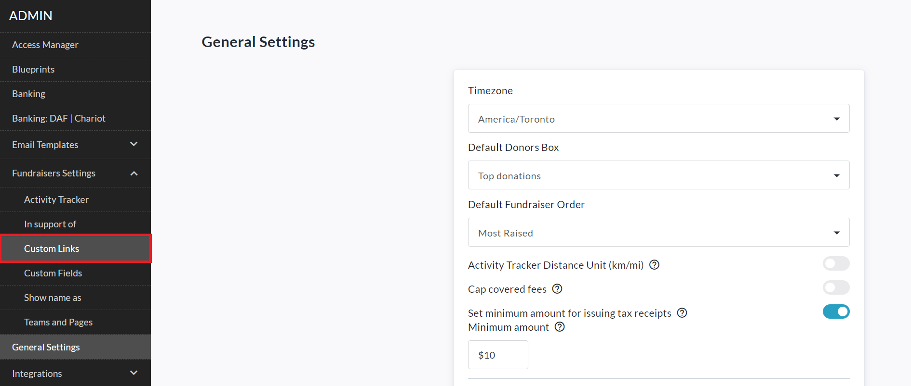
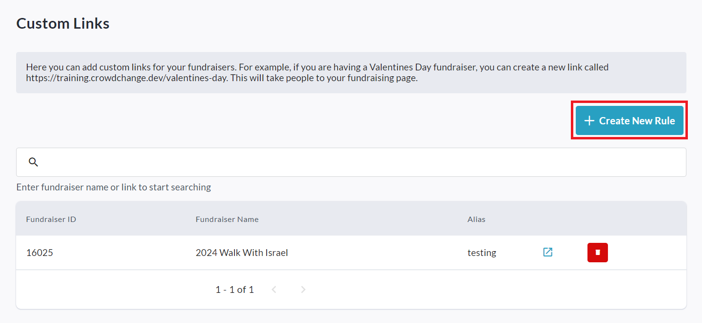

<!-- Source: https://chadmin.crowdchange.help/ct/how-to-create-custom-fundraiser-links | Nav: How to Create Custom Fundraiser Links | Mirrored 2026-10-14 -->

# How to Create Custom Fundraiser Links

**Custom Fundraiser Links** are a great way to share your fundraiser using a link that is memorable and easy for potential donors. This feature creates a custom domain link that is specific to your fundraiser.

To access the **Custom Links**menu, follow these steps:

1. Log in to a CrowdChange account with **Admin**permissions.

2. Click **Profile → Admin** in the upper right-hand corner of the screen.

3. Click **Fundraisers Settings →** **Custom Links** on the left sidebar.

   

On the **Custom Links**page that appears, you can create a custom link which is tied to a specific fundraiser.  

1. Click on **Create New Rule**.

2. Enter the **Page Alias**. This is how your custom link will read. Try to make this easy for your users to remember.

3. Search or scroll through the list of fundraisers, and select the **Fundraiser** you would like to link to.

4. Click **Save**.

The link will be listed on your **Custom Links** page as shown above. To remove it, click the **Trash Can** icon.

There's no limit to how many of these links your CrowdChange site can have, so create as many as you need!  
**Custom Fundraiser Links** will appear when used in any forward-facing communication to your donor base (i.e. email, social media posts, etc.), however, when donors land on the connected fundraiser the custom ending will be removed and replaced by the CrowdChange Fundraiser ID.

For example,**https://kevindev.crowdchange.dev/bingo** will revert back to **https://kevindev.crowdchange.dev/7722** when a donor lands on the fundraiser.
