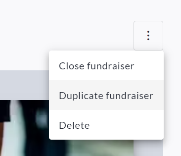
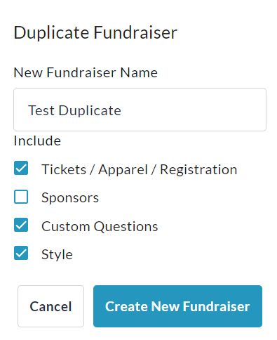

<!-- Source: https://chadmin.crowdchange.help/ct/how-to-duplicate-a-fundraiser | Nav: How to Duplicate a Fundraiser | Mirrored 2026-10-14 -->

# How to Duplicate a Fundraiser

**Duplicating**can save you a lot of time when setting up a new fundraiser. Instead of having to start from scratch, you can use a previously created fundraiser as a template to get started.

To duplicate a fundraiser, follow these steps:

1. Go to the fundraiser you would like to duplicate and **Log In**.

2. Click **Manage Fundraiser** in the top right corner of the page.

   
3. Click the **triple-dot icon** in the top right corner, then **Duplicate Fundraiser**.

   
4. Enter a New Fundraiser Name, select what features to include and click **Create New Fundraiser**.

   

**Important Notes:**

Duplicating a fundraiser will not carry over any historical data (transaction details, donor information, etc.). Our recommendation is to download the**Donations Report** from the original fundraiser, as the donor contact information can then be imported to the **Mailing List** of the new fundraiser.

Please refer to the below:

* [**How to Access the Donations Report**](how-to-access-the-donations-report-fundraiser-leve.md)

* [**How to Use the Mailing List**](how-to-use-the-mailing-list.md)

Duplicated fundraisers will enter [**Fundraiser Approval**](fundraiser-approval-admins.md), and will need to be approved.
