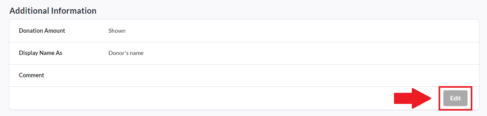
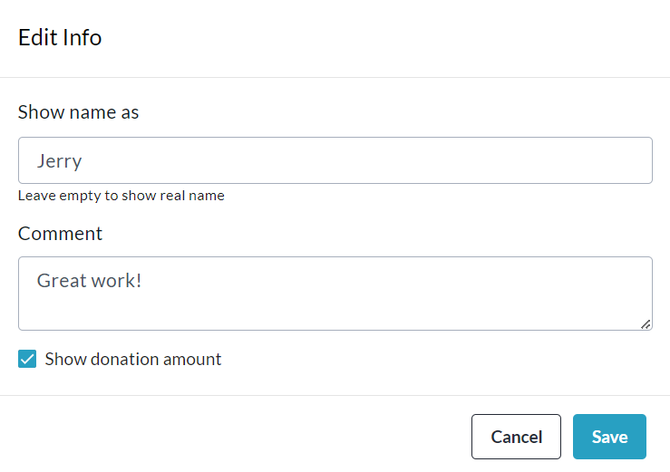

<!-- Source: https://chadmin.crowdchange.help/ct/how-to-edit-display-name-comment-and-show-or-hide- | Nav: How to Access the Admin Donations Report > How to Edit Display Name, Comment and Show or Hide Amount on a Donation | Mirrored 2026-10-14 -->

# How to Edit Display Name, Comment and Show or Hide Amount on a Donation

One of the most useful features of the Admin Donations Report is the capability it offers Admin users to change display names, comments and amount show/hide settings of donations.

To do this yourself, simply follow the steps below:

1. Go to your CrowdChange site and **Log In**.

2. Click **Profile** in the top right corner, then**Admin**.

3. Go to **Reports** **\> Donations Report**using the left sidebar.

4. **Search** and/or **Filter** for a specific donation, and once you've found it, click on it.

5. On the transaction page, click **Edit** within the **Additional Information** section.

   
6. Make any desired changes and click **Save** when you're finished!

   
