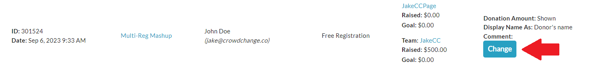
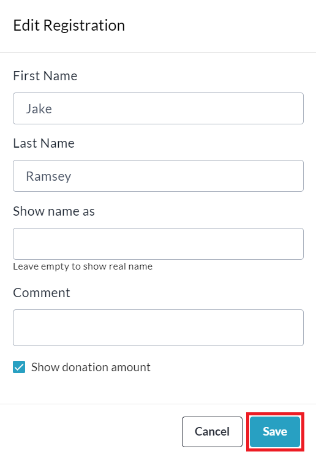

<!-- Source: https://chadmin.crowdchange.help/ct/how-to-edit-name-and-display-name-of-a-registrant- | Nav: How to Access the Registration Report > How to Edit Name and Display Name of a Registrant (Multi-Registration sites only) | Mirrored 2026-10-14 -->

# How to Edit Name and Display Name of a Registrant (Multi-Registration sites only)

Admin Users on sites with our Multi-Registration feature enabled have the ability to change the name and display name (on the Donation List) of a registrant via the **Admin Registration Report**.  
**Please Note** that changing the name (not display name) does not change the primary name attached to the registration itself (in the Registration Report under 'Registrant' column) - it only changes the user name field within the Excel version of the Report, and the name shown under 'Transaction Contents \> Self Donation' within a transaction on the web version of the Admin Donations Report.

To make the change, feel free to follow the simple steps below:

1. Go to your CrowdChange site and **Log In**.

2. Click **Profile** in in the top right corner, then**Admin**.

3. Go to **Reports** **\> Registration Report**using the left sidebar.

4. **Search** and/or **Filter** for the specific registration.

5. Click the **Change**button within a registration to edit the registrant details.

   
6. Enter the new or corrected name and display name, then click **Save**.

