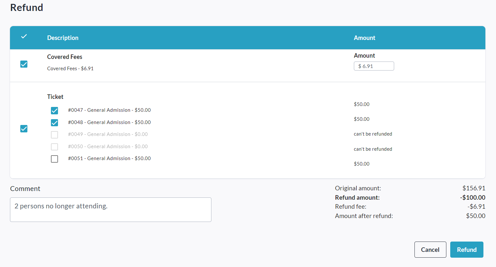
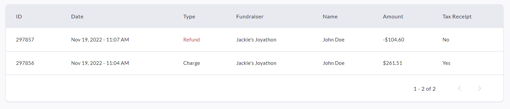
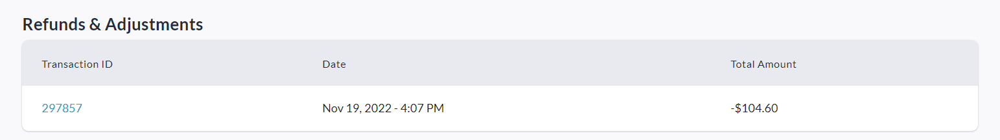
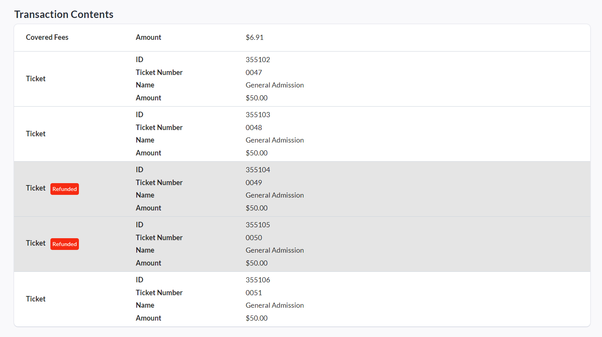
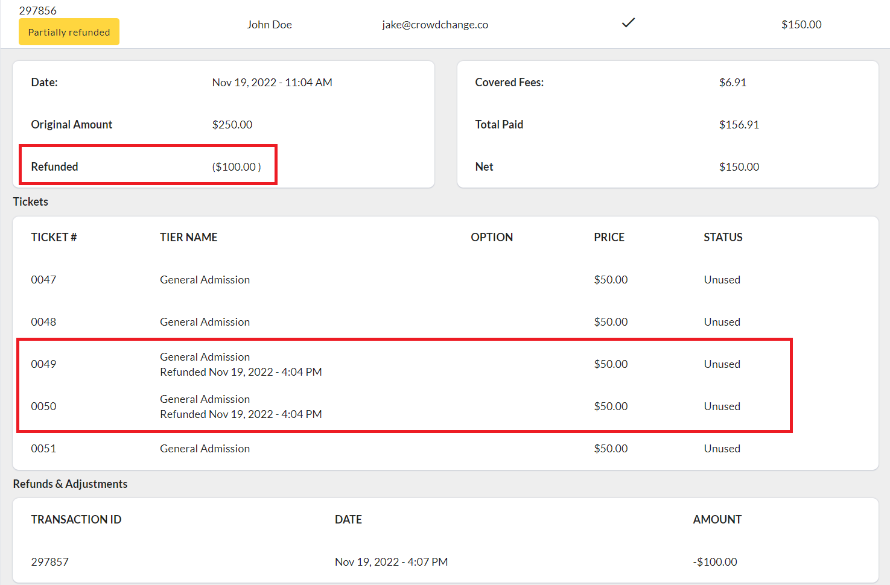

<!-- Source: https://chadmin.crowdchange.help/ct/how-to-issue-full-and-partial-refunds | Nav: How to Issue Full and Partial Refunds | Mirrored 2026-10-14 -->

# How to Issue Full and Partial Refunds

Need to refund a transaction? CrowdChange now provides the ability for Admins to issue **Partial Refunds**in addition to standard, full refunds. For example, you can refund 2 tickets only, out of a transaction of 5 tickets.

Partial Refunds are a convenient tool in situations where a donor or supporter requests a refund for a specific part of their transaction - Instead of having to refund the entire transaction and potentially lose that revenue (if they decide not to re-donate), you can simply refund the specific item they requested.

To issue a refund of either kind, follow these simple steps:

1. Go to your CrowdChange site and **Log In**.

2. Click **Profile** in in the top right corner, then**Admin**.

3. Go to **Reports** **→ Donations Report**using the left sidebar.

4. Click on the transaction you would like to refund (fully or partially).

5. Click the grey **Refund**button in the bottom right corner of the transaction's menu.

6. Check the box next to the items you would like to refund, and enter a comment, as shown below:

   
   (Example partial refund of 2 tickets (and covered fees) from a 5 ticket transaction.)
7. Click **Refund**in the bottom right corner to complete the refund process.

*** ** * ** ***

**Please Note:** Refunds will be listed separatelyin the Admin Donations Report, but transactions which have been partially refunded will also show this information within their transaction panel.  

Admin Donations Report listing both the initial transaction and the refund.  

If you click the initial transaction, within its transaction panel you will see information on the refund...  

...and specifics on which components of the transaction were refunded.

The **Fundraiser-Level Donations Report** will also show partial refunds within transactions.  
  

## **Tax Receipts \& Partial Refunds**

See three examples below of how Tax Receipting interacts with Partial Refunds:

### **Example #1** : Initial transaction of $50 includes a $15 donation, and a $35 registration purchase. The organization's minimum donation amount for issuing a Tax Receipt is $20.

→ Therefore, a Tax Receipt for $50 is initially issued with this transaction.

→ An Admin user refunds the $35 registration tier, as the donor is no longer able to participate in the event. The donor receives a $35 refund, and the initial Tax Receipt is now void as the remaining $15 donation does not meet the organization's minimum amount required to receive a receipt.

### **Example #2** :Initial transaction of $100 includes a $50 donation, and a $50 ticket. The organization's minimum donation amount for issuing a Tax Receipt is $20.

→ Therefore, a Tax Receipt for $100 is initially issued with this transaction.

→ An Admin user refunds the $50 ticket, as the donor is no longer able to attend this event. The donor receives a $50 refund, the initial Tax Receipt is voided and a new Tax Receipt is generated, then issued, to the donor for the new tax-eligible amount of $50.

### **Example #3** : Initial transaction of $100 includes a $50 donation, and a $50 ticket which was not deemed tax eligible. The organization's minimum donation amount for issuing a Tax Receipt is $20.

→ A Tax Receipt for $50 is initially issued with this transaction.

→ An Admin user refunds the $50 ticket, as the donor is no longer able to attend this event. The donor receives a $50 refund, and the initial Tax Receipt is unaffected as the ticket price was not originally part of the tax-eligible amount.
