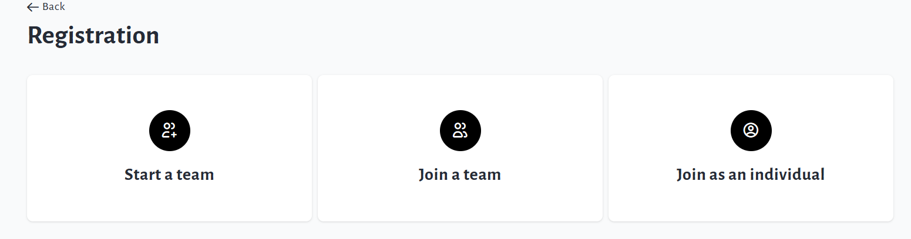

<!-- Source: https://chadmin.crowdchange.help/ct/how-to-link-registrations-to-personal-team-pages | Nav: How to Link Registrations to Personal & Team Pages | Mirrored 2026-10-14 -->

# How to Link Registrations to Personal & Team Pages

If you need to **require registrations** (free or paid) for everyone who creates a Personal or Team Fundraising Page, you can accomplish this easily in your fundraiser settings.

Follow these steps to link Registrations to P2P:

1. Go to your Main Fundraising Page and click **Manage Fundraiser**.

2. Click **Purchase Options**on the left sidebar.

3. Click **Registration** , enable it,then click **Save**.

4. Click **Peer-to-peer settings**on the left sidebar and enable the following:

   1. **Personal fundraising pages**

      1. ***Personal fundraising pages under a team can be created***

      2. ***Registration is required to create a personal page***

      3. ***Registrants are required to create a personal page with an email address (no opt-out)***

   2. **Team fundraising pages**

      1. ***Registration is required to create a team***

5. Ensure to **Save Changes**within each section.

This will require registrants to create their Personal or Team Page during checkout.

There will no longer be an option to create a Personal or Team Page without registration.

Your fundraiser will now take on the 'multi-registration' workflow:  

