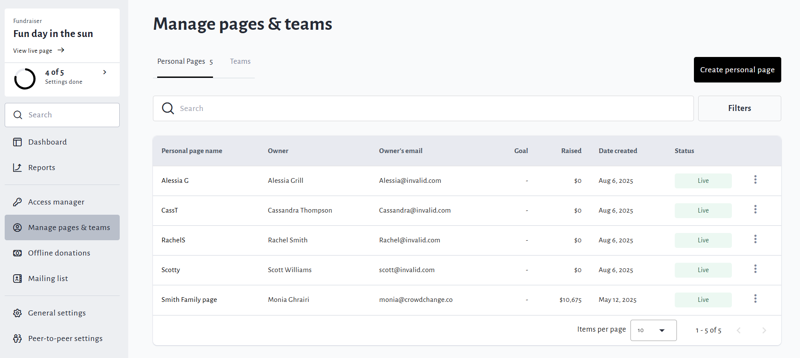
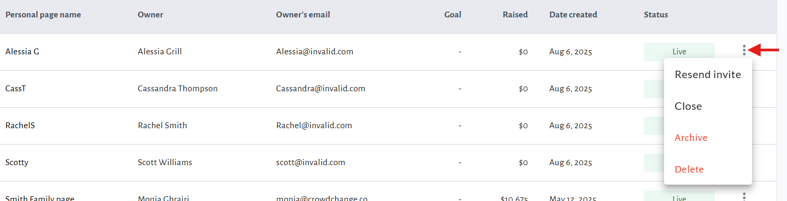
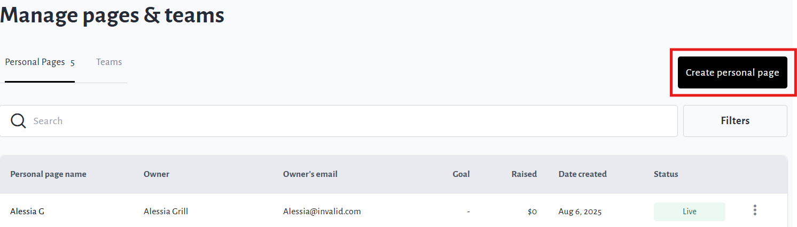
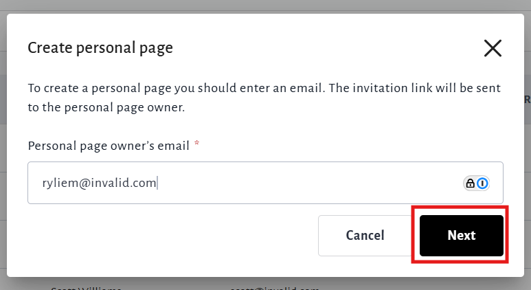
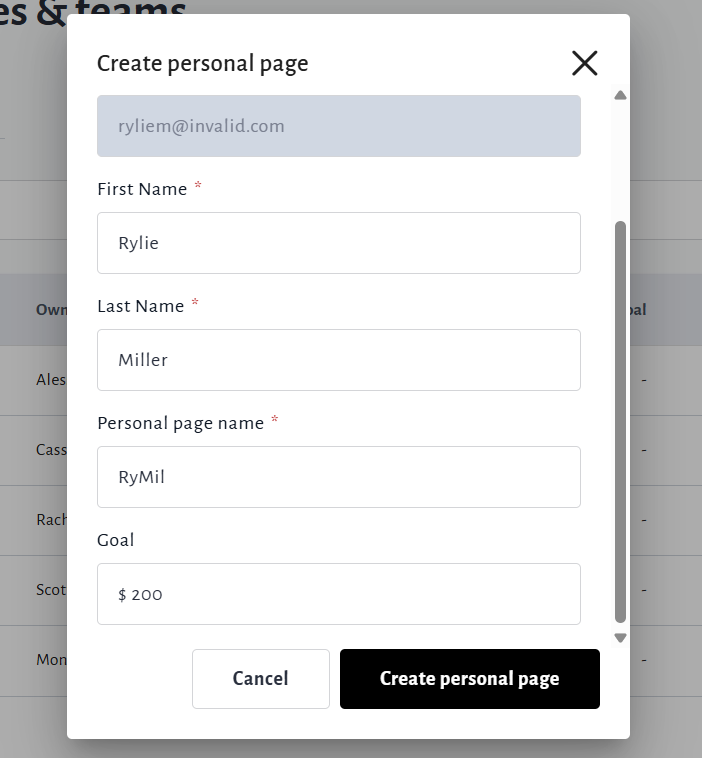
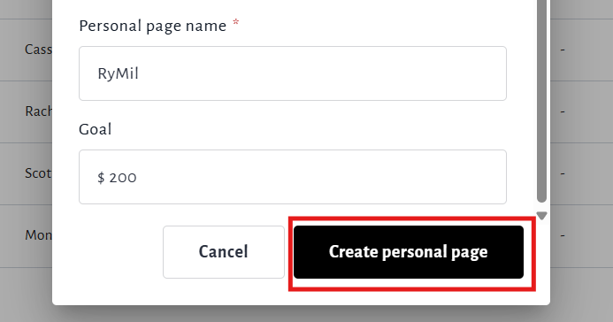

<!-- Source: https://chadmin.crowdchange.help/ct/how-to-manage-personal-pages-teams | Nav: How to Manage Personal Pages & Teams | Mirrored 2026-10-14 -->

# How to Manage Personal Pages & Teams

As an Admin user, there's a quick and simple way to manage all personal pages and teams that have been created and create new ones. Just use our intuitive **Manage Personal Pages \& Teams** feature!

You can also use this feature to manually create a personal page or team for a user who has accidentally deleted their own.

To get started, go to your fundraiser and click **Manage Fundraiser**.

Click **Manage pages and teams** on the left sidebar.  

Once inside the **Manage pages and teams** menu, you can see helpful statistics on your pages, and you have the ability to both create new pages, and view the list of existing pages.

To the right of each page in the list, you can click the **triple-dot icon** to access management options such as:

**Resend Invite, Close, Archive, Un-Archive** and **Delete**.  

* Clicking the name of the page (on the left) will take you directly to the page.

* Clicking the **Resend Invite** option allows you to re-send the invitation email to the page owner.

* Clicking the **Archive** option allows you to directly archive the page.

* Clicking the **Delete** option allows you to fully delete the page. Before deletion you must give a reason.

## Creating a page for a user/participant

To create a page for a user or participant, follow the simple steps below:

1. Click **Create personal page** in the top right corner.

   

2. Enter their email address under 'Create Personal Page' and click **Next**.

   

3. If they already have a CrowdChange account, their first and last name will populate automatically - if not, enter their first and last name.

   

4. Confirm the name and goal amount of the page, connect it to a team if desired, and click **Create personal page** tofinalize.

   

If the user does not already have a CrowdChange account, after the page is created, an invitation email will be sent to them, prompting them to create an account before managing it.

You may also edit the automated trigger email that is sent when a personal page is created by an Admin on someone's behalf. This can be found under **Manage Fundraiser → Automated Email Templates → Personal page created by administrator**.
