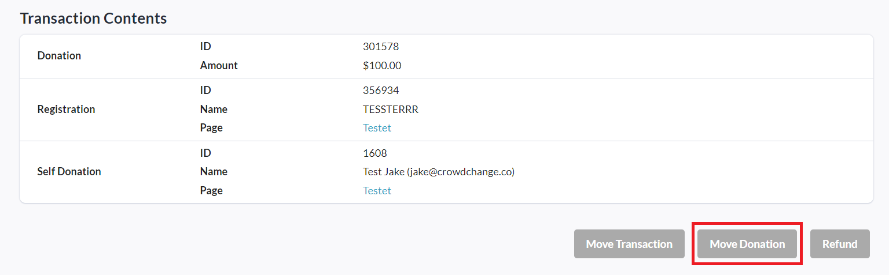
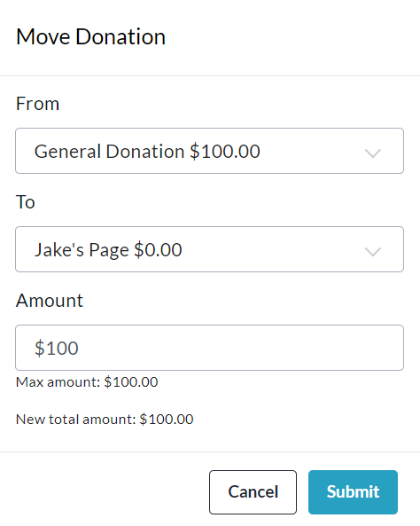

<!-- Source: https://chadmin.crowdchange.help/ct/how-to-move-general-donations-to-registrant-person | Nav: How to Access the Admin Donations Report > How to Move General Donations to Registrant Personal Pages - Multi-Registration sites only | Mirrored 2026-10-14 -->

# How to Move General Donations to Registrant Personal Pages - Multi-Registration sites only

On multi-registration enabled sites, in cases where a registrant makes a **general**donation instead of a donation to a personal fundraising page created in the same transaction, as an Admin user, you have the ability to move this donation to the personal fundraising page via the Admin Donations Report.

Follow the simple steps below to do so:

1. Go to your CrowdChange site, and **Log In**.

2. Click**Profile → Admin**in the top right corner.

3. Click**Reports → Donations Report**on the left sidebar.

4. Click the relevant registration transaction and you will be taken to the transaction page.

5. Scroll down and click **Move Donation**at the bottom of the page.

   
6. In the pop-up that appears, complete the **From** , **To** and **Amount**fields as desired.

   
7. Click **Submit**to confirm and move the donation.

The donation will now be shown on the registrant's personal fundraising page as desired.

This process can also be performed in reverse to move a personal page donation to a general one.
