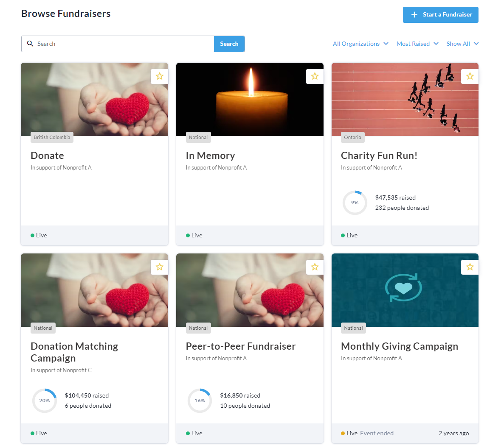
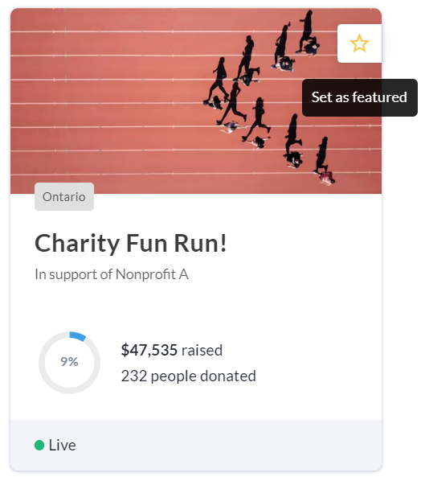
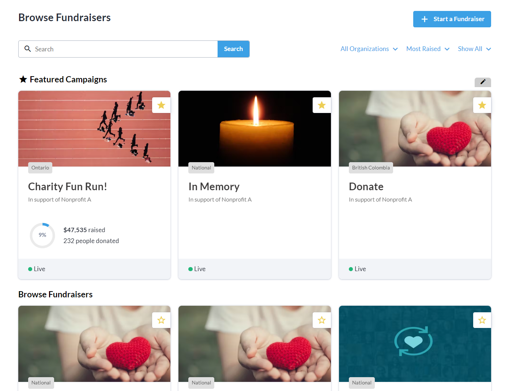
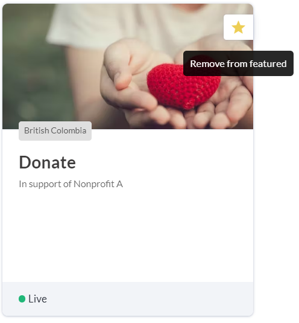

<!-- Source: https://chadmin.crowdchange.help/ct/how-to-pin-featured-fundraisers | Nav: How to Pin Featured Fundraisers | Mirrored 2026-10-14 -->

# How to Pin Featured Fundraisers

You can pin fundraisers to the **Featured**section at the top of your site's homepage so they're always in view!

To do so, just follow these steps:

1. Go to the home page of your CrowdChange site. If you've already created some fundraisers, you'll see them listed as below:

   
2. Hover over a fundraiser you would like to pin to the **Featured**section. A star icon is shown in the top right corner. Click it to set / pin the fundraiser as featured.

   
3. Fundraisers you star / pin will be placed at the top of the page in the **Featured**section

   

4. To remove a fundraiser from the **Featured**section, click the star icon again.

   

Please note that the Featured section is limited to **9**fundraisers.
