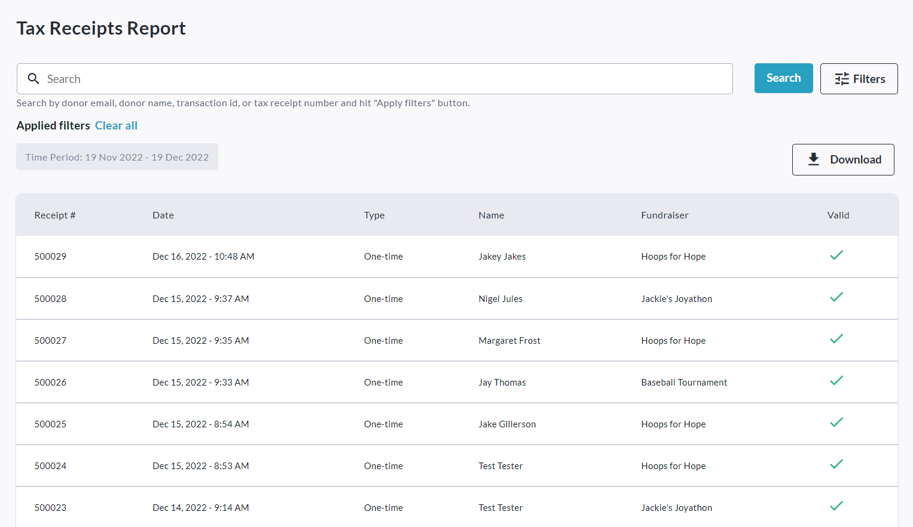
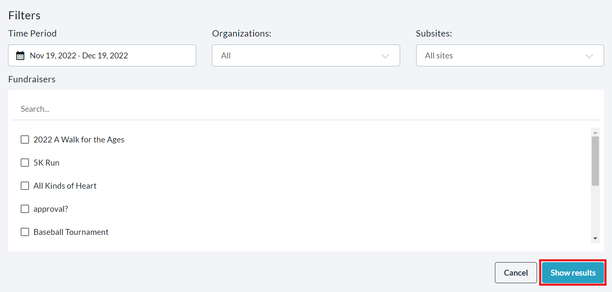
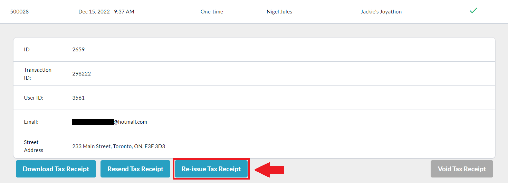
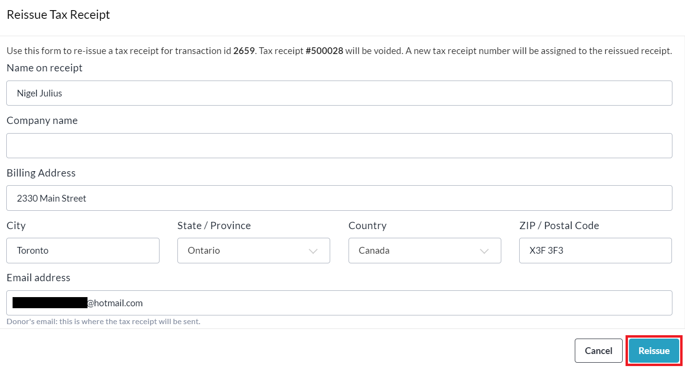

<!-- Source: https://chadmin.crowdchange.help/ct/how-to-re-issue-a-tax-receipt-tax-receipts-report | Nav: Tax Receipts & Eligibility > How to Re-Issue a Tax Receipt (Tax Receipts Report) | Mirrored 2026-10-14 -->

# How to Re-Issue a Tax Receipt (Tax Receipts Report)

Tax receipts can be **re-issued** , **issued** , **voided** , **re-sent** and/or **downloaded** on a transaction-by-transaction basis within the **Tax Receipts Report**of your CrowdChange site. Additionally, you can download either a ZIP archive containing all PDF tax receipts within your date range and filters set, or an Excel Tax Receipts Report.

To access this report, follow these simple steps:

1. Go to your CrowdChange site and **Log In**.

2. Click **Profile** in in the top right corner, then**Admin**.

3. Go to **Reports** **\> Tax Receipts Report**using the left sidebar. You will be taken here:

   
4. If you are looking for a specific tax receipt, you can use the search bar to search by **Donor Name** , **Email** ,**Tax Receipt Number** , or **Transaction ID**.

5. Clicking the **Filters** button allows you to filter for a specific **Time Period** , **Organization** , **Subsite** or **Fundraiser** using their respective dropdown menus. Be sure to click **Show results** to apply these filters.

   
6. Once you've found your desired tax receipt, click on it, then click **Re-Issue Tax Receipt**.

   
7. Enter the updated information as required and click **Reissue**.

   
   (You can also scroll down to adjust the Amount total and Amount benefit.)

Re-issuing a tax receipt will **VOID** the original receipt. This will be indicated within your tax receipts report and a **VOID**stamp will be added to the PDF copy of the original receipt.

The donor will receive notification of this and the re-issued receipt (sent to the email address entered when filling out the new info) will communicate that it is a replacement for the original receipt.  
Click the **Download** button to download either a ZIP archive containing all PDF tax receipts within your date range and filters set, or an Excel Tax Receipts Report.
