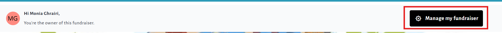
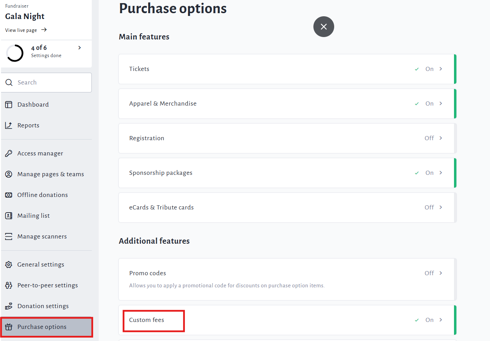
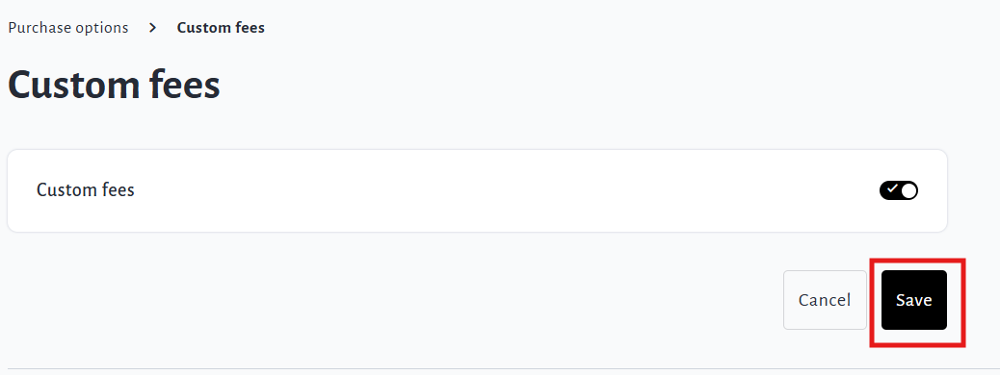
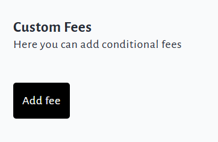
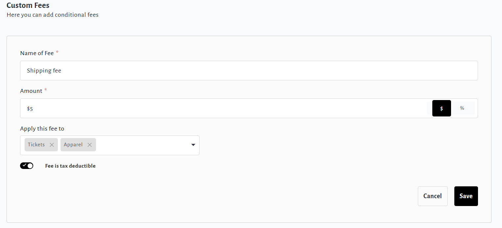

<!-- Source: https://chadmin.crowdchange.help/ct/how-to-set-up-custom-fees | Nav: How to Set Up Custom Fees | Mirrored 2026-10-14 -->

# How to Set Up Custom Fees

CrowdChange offers the capability to add **custom fees**per fundraiser / event if necessary.

For example, if you need to add a separate 'Shipping Cost' to each apparel purchase on your fundraiser.

Custom fees can be a specific dollar amount or a percentage, and may be tax-deductible or not.  
**Please note:** this feature is **NOT**available by default and must be enabled by CrowdChange staff.

* Custom fee amounts can be refunded as part of a Partial Refund from the Admin Donations Report.

* Custom fees can also be set per Blueprint, allowing you to copy set fees to connected fundraisers.

* Promo Codes can be applied to custom fees in the same way they are applied to purchase options.

*** ** * ** ***

## Enabling Custom Fees on a Fundraiser

1. **Log In**and navigate to your fundraiser.

2. Click **Manage Fundraiser**in the top-right section of the page.

   

3. Click**Purchase Options** on the left sidebar, then**Custom Fees**.

   

4. Enable **Custom Fees** and click **Save**.

   

## Adding/Creating a Custom Fee

1. **Log In**and navigate to your fundraiser.

2. Click **Manage Fundraiser**in the top-right section of the page.

   
3. Click**Purchase Options** on the left sidebar, then**Custom Fees**.

   
4. Click **Add Fee**.

   

5. Name your custom fee and enter a dollar or percentage amount.

6. Select the purchase option(s) this fee should apply to.

7. Choose whether the fee is tax deductible or not.

   

8. Click **Save** to complete.
