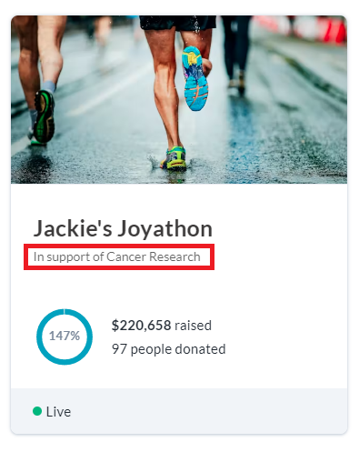
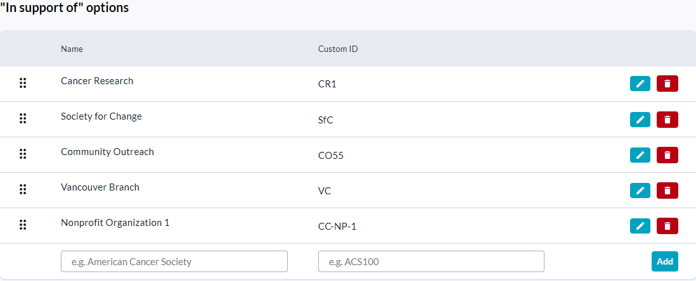

<!-- Source: https://chadmin.crowdchange.help/ct/how-to-set-up-in-support-of-options | Nav: How to Set Up 'In Support Of' Options | Mirrored 2026-10-14 -->

# How to Set Up 'In Support Of' Options

**'In Support Of' options**briefly explain the cause of a fundraiser to the general public.

For example, "In Support Of Cancer Research". Admin users have the ability to pre-set 'In support of' options which fundraiser creators on their site may choose from.  
The 'In Support of' field can also be free-text format. This depends on the configuration of your site.

'In Support of' options are displayed on both:

* The**fundraiser tile**(on the home page)...

  
* ...and the **Main Fundraising Page** itself, underneath the title of the fundraiser.

  

## Setting up 'In support of' options

To add 'In Support of' options, follow the steps below:

1. **Log In** to your CrowdChange site.

2. Click **Profile** → **Admin** in the top right corner.

3. Go to **Fundraisers Settings** **→ In support of** on the left sidebar.

4. Enter the **Name** and **Custom ID** for each option you would like to have and click **Add**.

   
   Example Options

## Editing 'In support of' options

1. Click on the **pencil icon** next to the option you want to update.

2. Make any necessary changes and click the **green tick icon**.

## Deleting 'In support of' options

1. Click on the **trash can**icon next to the option you want to delete.

2. In the popup that appears, click **Yes**.

An 'In support of' option which has been previously used by a fundraiser can be restored after being deleted by clicking the **green return arrow icon** next to said option.  
**Personal and Team Pages** also display 'In Support of' options, and depending on the settings of your site, personal page owners may or may not be able to select their 'In Support of' option of choice.
