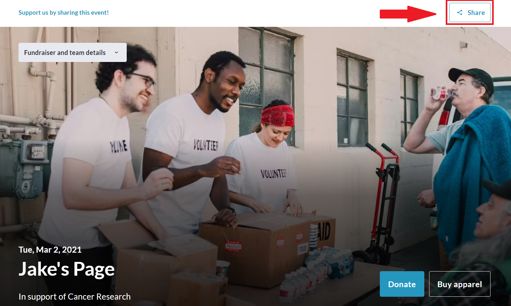
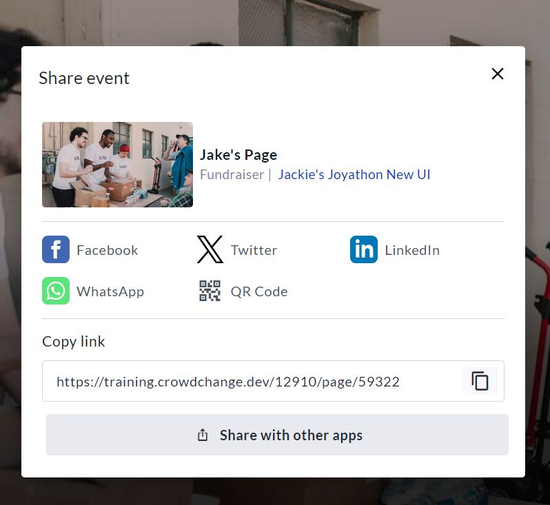

<!-- Source: https://chadmin.crowdchange.help/ct/how-to-share-your-personal-fundraising-page | Nav: How to Share your Personal Fundraising Page | Mirrored 2026-10-14 -->

# How to Share your Personal Fundraising Page

Once you have created your personal fundraising page, follow these simple steps to share it with friends and family and raise support!

1. Go to your personal fundraising page.

2. Click the **Share**button (either above or below the Hero image).

   
3. On the overlay menu that appears, select your preferred sharing option.

   
4. A new window will open prompting you to log in to the specific platform in order to share your fundraising page.

For more app share options, click '**Share with other apps**' at the bottom.

Alternatively, you can copy the link and share it manually, or use the QR Code option.
