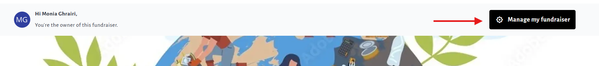
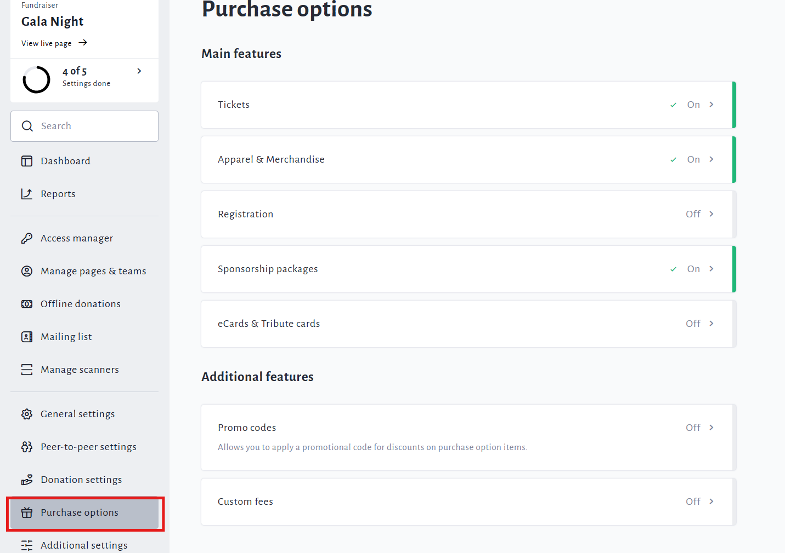
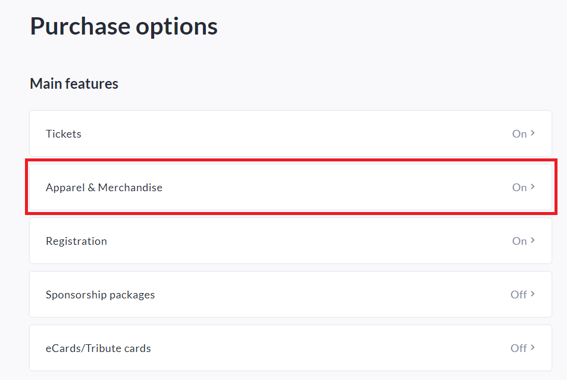
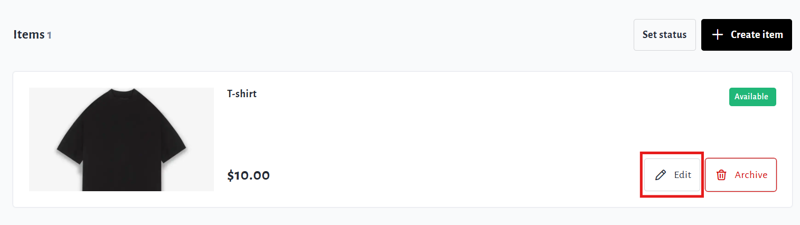
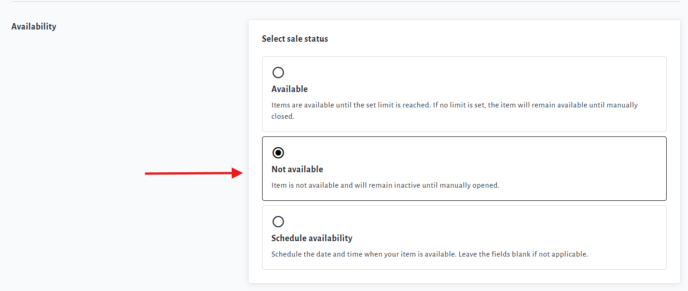

<!-- Source: https://chadmin.crowdchange.help/ct/how-to-stop-merchandise-sales | Nav: How Merchandise Works > How to Stop Merchandise Sales | Mirrored 2026-10-14 -->

# How to Stop Merchandise Sales

You may **Stop** or **Pause** merchandise sales at any time via the Purchase Options menu.

Follow the steps below to do so:

1. Go to your fundraiser, **Log In** , and then click **Manage My Fundraiser**.

   

2. On the left sidebar, click **Purchase Options**.

   

3. On the **Purchase Options** page, click **Apparel \& Merchandise**.

   
4. Scroll down and click on the **Edit**button of an item to make the updates needed.

   

5. Scroll down to the **Availability** section, and select**Not for sale**.

   

6. Click the**Save**button at the bottom to confirm.

   

You **will not** lose historical information of previous sales.

You **will**still be able to accept donations and other purchase options.
