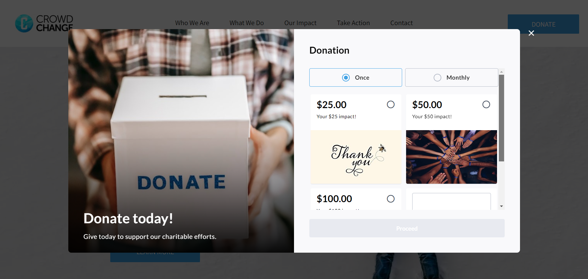
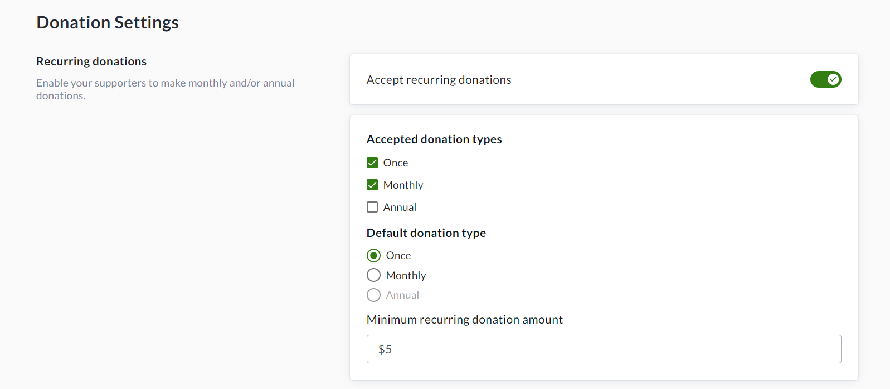
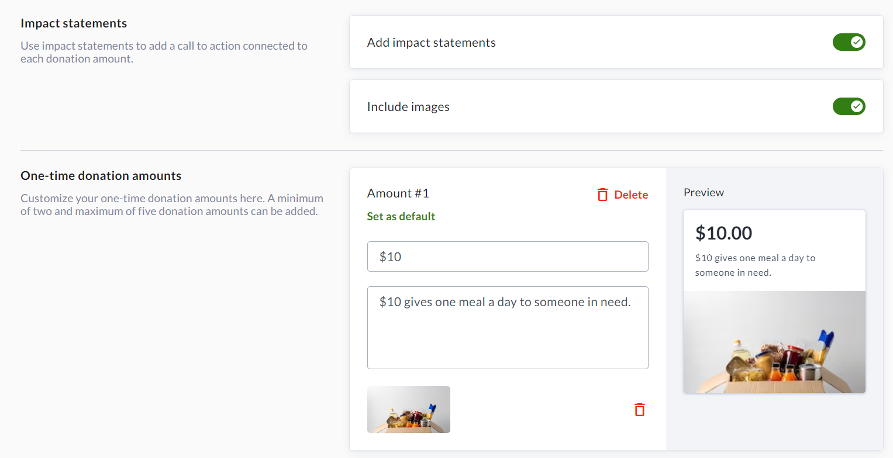
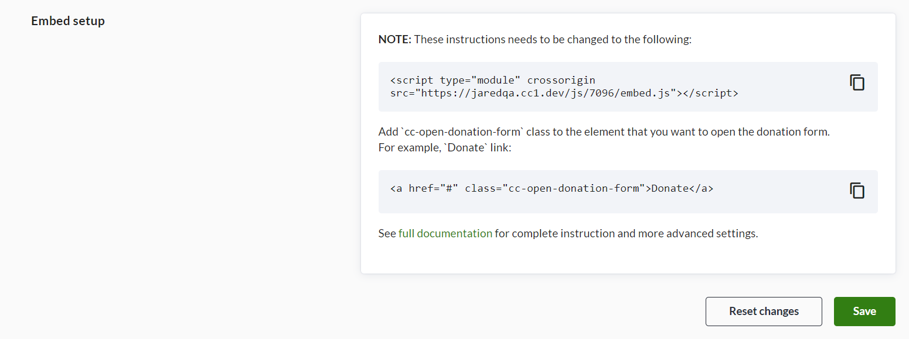

<!-- Source: https://chadmin.crowdchange.help/ct/how-to-use-embedded-donation-forms | Nav: How to Use Embedded Donation Forms | Mirrored 2026-10-14 -->

# How to Use Embedded Donation Forms

Using our Embedded Donation Forms feature, you have the ability to insert a streamlined CrowdChange donation form directly into your website or landing page.  
**Please Note:** This feature is **NOT**enabled by default - Reach out to your Partner Success Representative today to request it be activated on your CrowdChange site!

Using this feature, visitors to your website won't need to be redirected to CrowdChange in order to make a donation - they can do so directly from the embedded donation form on your website.  

Embedded Donation Forms also introduce **Impact Statements**, where shorthand text and an image showing tangible benefits connected to each donation amount are displayed during selection.

Each Embedded Donation Form is linked to a **Fundraiser**in CrowdChange with the 'Embed Donation Form' feature enabled. This is where you will go to set up the donation form, amounts, impact statements, check reports, and more.

## How to Set Up an Embeddable Donation Form

To set up an embeddable donation form, you need to enable the 'Embed donation form' feature on a CrowdChange fundraiser. We recommend setting up a fundraiser specifically to be used for this purpose.

Follow the simple steps below to do so:

1. Create a new CrowdChange fundraiser by clicking '**Start a Fundraiser** ' on your homepage and going through the [**Start a Fundraiser**](how-to-start-a-fundraiser.md) process.

2. Ensure to toggle on '**Enable embedded donation form**' on the General Info page.

3. Once the fundraiser is created, go to **Manage Fundraiser → Donation settings**.

4. Click **Donation amounts \& types**.

5. ***Optional*** *: Enable '* ***Accept Recurring Donations*** *' and specify accepted donation types and min. amounts.*

   
   1. Enable our recurring donation upsell feature by toggling on '**Encourage one-time donors to upgrade to recurring donations**'.

      
6. Set up amount-specific impact statements and images as desired.

   1. *Note that these can be set independently for Recurring Donations.*

7. 

   Scroll down to the bottom and click **Save**.  
   

## How to Embed the Donation Form on your Website

To embed the Donation Form in your website, you will need to follow the steps below:  
May require some familiarity with HTML code.

1. Go to **Manage Fundraiser → Donation Settings → Embedded Donation Form**, and set a Title, Description, Accent Colour and Image.

2. Click **Save** at the bottom, then **Copy**the first provided code snippet for the embedded form.

   
3. **Paste** the first code snippet before `</body>` tag on your website (it should look like the below):

    

This will make the donation form available for use either on a specific page, or across your entire website.

4. **Add** the`cc-open-donation-form` class (the second code snippet) to any element you want to use to open the donation form.

   1. For Example, to add your donation form in a new HTML text element called ***'Donate'***, copy and paste the code snippet below:

          <a href="#" class="cc-open-donation-form">Donate</a>

   2. To add the donation for into an existing HTML element on your website, you can simply add the ***\`cc-open-donation-form\`*** class to the element that you want to open the donation form. In the code snippet below, this has been added into an existing button on the website:

          <a data-display-type="block" class="u_1491401495 dmButtonLink dmWidget dmWwr default dmOnlyButton cc-open-donation-form"

You may use additional parameters, such as `lang` to set language. See the table in the following section to learn more.

### Adding Multiple Donation Forms to the Same Website

If you have created multiple donation forms within your CrowdChange site, they can be embedded into your website by following these steps:

1. **Navigate** to the Embedded Donation Form Settings page of the additional donation form(s).

2. **Copy and Paste** the first code snippet before \</body\> tag of the specific page you would like the form to be available on.

   1. For example, if there is a sub-page within your website titled 'Become A Monthly Donor', you will need to paste this code snippet before the \</body\> tag of this page.

3. Follow **Steps 4 A and B** in the above section to either add a new HTML element with your donation form, or embed the form into an existing HTML element.

Multiple unique donation forms cannot be added to the same page within a website, and if your website uses a common footer (i.e. shared between multiple pages), this footer cannot share the code connected to multiple forms. In this case, the code for each embedded form must be added to the Body HTML of each specific page.

### Additional URL Parameters

The following parameters can be added to `/embed.js` as a query string.

For example, to set language to French, add `lang=fr` parameter to query string (`/embed.js?lang=fr`). See below for sample code snippets:

#### To pull in the French content setting in your Embedded Donation Form Settings:

    

#### To pull in the English content setting in your Embedded Donation Form Settings:

    

| Parameter | Required? |   Allowed Values    |          Description           |
|-----------|-----------|---------------------|--------------------------------|
| lang      | Optional  | * EN (default) * FR | Language for the embedded form |

<https://apidoc.crowdchange.dev/docs/embedded-forms>

## Frequently Asked Questions

**Q: Is there an additional cost to enable this on my CrowdChange site?**

A: No, there is no additional cost associated with embedded donation forms. You are free to use this at your convenience!

**Q: Will this feature be available on my CrowdChange site by default?**

A: This will need to be enabled by your Partner Success Representative.

**Q: Which payment processors can be used with embedded donation forms?**

A: In our Version 1 release, Stripe will be the only payment processor offered with embedded donation forms. Billhighway will be added in a subsequent release, but all other gateways are still in planning at this time.

**Q: Can a donation form be embedded into multiple elements on my website?**

A: Yes, a CrowdChange embedded donation form can be used on multiple elements across your website.

**Q: Can I host my eCard store via an embedded donation form?**

A: eCards are not currently supported within embedded donation forms, but Tribute cards for 'in honour'/'in memory' style campaigns are supported.

**Q: Where can I access reporting on donations made via an embedded form?**

A: Just as any other transaction processed on your CrowdChange site, donations made via embedded donation forms are processed through your existing Stripe integration, and the transaction/donor data is available within all fundraiser and admin-level reports.
