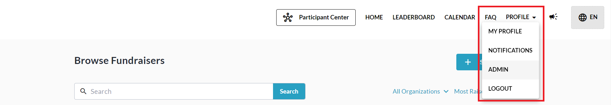
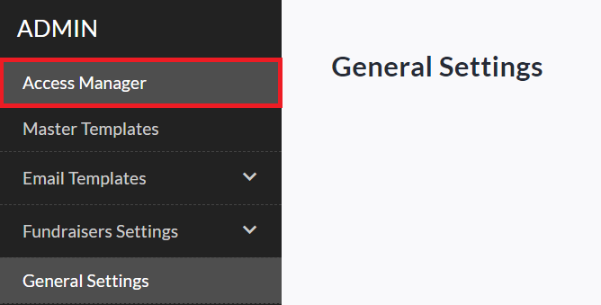
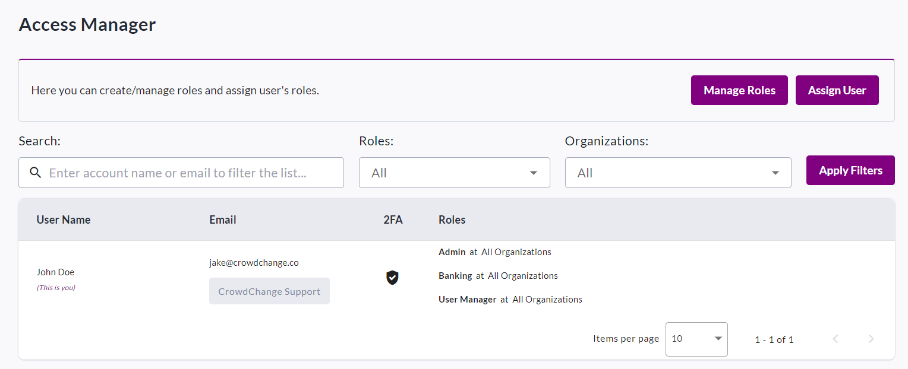
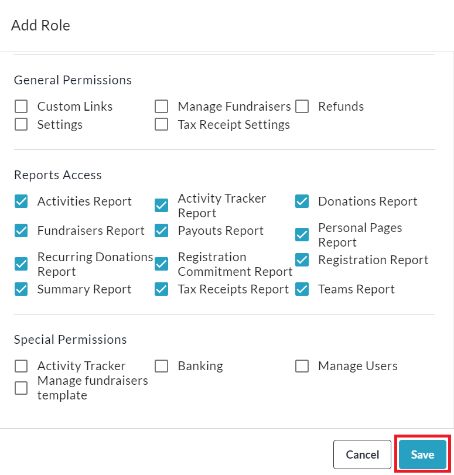

<!-- Source: https://chadmin.crowdchange.help/ct/how-to-use-the-site-level-access-manager | Nav: How to Use the Site-Level Access Manager | Mirrored 2026-10-14 -->

# How to Use the Site-Level Access Manager

You can use the **Site-Level** **Access Manager** to set custom administrative permissions for new or existing users across your CrowdChange site.  
**Prerequisites:**

To be able to access **Admin → Access Manager** the following conditions must be met:

1. **Access Manager** feature must be enabled on your CrowdChange site.

2. You must have **User Manager** permissions.

Once these conditions are met, follow the simple steps below to get started:

1. From anywhere on your CrowdChange site, go to **Profile → Admin**.

   
2. Click the **Access Manager** tab on the left sidebar.

   

   You will be taken to the site-level Access Manager where you will be shown a list of any added users and their assigned roles. The default roles available to be assigned are **Admin** , **Banking** and **User Manager**. You may also add custom roles with specific sets of permissions (for example: Reports-Only access). Roles can be assigned to existing users or new users via email invitation.  
   
3. *Optional: To create new custom role, click* ***Manage Roles*** *, then* ***Add Role*** *. Check all the permissions you would like to give this user and click* ***Save*** *to confirm. See an example below of 'Reports-Only' access.*

   
4. From the main page of the Site-level Access Manager (see Step 2), click **Assign User** to assign existing role(s) to a new or existing user. You can also assign roles per-organization if this feature is utilized.

   1. *If the user does not already have a CrowdChange account, they will be sent an email invitation to create one and accept the permissions.*

5. You can **update** or **remove**existing permissions from the user list using the pencil and 'x' buttons:

   
