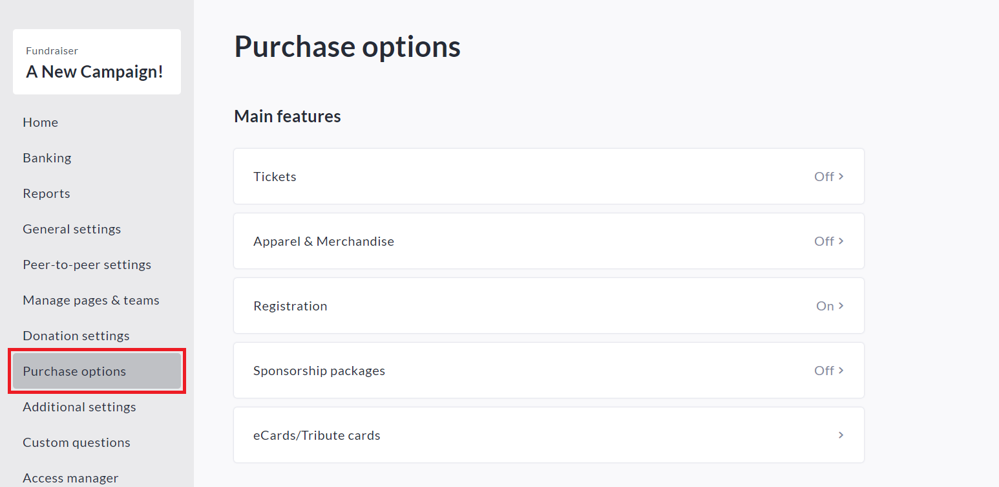
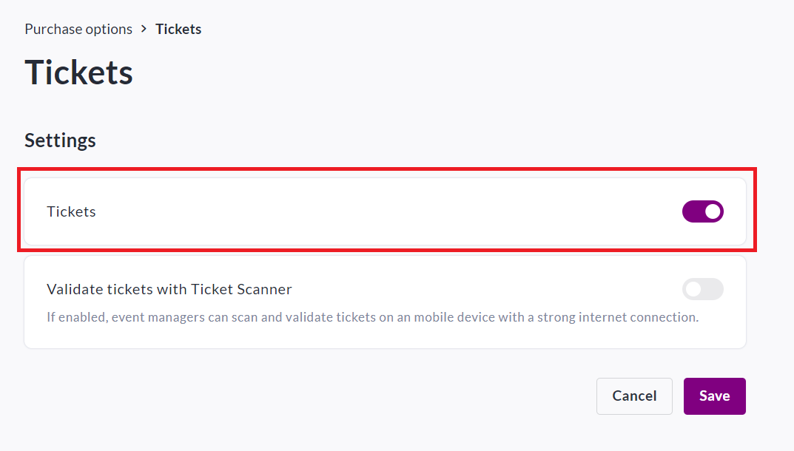
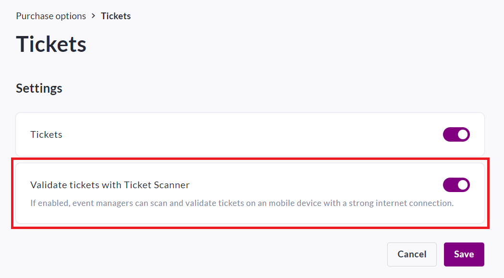
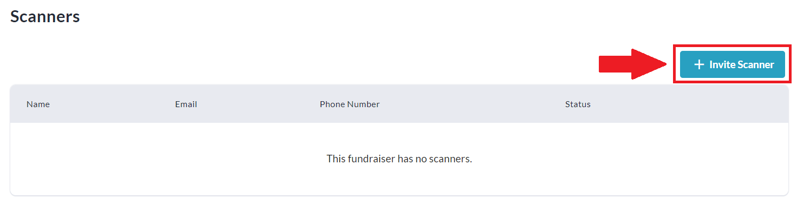
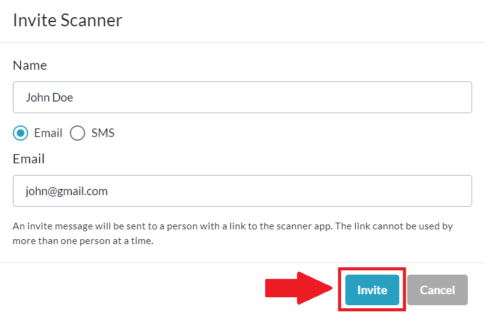
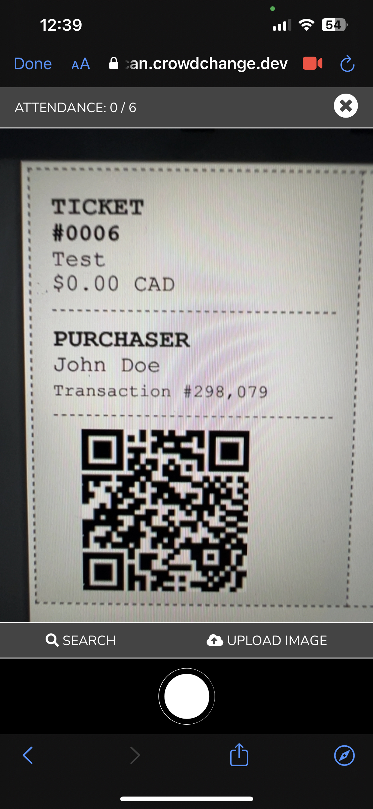
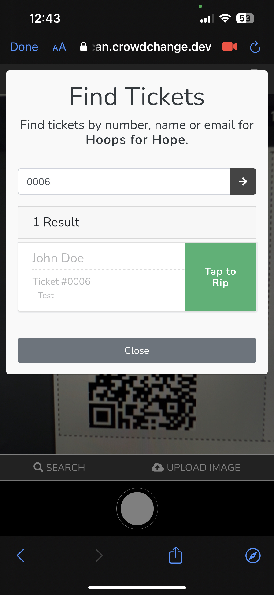

<!-- Source: https://chadmin.crowdchange.help/ct/how-to-use-the-ticket-scanner | Nav: How Ticketing Works > How to Use the Ticket Scanner | Mirrored 2026-10-14 -->

# How to Use the Ticket Scanner

Once you've learned [**How Ticketing Works**](how-ticketing-works.md), you are ready to use the CrowdChange **Ticket Scanner** for your next event!

To enable the **Ticket Scanner** feature on your CrowdChange Fundraiser, follow the steps below:

1. Go to your fundraiser, **Log In** , and then click **Manage Fundraiser**.

   
2. On the left sidebar, click **Purchase Options**.

   
3. On the **Purchase Options** page, click Tickets and toggle the feature on.

   
4. Additionally, toggle on **Validate tickets with Ticket Scanner**.

   
5. Click **Save.**

   

## Inviting Ticket Scanners

Once enabled, all tickets will include a unique **QR code** on the PDF ticket.

Follow the steps below to invite **Scanners**and scan tickets at your event:

1. Go to your Fundraiser, and click **Manage Fundraiser**in the upper right-hand corner.

   
2. On the left sidebar, click **Manage Scanners**.

3. Next, click **Invite Scanner**.

   
4. You can enter the name of the staff member/volunteer, and send their invitation by **Email** or **SMS**text.

5. Click **Invite**and the staff member/volunteer will be prompted to access the Ticket Scanner via the link sent to them.

   
6. On event day, the staff member can now use their phone to scan participant/donor tickets to the event.

## Scanning Tickets

When the mobile user assigned to scan tickets taps the link in the email, they are then given the option to **Scan Tickets**, and when this option is tapped, a camera interface will open with the following options:

1. **Scan QR code**- Simply point the camera at a participant's QR code and tap the circle at the bottom.

2. **Search** - This will open the manual search pop-up (See below - **Manual Verification**).

3. **Upload Image** - In cases where there is an issue with the camera, click**Upload Image** to open your device's file explorer, and upload a picture of the QR Code which can be used for verification:

## Manual Verification

If there are issues with either the ticket, the QR code, or if the guest forgets their ticket,**manual search**can be used to verify the ticket and mark it as used.

* You can find a person by name (first name or last name), email, or ticket number.

* Then, simply click on the ticket and select **Tap to Rip.**

* If the ticket was already used, it will still be shown, but you will not be able to mark it as used again.

  
**Important:** The CrowdChange Ticket Scanner is hosted on our platform and accessed through the browser of a user's mobile device who is given access as a Ticket Scanner.

There is no app to download, or 3rd party hardware to purchase. As long as the mobile device is connected to the internet, you are ready to scan!
