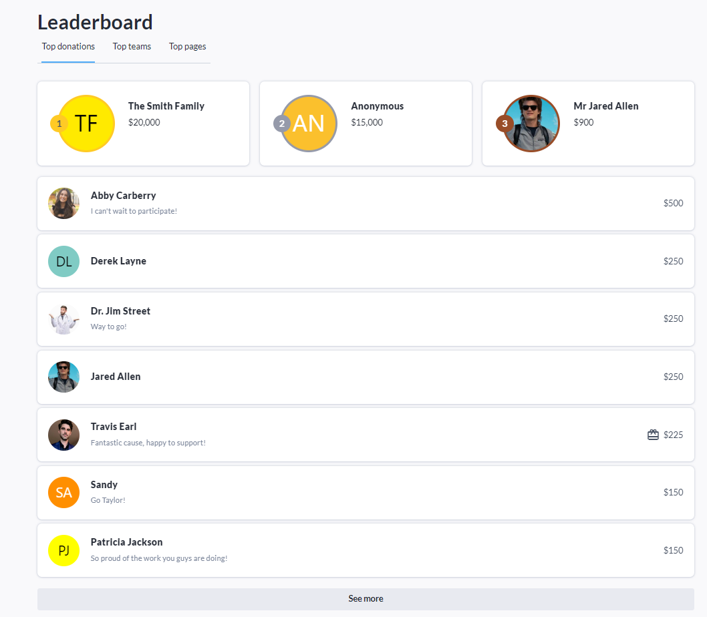
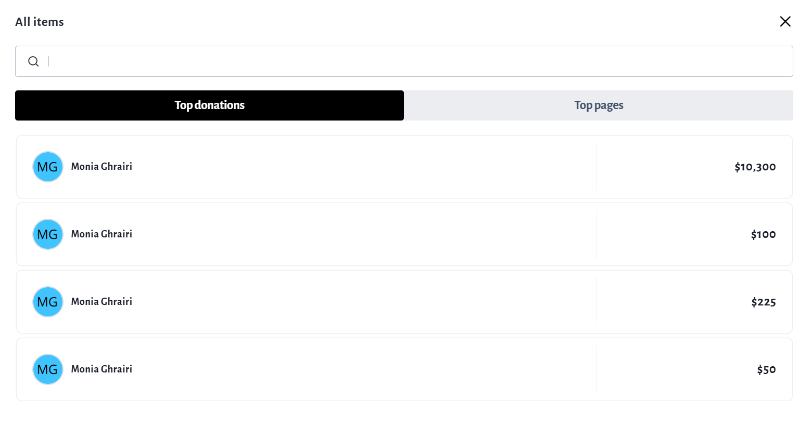
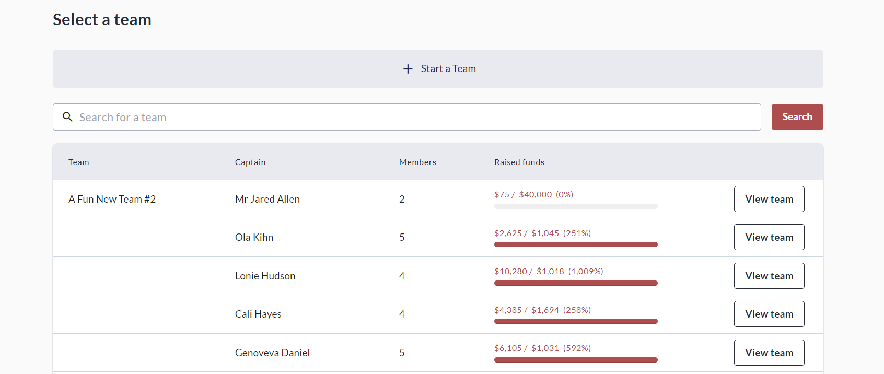
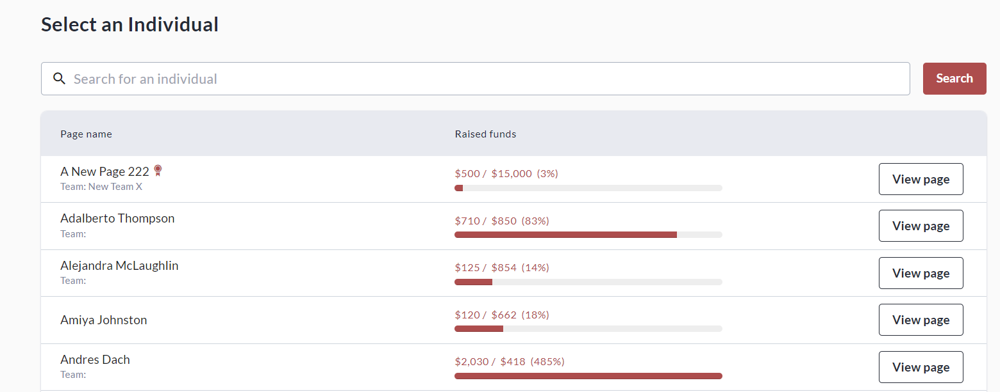

<!-- Source: https://chadmin.crowdchange.help/ct/leaderboard-page-navigation | Nav: Leaderboard & Page Navigation | Mirrored 2026-10-14 -->

# Leaderboard & Page Navigation

The **Leaderboard** block is useful not only for inspiring potential donors to contribute, but also for seeing how donors' contributions are showing up. There are 2 sort options - **Top** Donations and **Recent** Donations.  
The Leaderboard block will only be available if '**Show list of donors**' is enabled in fundraiser settings.

On a fundraiser with the **Top Donations List** enabled, as well as **Personal \& Team Fundraising Pages**, the Leaderboard block will look like this:  

At the bottom of **Top Donations** , click **See All** to be taken to the full **Donations List** shown below.  
Please note that this full list is always sorted by **Most Recent**, regardless of the previous setting.  

Navigating the **Personal and Team Fundraising Pages** created under your fundraiser is also made easy via their own searchable lists. Click **See All** at the bottom of the **Top Teams** or **Top Pages**lists to access these:

**Teams List:**  

**Personal Pages List:**  

