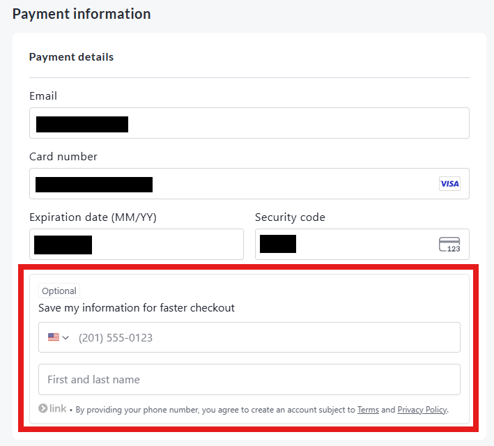

<!-- Source: https://chadmin.crowdchange.help/ct/link-by-stripe-in-crowdchange-checkout | Nav: Link by Stripe in CrowdChange Checkout | Mirrored 2026-10-14 -->

# Link by Stripe in CrowdChange Checkout

CrowdChange works with different payment processors depending on the needs of your organization. If you have any questions about which payment processor is right for your organization, don't hesitate to reach out to your Partner Success Representative to discuss your options.

CrowdChange checkout forms now include **Link by Stripe**, a secure feature from Stripe designed to make online checkout faster and more convenient.

*** ** * ** ***

## What is Link?

Link is a payment option provided by Stripe, one of the payment processors used on the CrowdChange platform. It allows donors and registrants to save their payment and contact details (such as card number, email, and phone number) so they can check out more quickly in the future.

Once saved, this information can autofill whenever the supporter checks out on any other site that also uses Link, including CrowdChange. To confirm their identity, Stripe sends a one-time code by email or text before details are filled in.

*** ** * ** ***

### What Supporters See

At checkout, supporters will see an **optional box** inviting them to "Save my information for faster checkout."  

Optional **Link** by Stripe elements shown to new users on checkout page

* Choosing this option saves their information securely with Stripe for future use.

* If they prefer not to, they can simply leave the box unchecked and continue as usual.

*** ** * ** ***

### Key Benefits

* **Optional for donors**: Saving information is never required. Supporters can always complete checkout without using Link.

* **Faster future checkouts**: If opted in, payment details are securely stored and can be reused in seconds.

* **Secure and trusted**: Link is fully managed by Stripe, a leading global payment processor, with encryption and strong authentication built in.

* **Works across Stripe sites**: Saved details can be used on any checkout that offers Link, not just CrowdChange.

*** ** * ** ***

### What This Means for Admins

* Link is automatically included in Stripe-powered checkouts on CrowdChange.

* No setup or configuration is required by admins.

* There are no additional fees or changes to your site's payment processing.
