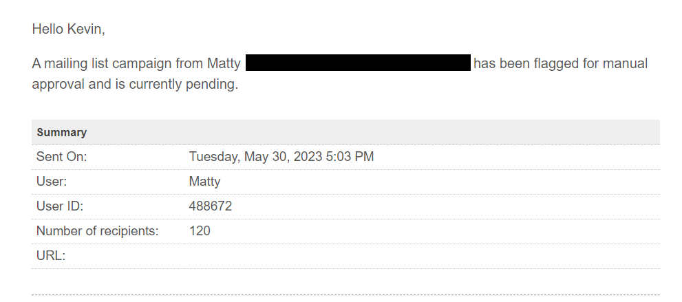
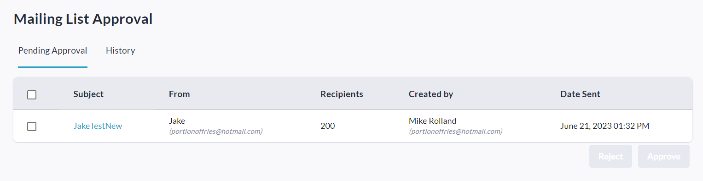
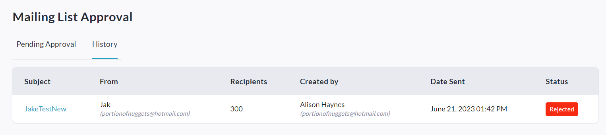

<!-- Source: https://chadmin.crowdchange.help/ct/mailing-list-admin-approval-for-large-campaigns | Nav: Mailing List - Admin Approval for large campaigns | Mirrored 2026-10-14 -->

# Mailing List - Admin Approval for large campaigns

If a personal or team page owner attempts to send a Mailing List campaign to over 100 recipients simultaneously, this campaign will be flagged for Admin review and approval before it can be sent out.  
**Please Note:**If the user's attempted message is approved, they are marked as approved in our system and will not be flagged again when sending a message to more than 100 recipients.

Additional limits in place which would trigger the approval process are indicated in [**this article**](mailing-list-contact-recipient-limits.md).

An email notification will be sent to site Adminswith two options - **Approve** or **Reject**, so they can act on the email immediately without needing to go to the site. Here is what the email will look like:  

The email subject line and message body will appear in this section.  

If desired, they can also go to **Admin \> Reports \> Mailing List Approval** and approve or reject from there.

Once on the Mailing List Approval page, two tabs are available: **Pending Approval** \& **History**.

**Pending Approval**shows a table with all pending campaigns listed, and by checking the checkbox next to a campaign or multiple campaigns you can access the options to Approve or Reject.  

**History**shows a table with all previously approved or rejected campaigns listed.  

Clicking on a campaign's name (under Subject) will take you directly to the campaign report.

The status of a pending email campaign will be shown as '**Queued**' (to both the sender and the Admins) until Admin approval has been granted and it is sent out.
