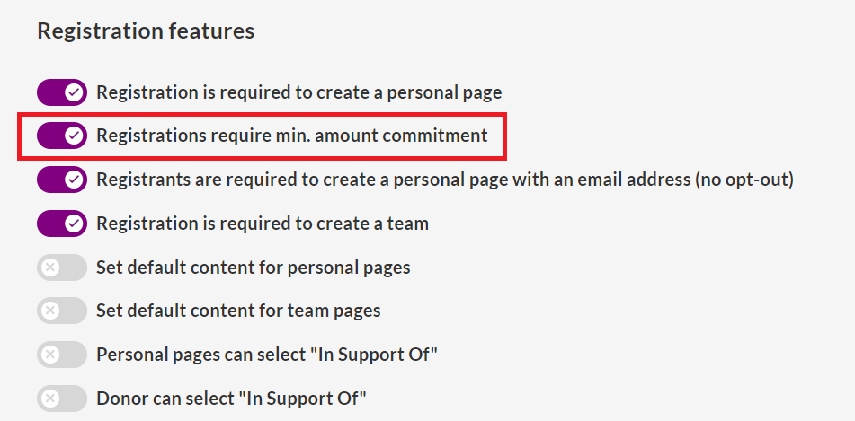
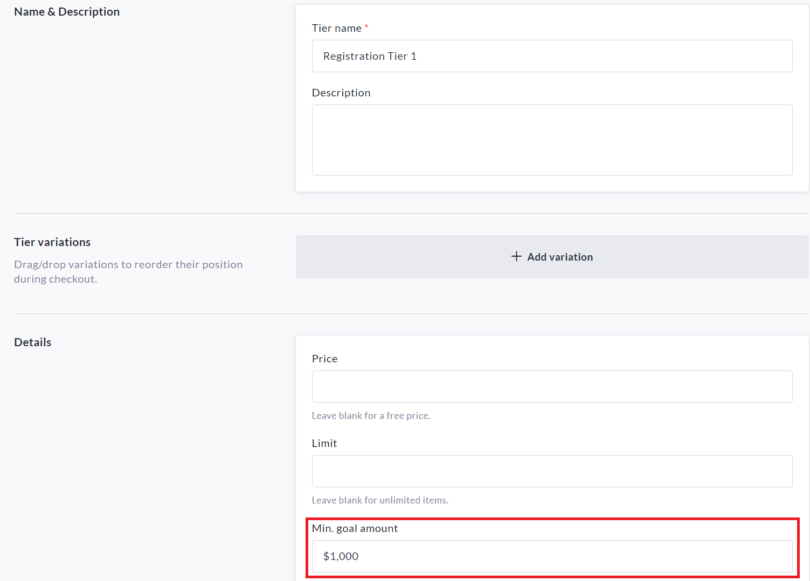
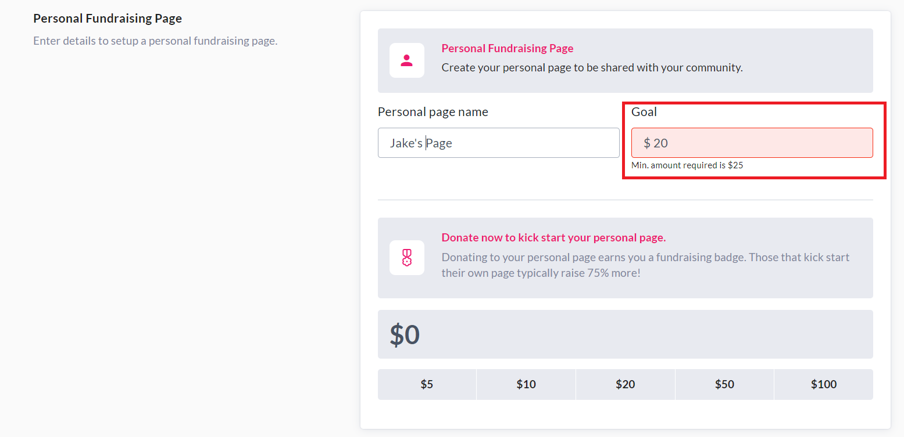
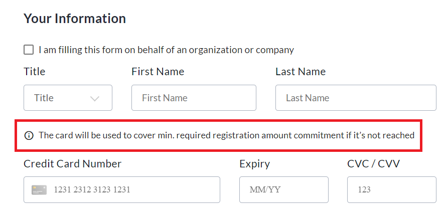

<!-- Source: https://chadmin.crowdchange.help/ct/minimum-fundraising-commitment-tied-to-registratio | Nav: Minimum Fundraising Commitment tied to Registration | Mirrored 2026-10-14 -->

# Minimum Fundraising Commitment tied to Registration

CrowdChange offers the ability for fundraiser hosts to set a Minimum Fundraising Goal \& Commitment amount tied to Registrations - this means that participants who register with personal fundraising pages commit to raising their goal amount (no less than the minimum set by the fundraiser host), and if this fundraising commitment is not met, they are charged the shortfall.

## **How this feature works**

This feature allows you to set a minimum fundraising goal for a registration tier.

It also allows you to collect Credit Card information to later charge your participants the value of any shortfall in their fundraising (at the end of the campaign).

The ability to track fundraising progress and charge registrants for their shortfall is available in the accompanying Admin **Registration Commitment Report**.

## **How to enable it**

**Please Note** : This feature is **NOT**enabled by default - Reach out to your Partner Success Representative today to discuss how it can benefit your campaign!

Once the feature has been enabled on your site, when setting up a fundraiser, toggle on **Registrations require min. amount commitment** within the **Registration features** section:  

Scroll down and click **Create Fundraiser** , then go to your fundraiser and click **Manage Fundraiser → Purchase Options → Registration**to create a registration tier.

If an existing registration tier had already been purchased, you would not be able to add this feature (since registrants were not required to use a minimum goal, and did not see any text regarding minimum commitments when they registered).

Create a new registration tier, and enter your minimum commitment amount in the **Min. Goal Amount** field.  

## **How this looks for participants**

Once a minimum goal amount has been set for a registration tier, it will be applied at registration in the Personal Fundraising Page section. If the user enters a number smaller than the minimum amount, they will be prompted to increase it and will not be able to proceed without doing so.

Registrants will now, based on the registration tier they select, be required to input a goal that meets the minimum amount set by the fundraiser host when the registration tier was created.  

On the checkout page, there will be another message explaining that the credit card entered will be charged any shortfall in funds raised (if the fundraising goal is not reached). With these settings applied, even users who register for free (via a free registration tier or using a promo code) will still need to input a credit card, allowing you to charge the card later for any fundraising shortfall.  

## **Admin Registration Commitment Report**

Reporting capability to track the progress of these financial commitments and who will be charged what amount is available within the Admin **Registration Commitment Report**.

To access this report, simply follow the steps below:

1. From anywhere on your CrowdChange site, click **Profile** in the top right corner, then **Admin**.

2. On the left sidebar, click**Reports \> Registration Commitment Report**.

3. Here you can track fundraising progress and charge registrants for any shortfall.
