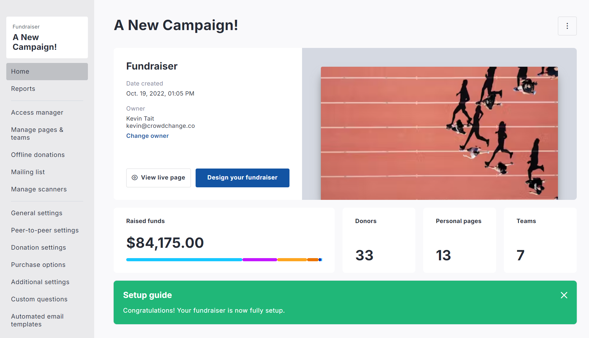
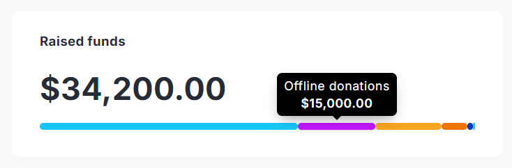
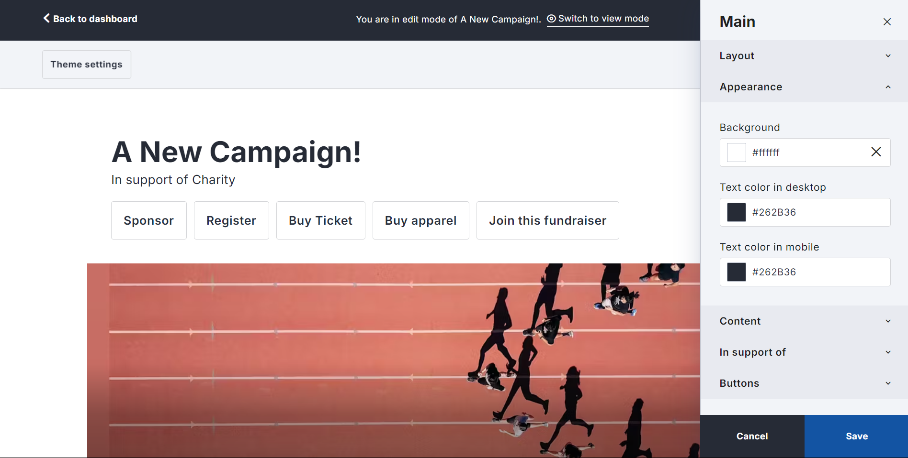
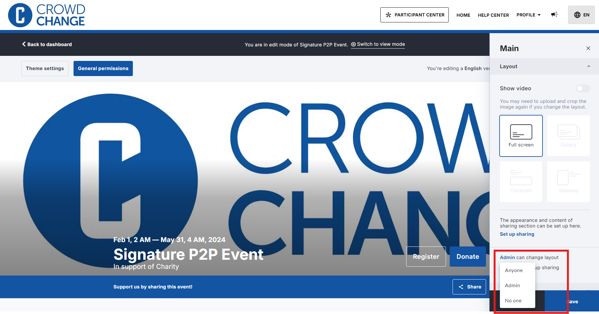
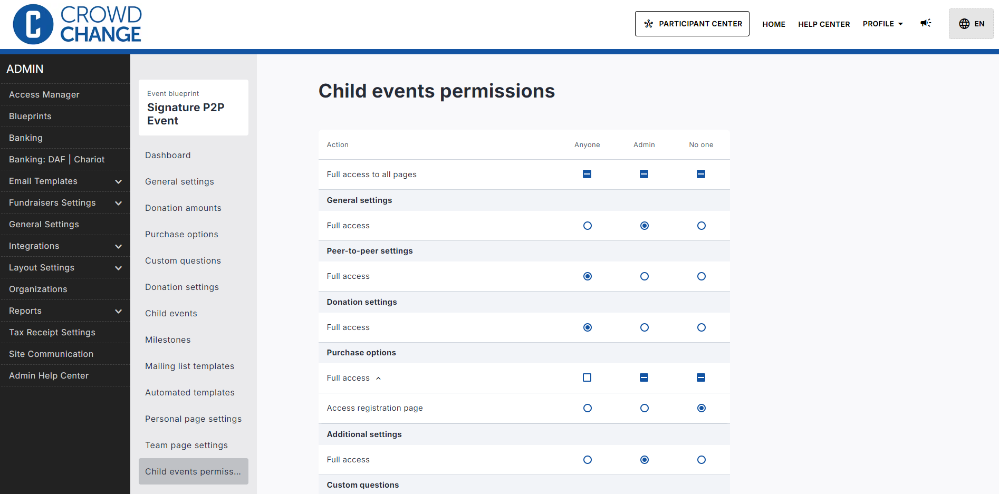
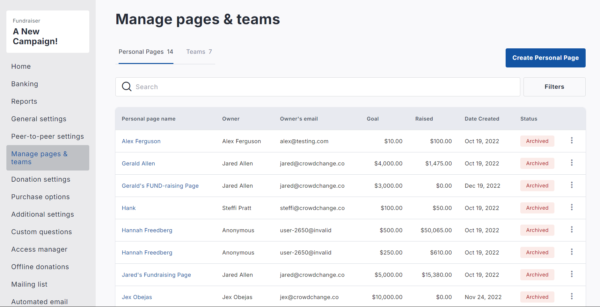

<!-- Source: https://chadmin.crowdchange.help/ct/new-fundraiser-dashboard | Nav: Product Updates > New Fundraiser Dashboard | Mirrored 2026-10-14 -->

# New Fundraiser Dashboard

At CrowdChange, our mission has always been to empower nonprofits with the tools they need to drive impactful fundraising campaigns. Over the past year, we've gathered extensive feedback from you, our users, listened to your challenges, and observed how you interact with our platform. This update is the result of that feedback. We recognized the need for a more intuitive, user-friendly interface that not only simplifies navigation but also enhances your ability to manage and optimize your campaigns efficiently.  
<https://www.youtube.com/watch?v=cxol5GkNCgI>

Based on your feedback, we've redesigned the user experience for fundraiser owners/admins to make managing your fundraising efforts easier and more intuitive than ever before. All the great fundraising features you know and love are still available and more accessible than ever via our new, streamlined layout.  

**What's New?**

* **Enhanced Navigation:** Quickly access the tools and insights you need with our improved, streamlined navigation, helping you focus on maximizing your campaign's impact.

* **User-Friendly Design:** Our new dashboard layout is clean, organized, and tailored to give you quick access to key performance metrics, donor data, and essential management features.

* **Improved Performance:** Enjoy faster load times and a more responsive interface, ensuring you can manage your campaign with ease---whether at your desk or on the go.

## Revenue Stream Visualization

The fundraiser dashboard presents your revenue streams in a color-coded thermometer to clearly display the breakdown of funds raised, so you can have a better understanding of where your revenue is coming from.

Simply hover your mouse over a section of the thermometer to learn more.  

## Enhanced Purchase Options UI

We've enhanced purchase options UI to make it easier than ever to manage your purchase options. **Sales Status**can now be controlled for all items, or within the details of a specific purchase option.  
.png?cb=1504fc0173a443cf6c88ad692b8d517b)

## Updated Fundraiser Blocks UI

We've refreshed the design panel for all fundraiser blocks to make it easier for your campaign owners to navigate these settings and adjust Fundraiser and Blueprint design.  

## New Blueprint Permission Controls

For partners using Blueprints, we've introduced new permission controls within Fundraiser Blocks Setup:  

And introduced a new **Child Events Permissions**page to provide more in-depth control over what your fundraiser owners will have access to:  

## Simplified Peer-to-Peer Page Management

We've combined Manage Teams and Personal Pages into one central space to provide better oversight and management capabilities.  

We'll be sharing more details, including a quick guide to help you get familiar with the new dashboard features. Keep an eye on your inbox and in-app notifications for more information!
