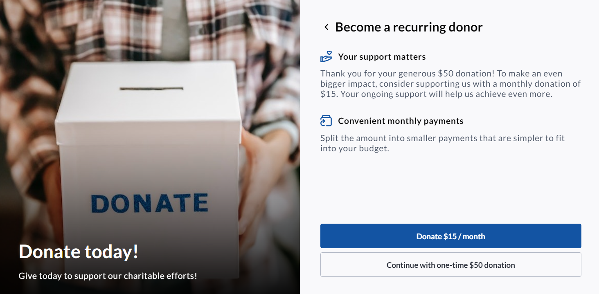
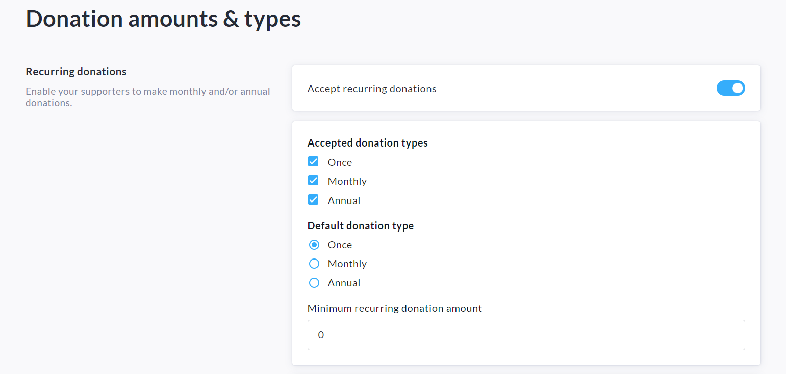
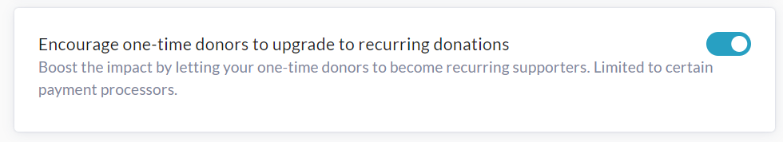

<!-- Source: https://chadmin.crowdchange.help/ct/one-time-giving-upsell-feature | Nav: One-time Giving Upsell Feature | Mirrored 2026-10-14 -->

# One-time Giving Upsell Feature

As part of our**Embedded Donation Forms** , we've added an optional '**One-time Giving Upsell**' feature which allows you to encourage donors who select a one-time donation to change it to a recurring donation prior to completing their transaction.

While one-time donations may ebb and flow unpredictably, recurring gifts offer a consistent, trustworthy revenue stream, bolstering confident budgeting and foresighted planning.  

## Enabling the One-time Giving Upsell feature

When setting up Donation Amounts for your Embedded Donation Form, you will be given the option to enable the upsell feature.

Once you are on the Donation Amounts \& Types setup page (*Donation settings→ Donation amounts \& types*), follow the simple steps below:

1. Enable '**Accept Recurring Donations**', specify accepted donation types and minimum recurring amount.

   

2. Enable our recurring donation upsell feature by toggling on '**Encourage one-time donors to upgrade to recurring donations**'.

   
3. Click **Save**at the bottom of the page to confirm.

   

### Check out our One-time Giving Upsell feature in action in our sample workflow here!

[nonprofitsample.crowdchange.net](http://nonprofitsample.crowdchange.net/)
