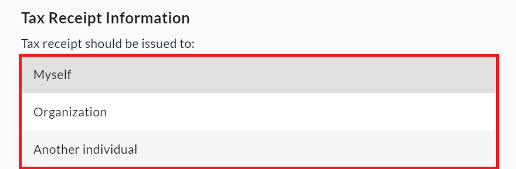
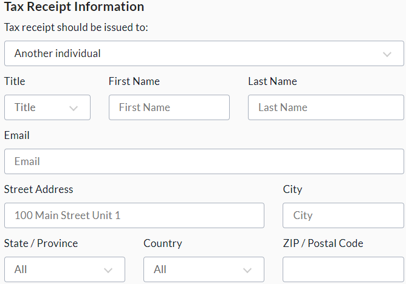

<!-- Source: https://chadmin.crowdchange.help/ct/optional-tax-receipt-designation-at-checkout | Nav: Tax Receipts & Eligibility > Optional - Tax Receipt Designation at Checkout | Mirrored 2026-10-14 -->

# Optional - Tax Receipt Designation at Checkout

If you would like to give your donors the ability to designate (at checkout) to whom or which organization the tax receipt should be issued, we offer this functionality optionally on special request.  
Please note that this feature is not enabled by default - Feel free to reach out to your Partner Success Representative to discuss and request it be enabled on your site.

For fundraisers where tax receipting is enabled, enabling this feature adds a new section at checkout to ensure tax receipts are issued with the correct information. Donors will be prompted to choose from a dropdown whether the tax receipt will be issued to themselves, an organization or another individual.  

Selecting **Organization** or **Another individual**will bring up additional fields in order to enter the relevant party's full name, email and billing information for the tax receipt.  

