<!-- Source: https://chadmin.crowdchange.help/ct/participant-center | Nav: Participant Center | Mirrored 2026-10-14 -->

# Participant Center

The Participant Center is your central fundraising hub, where you can view and manage all of your fundraisers, personal pages and/or team pages across your CrowdChange site. It gives you a high-level overview of your donor engagement, page strength, milestone achievements and more!  
Please note that this feature is **NOT** enabled by default.

If partners would like to opt in, they can request this via their Partner Success Representative.

To access the Participant Center (once enabled), from anywhere on your CrowdChange site, click the **Participant Center** button in the header at the top of the page, as shown below:  
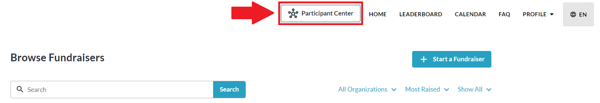

Within your **Participant Center**, you have the following options (read below):  
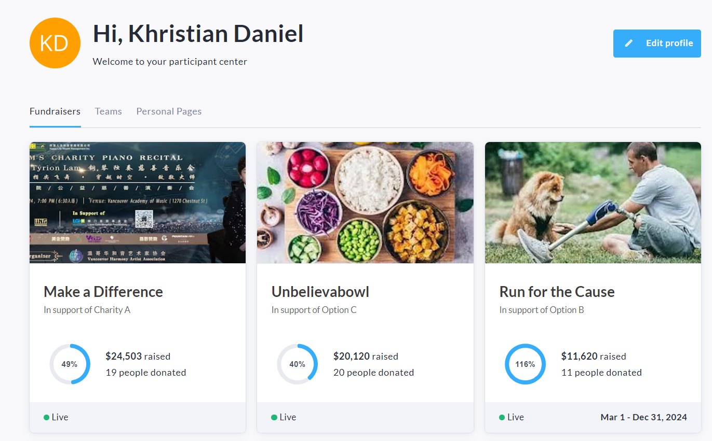

* Click **Edit Profile** in the top right corner to access your profile where you can upload a photo or edit your account details (name, email address, etc).

* Click either the **Fundraisers** , **Personal Pages** , or **Teams** tab to view the pages you own.

## Fundraisers Tab

From the **Fundraisers**tab, clicking a fundraiser tile (as shown below) will take you directly to it's public page where you can view or manage it as normal.  
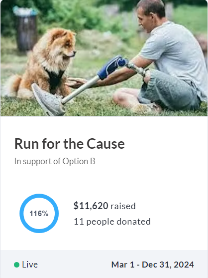

## Personal Pages Tab

On the **Personal Pages** tab, clicking a page tile (as shown below) will take you to that page's **Dashboard**, where you can get insight on the page strength, fundraising activity and milestone achievements.  
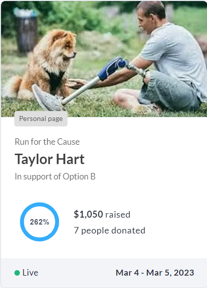

### Personal Page Dashboard

Here is what your **Personal Page Dashboard** will look like:  
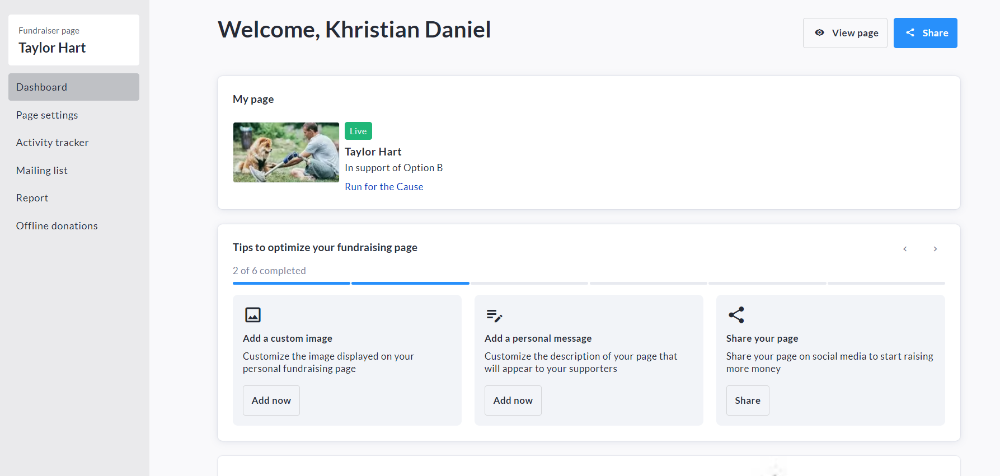

You can get to the live Personal Page itself from here by clicking**View Page** in the top right corner.

The **Share**button in the top right corner is available for you to share your page via social media or link.  
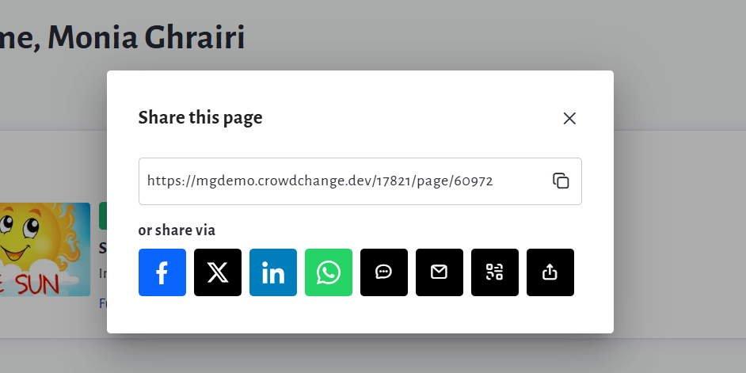

Within the left sidebar of your page dashboard, you can directly access specific menu options from your personal page, such as your **Page Settings** , **Mailing List** , **Report** , and **Offline Donations** menu.  
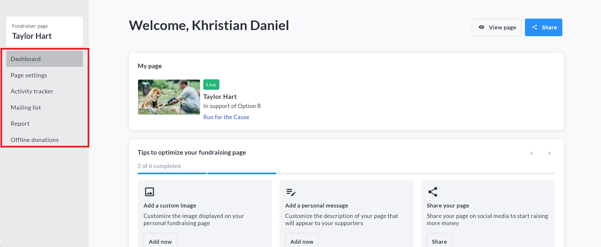

Scrolling down within the page dashboard, you can view further metrics as well as your badge progress:  
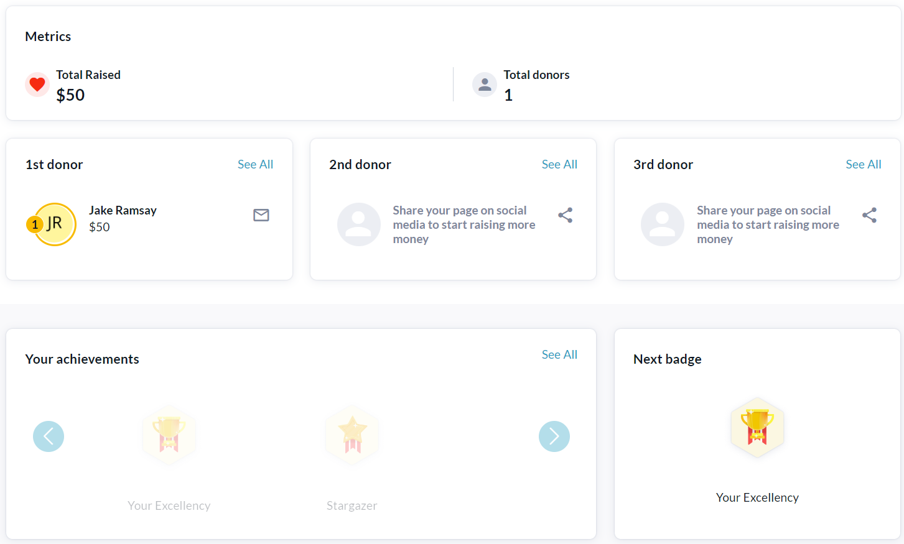

#### Activity Information \& Activity Badges

If the Activity Tracker is enabled, personal page dashboards within Participant Center will also show one more section: **Activity Tracker**. This section allows page owners to quickly view their activity progress, badges, and to access Activity Tracker from Participant Center to change or track activities.  
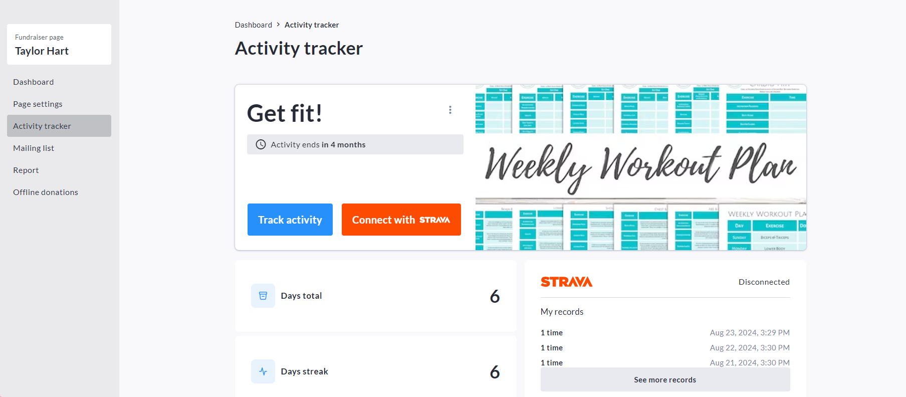  
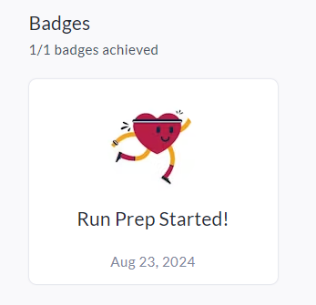

This **Activity Tracker** sectionwill also be shown on the Personal Page itself.

## Teams Tab

On the **Teams** tab within Participant Center, clicking a team tile (as shown below) will take you to that team's **Dashboard**, where you can see further team details and donor metrics.  
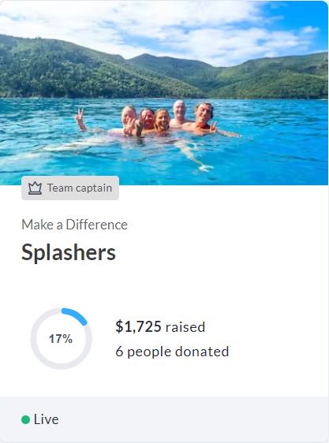

### Team Page Dashboard

Here is what your **Team Page Dashboard** will look like:  
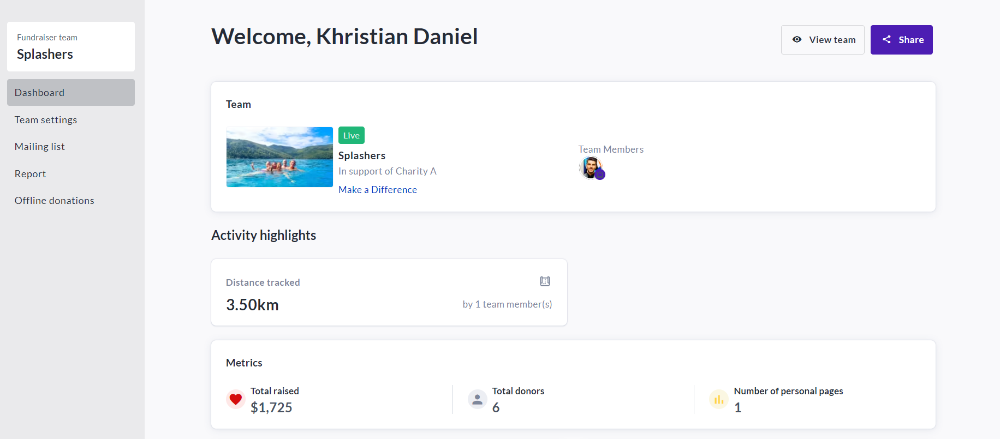

You can get to the Team Page itself from here by clicking**View Team**in the top right corner.

The **Share**button in the top right corner is available for you to share your team page via social media or link.

Within the left sidebar of your Team Page Dashboard, you can directly access specific menu options from your Team page, such as your **Page Settings** , **Mailing List** , **Report** , and **Offline Donations** menu.  
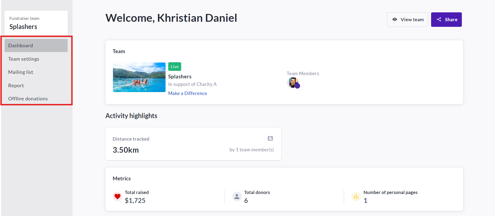

#### Activity Highlights \& Activity Tracker Leaderboard

If the Activity Tracker is enabled, team page dashboards within Participant Center will also show two more sections: **Activity Highlights** and **Activity Tracker Leaderboard**. These sections provide Team Captains with useful information and statistics on the Activity engagement of their team members.  
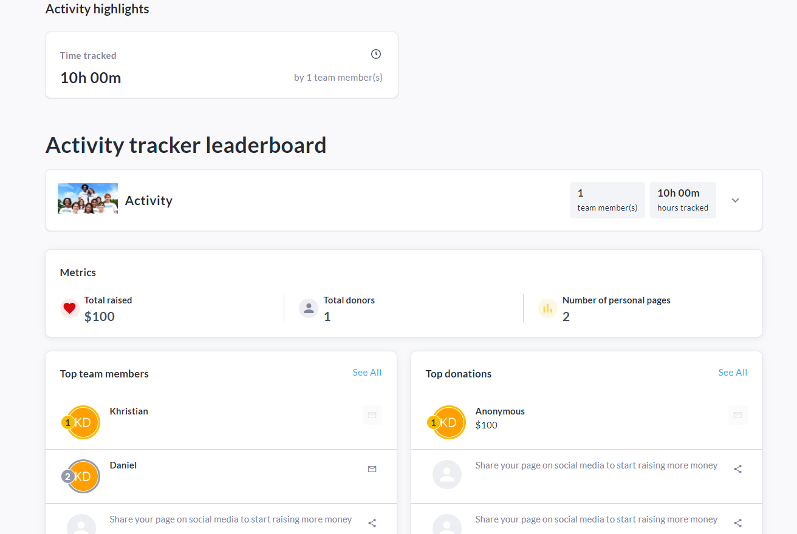

The **Activity Tracker Leaderboard**will also be shown on the Team Page itself.
