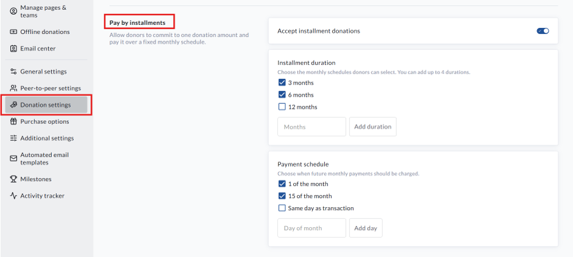
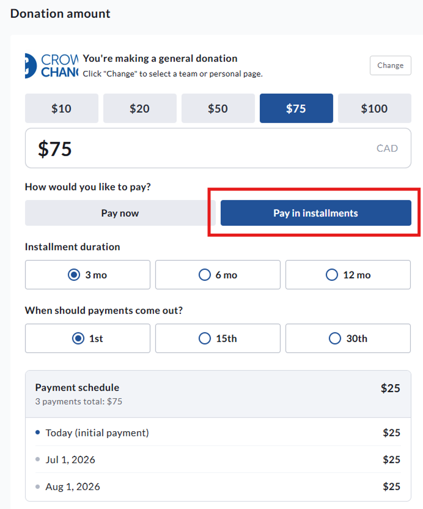

<!-- Source: https://chadmin.crowdchange.help/ct/pay-by-installments-how-to-break-a-donation-up-into-separate-payments | Nav: Pay by Installments - how to break a donation up into separate payments | Mirrored 2026-10-14 -->

# Pay by Installments - how to break a donation up into separate payments

**Pay by Installments** allows donors to commit to a single donation amount and spread the payment over a fixed number of monthly installments.

Unlike recurring donations, installments represent one donation commitment that is paid overtime. The donor makes one pledge for the full amount, and the remaining payments are automatically collected on the selected schedule.

**Enabling Pay by Installments**

**Please Note:** Pay by Installments is an optional feature that must first be enabled for your organization.

Once enabled, administrators can configure these settings within the Fundraiser's Donations settings.

To turn on Pay by installments within a fundraiser, please follow the steps below:

1. **Login** to the fundraiser

<!-- -->

2. Click **Manage fundraiser** in the top right corner

<!-- -->

3. Click **Donation settings** in the menu on the left

<!-- -->

4. Scroll to **Pay by installments** and toggle on **Accept installment donations**

<!-- -->

5. Set the **Installment duration** and **Payment schedule options**

<!-- -->

6. Scroll down and click **Save**

Pay by installments settings within Donation settings

*** ** * ** ***

**Donor Checkout Experience**

The Pay by Installments option is only displayed when all of the following conditions are met:

* Pay by Installments is enabled for the fundraiser.

* The donor selects a **One-Time** donation.

* The donation amount is greater than $0.

If multiple options are available, donors can choose:

* **Pay Now** or **Pay by Installments**

* The number of monthly payments

* Their preferred monthly payment date

Before completing checkout, donors will see a payment preview showing:

* Total donation amount

* Amount of each monthly payment

* Number of scheduled payments

The donation is then processed as a single pledged donation with an installment schedule attached.  

View of Pay in installments option on the Checkout Page

*** ** * ** ***

**How Payments Work**

When a donor selects Pay by Installments:

1. The donor's full donation commitment (pledge) is created immediately.

2. The first installment is charged immediately using the selected payment method.

3. The payment method is securely stored for future scheduled payments.

4. Remaining installments are automatically charged on the selected monthly schedule.

5. Once all scheduled payments have been successfully collected, the installment plan is completed automatically.

Unlike recurring donations, installment plans are **not subscriptions**. They are a single donation commitment that is fulfilled through multiple scheduled payments.

*** ** * ** ***

**Fundraiser Status**

Once a donor commits to an installment plan, the payment schedule will continue even if the fundraiser has been:

* Closed

* Archived

* Ended

This ensures donors can complete the commitment they originally made.

*** ** * ** ***

**Donation Receipts**

After each successful installment payment, the donor receives a payment receipt showing their current progress.

Receipt summaries include:

* Amount paid

* Total pledged amount

* Remaining balance

* Number of payments completed

* Total number of scheduled payments

* Date of the next scheduled payment (when applicable)

If there are no remaining scheduled payments, the receipt will indicate that the installment plan has been completed.

**Please Note:** If you use a custom receipt template that does not include the transaction summary, the installment progress section will automatically be added to the donor receipt.

*** ** * ** ***

**Reporting**

For reporting purposes, the **original pledge** represents the donation.

The individual monthly payments are treated as fulfilments of that pledge and are not counted as separate donations.

This ensures donation totals, fundraising progress, donor counts, and leaderboards remain accurate without double-counting payments.

Administrators can view installment progress, including:

* Total pledge amount

* Amount collected

* Remaining balance

* Percentage completed

* Number of payments completed

* Total scheduled payments

* Next scheduled payment

* Saved card details (brand, last four digits, and expiry)

Transaction details also provide links between the original pledge and all associated installment payments, making it easy to review the complete payment history.

*** ** * ** ***

**Managing Installment Plans**

If an installment payment fails, administrators can:

* View the reason for the failed payment.

* Update the donor's saved payment method.

* Retry the missed payment.

* Close the installment plan at the amount already collected if no further payments will be processed.

*** ** * ** ***

**Refunds**

Refunds apply only to individual installment payments that have already been charged.

Refunding an installment payment does not automatically refund or remove the original pledge.

If an installment payment is refunded while the plan is still active:

* The donor's paid progress is reduced.

* Future scheduled payments continue as planned.

If a payment from a completed or already closed installment plan is refunded:

* The pledged amount is adjusted to match the amount successfully collected.

* The installment plan is marked as closed.

This ensures donation totals, fundraising reports, and donor leaderboards continue to accurately reflect the amount received.

*** ** * ** ***

**Frequently Asked Questions**

**Can donors change an installment plan after donating?**

No. Donors cannot modify the payment amount, payment schedule, or number of installments after the donation has been submitted. If changes are required, please contact your CrowdChange support team.

**Is Pay by Installments the same as recurring donations?**

No. Recurring donations create an ongoing monthly or annual subscription until cancelled.

Pay by Installments creates a single donation commitment that is automatically completed after the selected number of monthly payments have been collected.

**Will installment payments continue after my fundraiser ends?**

Yes. Existing installment plans continue until all scheduled payments have been completed, even if the fundraiser has been closed or archived.

**Do installment payments count as multiple donations?**

No. The original pledge is counted as the donation. Individual installment payments are recorded as fulfilments of that pledge and are excluded from donation totals and donor leaderboards to prevent double-counting.
