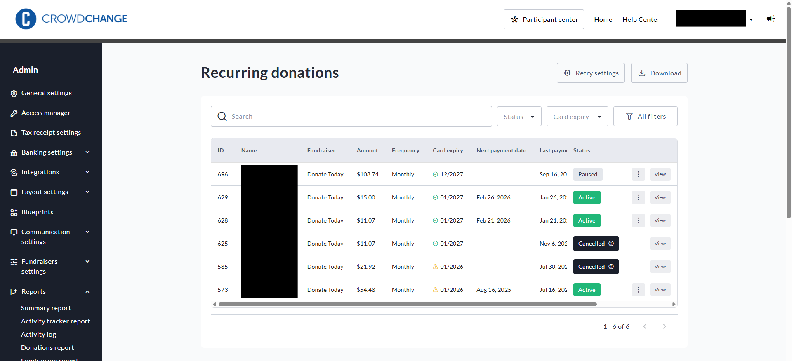
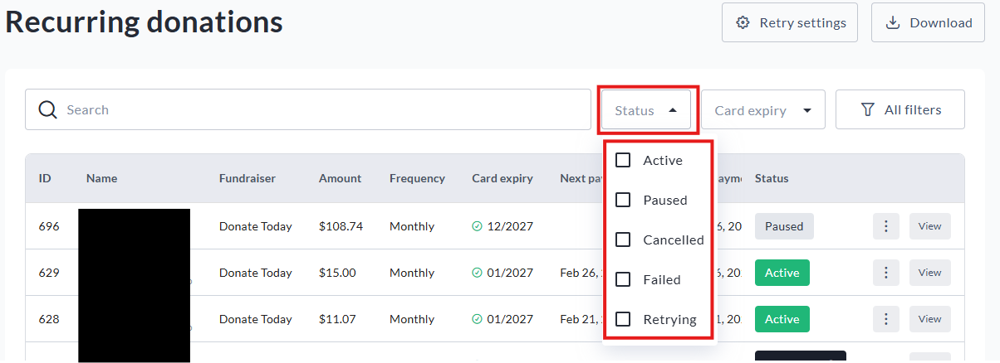
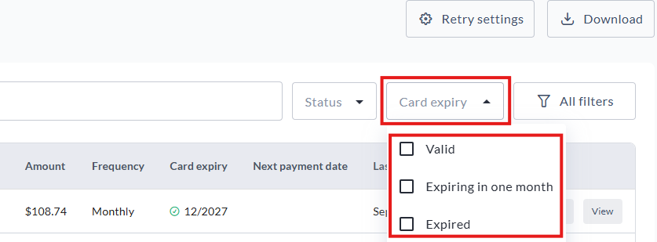
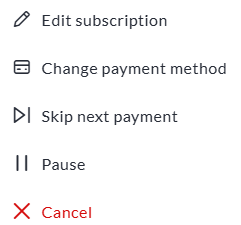
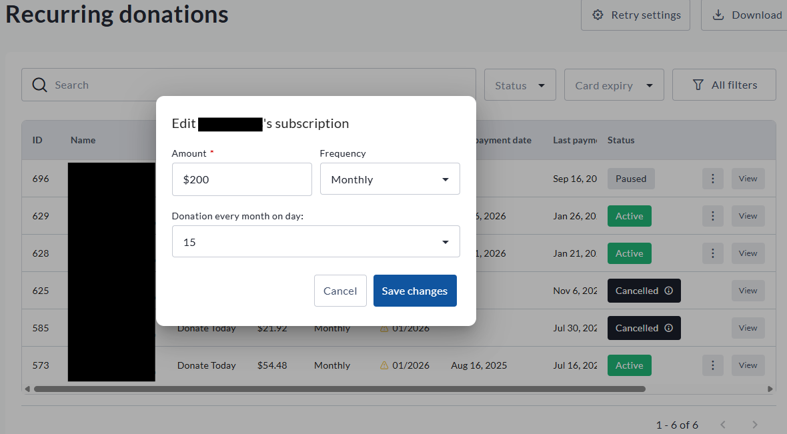
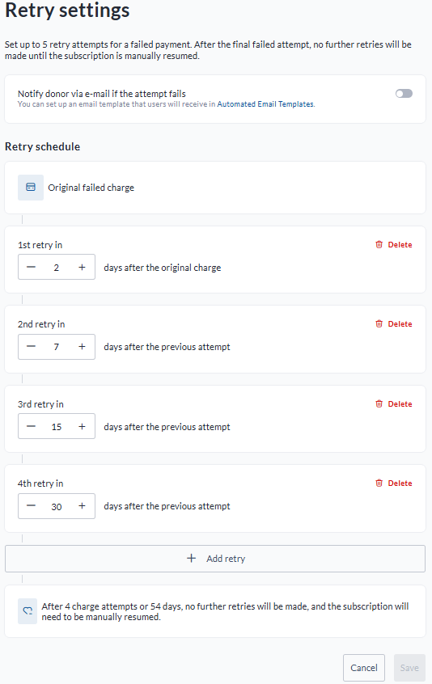
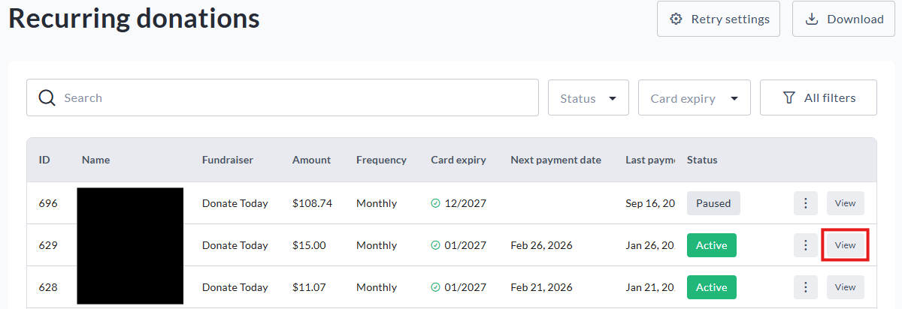
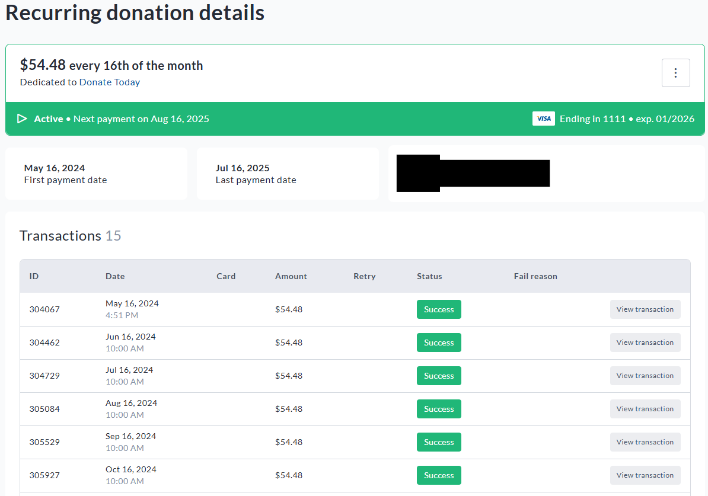

<!-- Source: https://chadmin.crowdchange.help/ct/recurring-donations-report-how-to-manage-recurring | Nav: Recurring Donations Report - How to Manage Recurring Donations on CrowdChange | Mirrored 2026-10-14 -->

# Recurring Donations Report - How to Manage Recurring Donations on CrowdChange

As a site Admin, the **Recurring Donations Report** gives you a detailed list of all subscriptions across your CrowdChange site, and allows you to update them on behalf of your donors. (See: [**Recurring Donations**](recurring-donations.md)).

You can update the card details, change the recurring donation amount, the payment day, skip a payment, and pause, resume or cancel a recurring donation. **Please note** that you can not change a donation amount to be less than the minimum set at the [**Admin \> General Settings**](admin-general-settings.md)level.

To access this report, follow these simple steps:

1. Go to your CrowdChange site and **Log In**.

2. Click your name in in the top right corner, then**Admin**.

3. Go to **Reports** **\> Recurring Donations Report**using the left sidebar. You will be taken here:

View of the **Recurring donations report** within the **Admin dashboard**

*** ** * ** ***

## Subscription statuses

There are five statuses that a recurring donation can have. They are as follows:

* **Active** - this means that a subscription is active, and will be processed at the rate selected by the donor (monthly or annually).

* **Paused** - this means that the subscription is still active, but payments are Paused. Donors can Pause or Resume their paused donation via their **Profile** . Site admins can Pause or Resume a paused subscription via the **Recurring donations report**.

* **Cancelled** - this means that a subscription has been manually cancelled, either by the donor or a site admin. Cancelled subscriptions cannot be resumed - if a donor wants to subscribe again, they would need to initiate a new subscription by making a new transaction.

* **Failed** - this means that a subscription has been cancelled automatically due to a failed transaction. Transactions are retried at a set rate prior to failing, outlined below in the **Retry settings** section. Like the **Cancelled**status, this transaction cannot be resumed.

* **Retrying** - a subscription marked retrying has had at least one transaction attempted, but has failed thus far. The transaction is not marked as failed yet as the **Retry settings** has not yet gone through all attempts.

Site admins can filter for the above statuses by clicking **Status** beside the search bar at the top of the **Recurring donations report** page (see below).  

The **Status** filtering options on the **Recurring donations report**

Site admins can also track **expiring credit cards** by using the **Card expiry**filter shown below:  

The **Card expiry**filter in the recurring donations report

This can help site admins track donations at risk of failure due to card expiration.  
Some payment processors include a feature that automatically updates credit card information for recurring donations when a card is renewed, as long as the details remain consistent. This helps prevent interruptions in monthly/annual giving. For more information on whether or not your account is already using this function, please contact your Partner Success Manager.

*** ** * ** ***

## Changing a recurring donation

If you would like to change the **amount** , **frequency** , **payment information** , or **status** of a recurring gift, please follow these steps:

* Go to your CrowdChange site and log in to your account with Admin access

* Click your name in the upper right-hand corner of your screen, then click **Admin**

* From the **Admin dashboard** , click **Reports** , then **Recurring donations report**

* Once on the **Recurring donations report**, find the donation you want to adjust either by scrolling or searching

* Once you have found the donation in question, click the three dots on the right hand side of the donation

You will then be met with the following options:  

Clicking the **three-dot** menu on a recurring donation provides the following options

You can adjust the amount, frequency and timing of said donation (see below) by clicking **Edit subscription**.  

View of the **Edit subscription** options within the **Recurring donations report**

You can also update the payment method (change card) of the recurring donation by selecting **Change payment method**.

You can elect to **Skip next payment** if you want to maintain the subscription, but opt out of the next scheduled payment.

You can **Pause**the subscription, which maintains the ability to resume in the future, but stops payments from occuring as scheduled until manually resumed.

Finally, you can **Cancel** the recurring donation outright, which stops the subscription. Please note a cancelled subscription cannot be renewed.

*** ** * ** ***

## Retry settings

The **Retry settings** page allows you to set the schedule that additional payment attempts are charged to a donor's credit card after a scheduled recurring payment fails. You can set up to **five** retry attempts for a failed transaction. After all five attempts have failed, a subscription is set as **Paused**. No further retries will be attempted unless the subscription is manually resumed.

To access and set up your **Retry settings**, please follow these steps:

* Go to your CrowdChange site and log in to your account with Admin access

* Click your name in the upper right-hand corner of your screen, then click **Admin**

* From the **Admin dashboard** , click **Reports** , then **Recurring donations report**

* Once on the **Recurring donations report** , click **Retry settings**

View of the **Retry settings** options within the **Recurring donations report**

Once on this page you can set up to five retry attempts based on the schedule that best suits your organization.

*** ** * ** ***

## Recurring donation details - breaking down a subscription

Within the **Recurring donations report** , you can see a breakdown of an individual subscription by clicking **View**.  

Click **View** on a specific donation to be taken to the **Recurring donation details** page

This includes:

* Donation amount

* Frequency

* Which fundraiser the donation has been made to

* When the subscription was created (first payment date)

* When the next payment is scheduled

* Record of attempted transactions that have failed (if applicable)

* Links to individual transaction details for each payment

* Credit card type

* Last four digits of credit card number

Clicking the three dot menu on this page also allows the same update options listed in the above section.

*** ** * ** ***

**IMPORTANT:** Please note that **Tax Receipts** for recurring donations are generated at year-end (First week of January of the following year) and are populated in your Tax Receipts Report automatically. All recurring donations for the year are consolidated into one tax receipt. These receipts are **NOT** sent to donors automatically - you can send these receipts manually by downloading the receipts , or send these receipts using pre-built automated emails in the **Tax receipts report**.
