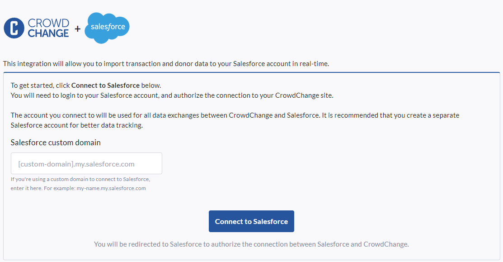
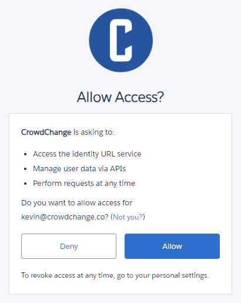
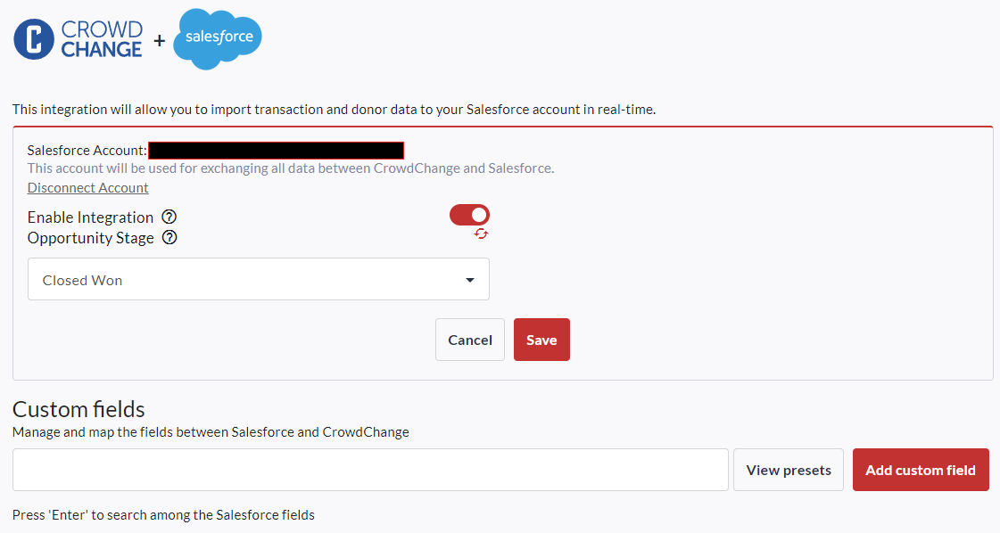
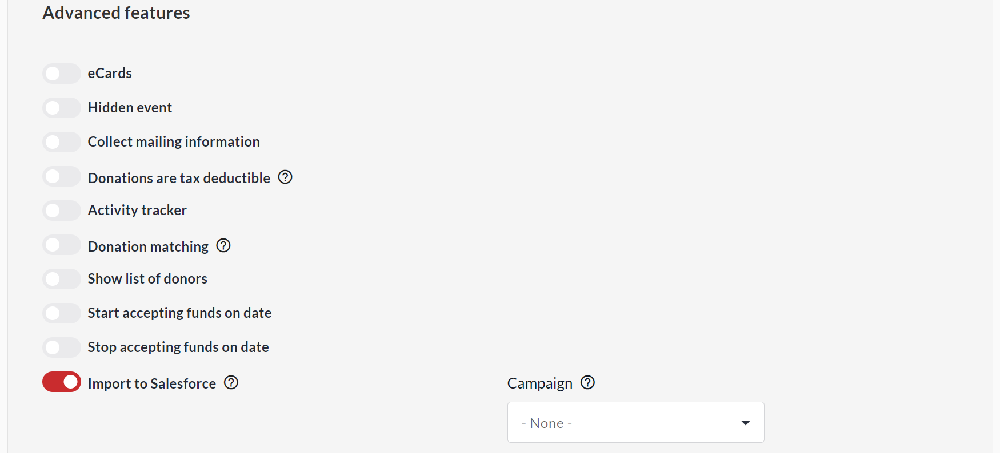
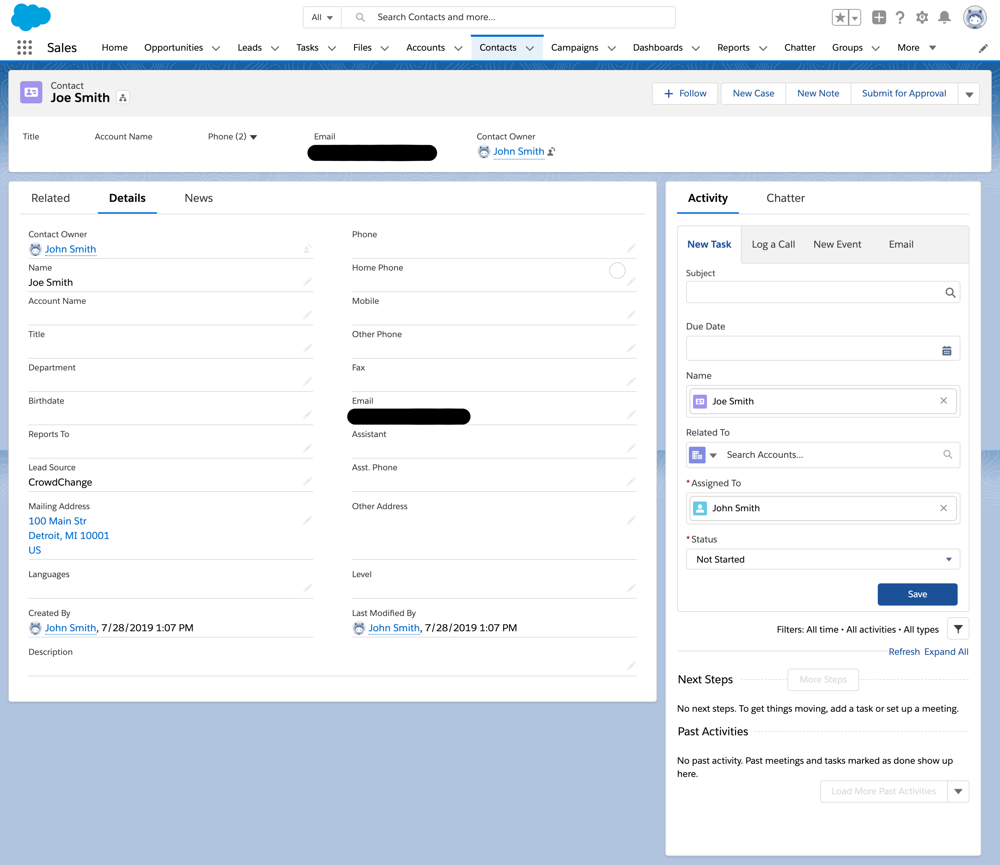
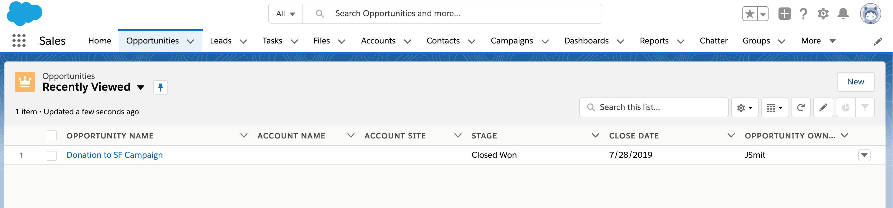
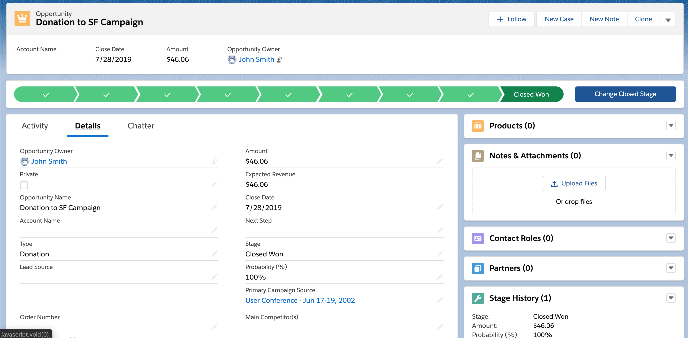

<!-- Source: https://chadmin.crowdchange.help/ct/salesforce-integration-with-crowdchange | Nav: Salesforce Integration with CrowdChange | Mirrored 2026-10-14 -->

# Salesforce Integration with CrowdChange

## **How does CrowdChange integrate with Salesforce?**

CrowdChange is equipped with Salesforce integration through Connected Apps. A Connected App is a framework which enables an external application to integrate with Salesforce using APIs and standard protocols, such as SAML, OAuth, and OpenID Connect. Connected Apps use these protocols to authenticate, authorize, and provide single sign-on (SSO) for external apps. The external apps that are integrated with Salesforce can run on the customer success platform, other platforms, devices, or SaaS subscriptions.

For example, when you log in to your Salesforce mobile app and see your data from your Salesforce org, you're using a Connected App.  
Using Salesforce but not set up for integration? Speak to your Partner Success Representative to discuss your options. CrowdChange sites are not set up for Salesforce Integration by default.

## **How can I enable Salesforce integration on my CrowdChange site?**

In order to enable Salesforce integration, follow these steps:

1. Go to your CrowdChange site and log in to your account. Please note that administrator access is required to enable Salesforce integration.

2. In the upper right-hand corner of your screen, click **Profile** , then **Admin** . In the left-hand sidebar, click **Integrations** , then **Salesforce Integration**.

3. On the screen below, input your **Salesforce custom domain** into the box pictured below, then click **Connect to Salesforce**. This will then open a new tab that will redirect you to Salesforce - please allow CrowdChange access in order to initialize this connection.

  
  
Please note that all entries made in Salesforce by CrowdChange will be logged under the email address of the user who completes this integration process - for example, if you log in to your Salesforce account using the email address [kevin@crowdchange.co](mailto:kevin@crowdchange.co), all entries that CrowdChange creates in Salesforce will be entered under the [kevin@crowdchange.co](mailto:kevin@crowdchange.co) email address.

We recommend creating a CrowdChange specific account to complete this integration in order to differentiate CrowdChange entries from any other entries made under your existing Salesforce account. This will allow you to better track data.

**Salesforce Integration Settings**

Once your Salesforce Integration is complete, there are a few options that will display.

* **Enable Integration**

  * If this option is toggled on, transactions and campaigns will be created in Salesforce (Fundraisers have their options to enable data going through to Salesforce).

* **Opportunity Stage**

  * This allows you to select Opportunity Stage for all new donations (Opportunities) when transactions are added in Salesforce.

## Mapping

**Default Fields**

With no adjustments, data from CrowdChange will be imported into Salesforce with the following mapping applied:

*Account*  

| **Salesforce Field** |       **CrowdChange Field**       |
|----------------------|-----------------------------------|
| Name                 | user.name                         |
| Description          | CrowdChange Account ID: {user_id} |
| Type                 | Other                             |
| BillingStreet        | billing.address                   |
| BillingCity          | billing.city                      |
| BillingState         | billing.state                     |
| BillingPostalCode    | billing.zip                       |
| BillingCountry       | billing.country                   |

*Contact*  

| **Salesforce Field** | **CrowdChange Field** |
|----------------------|-----------------------|
| FirstName            | user.first_name       |
| LastName             | user.last_name        |
| Email                | user.email            |
| MailingStreet        | billing.address       |
| MailingCity          | billing.city          |
| MailingState         | billing.state         |
| MailingPostalCode    | billing.zip           |
| MailingCountry       | billing.country       |
| LeadSource           | CrowdChange           |

*Opportunity*  

| **Salesforce Field** |          **CrowdChange Field**           |
|----------------------|------------------------------------------|
| Name                 | Donation to {fundraiser.name}            |
| Amount               | transaction.amount                       |
| CloseDate            | transaction.date                         |
| StageName            | \[Stage\]                                |
| CampaignId           | \[Campaign ID\]                          |
| Type                 | Donation                                 |
| Description          | Donation made through \[Fundraiser URL\] |

*Payment*  

|  **Salesforce Field**  | **CrowdChange Field**  |
|------------------------|------------------------|
| Payment Amount         | transaction.amount     |
| Payment Date           | transaction.date       |
| Check Reference Number | transaction.id         |
| Payment Method         | transaction.pay_method |
| Paid                   | true                   |
| Written Off            | false                  |

**Fundraiser Settings**

If SalesForce integration is enabled, you will see a new section when creating or updating fundraisers.  

If the **Import to Salesforce** option is toggled on, all transactions for this fundraiser will be added to Salesforce. By default, the name of your fundraiser will be the name of the campaign created in Salesforce, but this can be changed using the text box underneath **Campaign** .

**Data Flow**

If Salesforce integration is enabled, and **Import to Salesforce** is enabled at the fundraiser level, all online transactions (NOT offline donations) will be imported into Salesforce.

* When a transaction is made, we will attempt to locate an existing Contact by email. If there is no match, we will try to match to existing contact by First Name + Last Name + Postal Code.

  If there is still no match, a new Contact will be created in Salesforce from the User information that we have on file in CrowdChange.

* Since Opportunities are assigned to Accounts, not Contacts - CrowdChange will only look for contacts with an Account ID associated with them. If an existing Contact is found without an Account ID, it will not be used.

* In the case where a Contact is not found with an Account ID, we will try to locate the Account that was previously created by CrowdChange. If no account is found, we will create a new account and try to create a new Contact for that account.

* Donation data will create a New Opportunity in Salesforce. If the Non-Profit Success Package (NPSP) is installed, there will be additional payment data created (payment method, currency, etc).

  

* Opportunity will be linked to Campaign if the Campaign field was used when setting up your Fundraiser.

Please note that**Offline Donations** entered in CrowdChange do not get exported to Salesforce.
