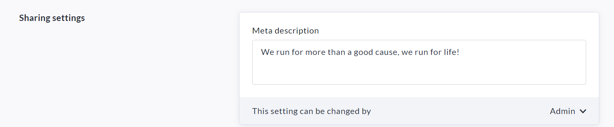

<!-- Source: https://chadmin.crowdchange.help/ct/set-a-custom-meta-description-for-fundraiser-socia | Nav: Set a custom meta description for fundraiser social sharing | Mirrored 2026-10-14 -->

# Set a custom meta description for fundraiser social sharing

If you need to set a custom meta description for your fundraiser(s), which will be used when sharing to social media platforms (instead of the fundraiser description), you can do so using the steps below.  
Please note that this feature is **NOT**enabled by default - you will need to reach out to your Partner Success Representative if you would like to use it.

Once the feature has been enabled on your site, you will be able to use it in 2 ways:

## Create / Edit Fundraiser Process

When creating or editing a fundraiser, look for the '**Meta Description**' field and enter your desired custom meta description for this fundraiser. It will be used in place of the fundraiser description when sharing to social media platforms.  

### Create / Edit Blueprint Process (if Blueprints are enabled)

When creating or editing a Blueprint, enter your desired Meta description for fundraisers created from this blueprint. It will be used in place of the fundraiser description when sharing to social media platforms. You can use the permissions dropdown to determine whether fundraiser creators can edit this themselves.  

