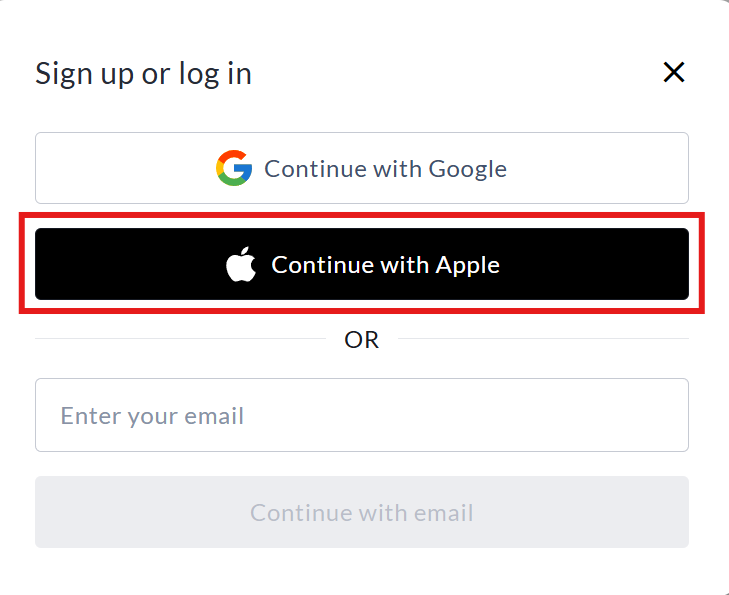

<!-- Source: https://chadmin.crowdchange.help/ct/sign-in-with-apple-why-does-a-users-email-appear-a | Nav: Sign in with Apple - Why does a user’s email appear as xxxx@privaterelay.appleid.com? | Mirrored 2026-10-14 -->

# Sign in with Apple - Why does a user’s email appear as xxxx@privaterelay.appleid.com?

If you see an email address like `abcd1234@privaterelay.appleid.com`, the user signed in using **Sign in with Apple** and chose the **Hide My Email** option.

This is expected behavior and is part of Apple's privacy protection feature.  

View of the login page with **Continue with Apple** highlighted

*** ** * ** ***

## What is Hide My Email?

When users sign in with Apple, they can choose to share either:

* Their real email address, or

* A private relay email address generated by Apple

If they select **Hide My Email** , Apple creates a unique, random email address ending in `@privaterelay.appleid.com`.

*** ** * ** ***

### How the private relay works

* Apple generates a unique relay email for that specific app or platform.

* Emails sent to that relay address are automatically forwarded to the user's real email inbox.

* The user's actual email address is never shared with CrowdChange.

This means the relay address is valid and functional, even though it does not look like a typical email address.

*** ** * ** ***

### Can we contact the user?

Yes. You can send emails to the `@privaterelay.appleid.com` address as usual. Apple will forward the message to the user's real email address.

The relay address will continue to work as long as the user keeps Sign in with Apple enabled for CrowdChange.
