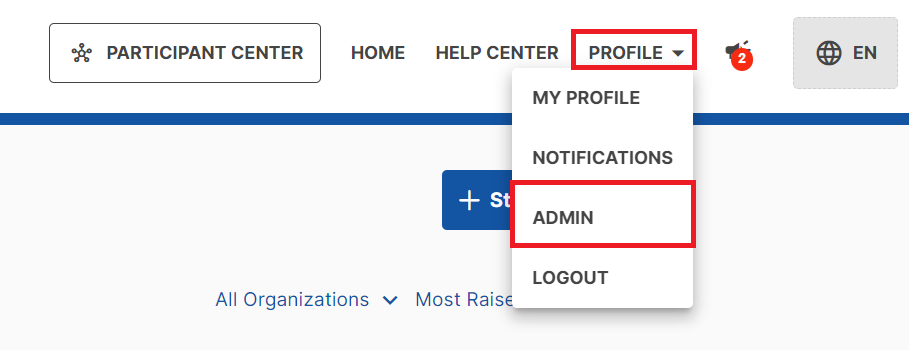
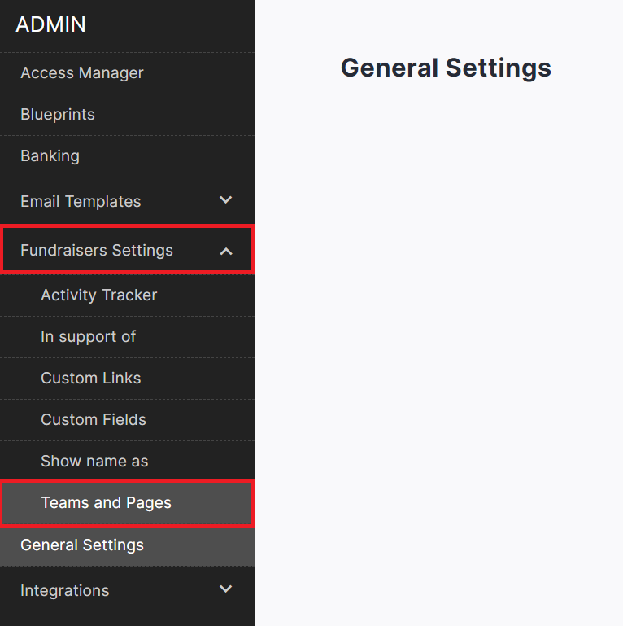
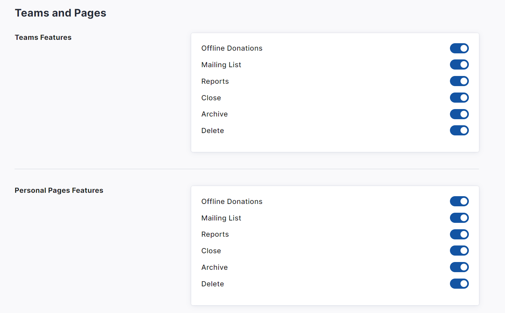
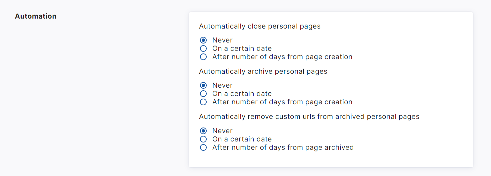

<!-- Source: https://chadmin.crowdchange.help/ct/site-admin-level-options-for-p2p-pages | Nav: Site Admin Level Options for P2P Pages | Mirrored 2026-10-14 -->

# Site Admin Level Options for P2P Pages

We offer some useful management options for P2P pages at the Admin/Site level.

These controls allow you to set exactly what functionality your team and page owners should have access to.

They can be accessed from your Admin Dashboard, and any changes made will affect all Personal and/or Team pages across your site. To access these controls, follow the steps below:

1. From anywhere on your CrowdChange site, go to **Profile → Admin** in the top right corner.

   
2. On the left sidebar that appears, click **Fundraisers Settings** , then **Teams and Pages**.

   
3. From here you can **enable** or **disable**specific features of Teams and/or Personal pages.

   
4. Additionally, you can enable automation settings to **auto-close** , **auto-archive** and **auto-remove** **custom URLs** for Personal Pages on a certain date or after a certain number of days.

   
5. Ensure to click **Save**at the bottom when ready to apply changes.

   
