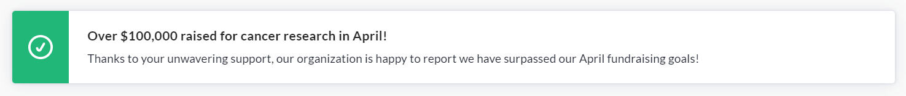
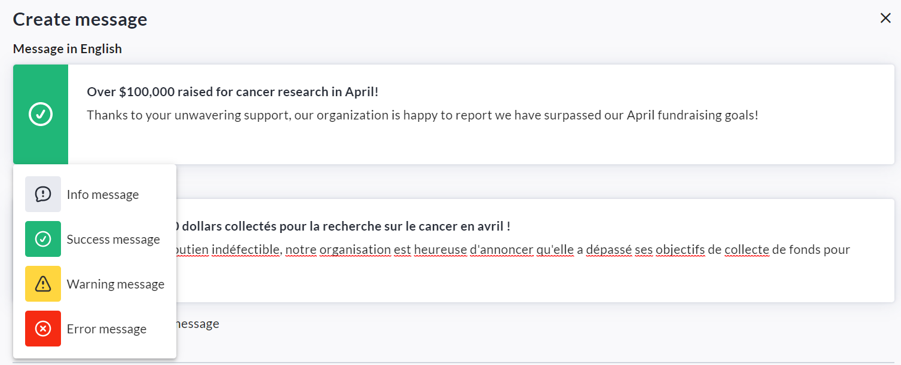
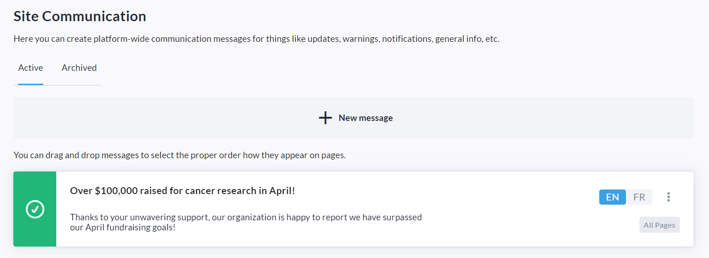

<!-- Source: https://chadmin.crowdchange.help/ct/site-communication | Nav: Site Communication | Mirrored 2026-10-14 -->

# Site Communication

The **Site Communication** feature is used to create site-wide communication messages for things like updates, warnings, notifications, general information, and more.

It provides an easy and efficient way to quickly communicate important knowledge to users on your site.

Messages can be targeted to the Homepage, Participant Center, Fundraisers and/or P2P Pages.  

For example, you can inform users of a significant milestone reached, give them instructions on how to take certain actions, provide a link to register for your major event, and much more! Feel free to get creative.  
Please note that this feature is **NOT**enabled by default - Reach out to your Partner Success Representative today to have it enabled on your site!

Once the feature has been enabled on your CrowdChange site, follow the steps below to create a message:

1. While logged in, click **Profile** in the top right corner, then **Admin**.

2. Click **Communication Settings → Site Communications**on the left sidebar.

3. Click **Create message**.

4. Enter the title and body text of your message (in French as well if site is bilingual).

5. Select an icon (Info, Success, Warning, Error).

   
6. Check the **Allow users to close this message** box if desired.

7. Enter a date range for when the message will be shown, if desired.

8. Under **Target Pages** , click **Advanced settings** to customize exactly where this message will be shown. If this step is skipped, the message will be shown on all pages.

9. Click **Save**.

*** ** * ** ***

You may return to the Site Communication menu at any time to add, update, archive or delete messages.  

