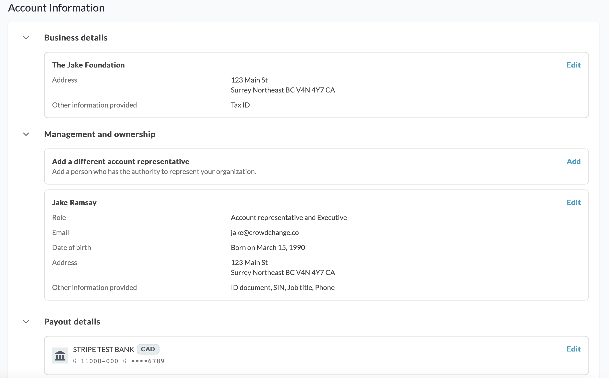
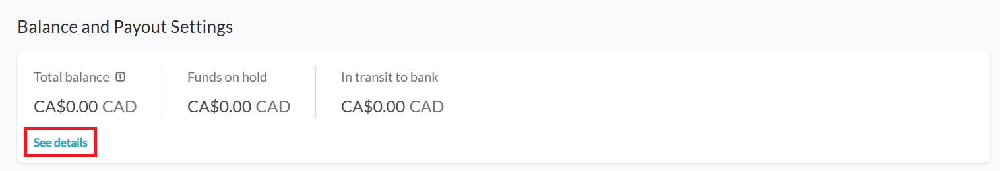
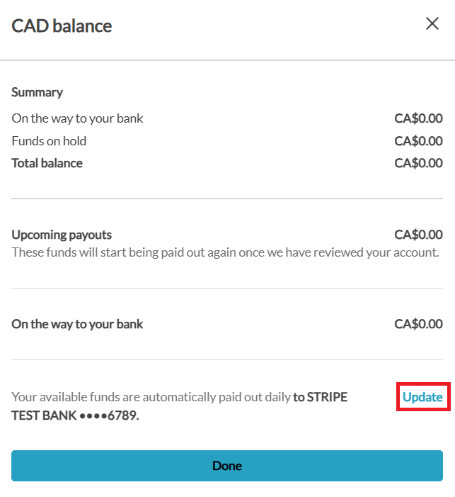
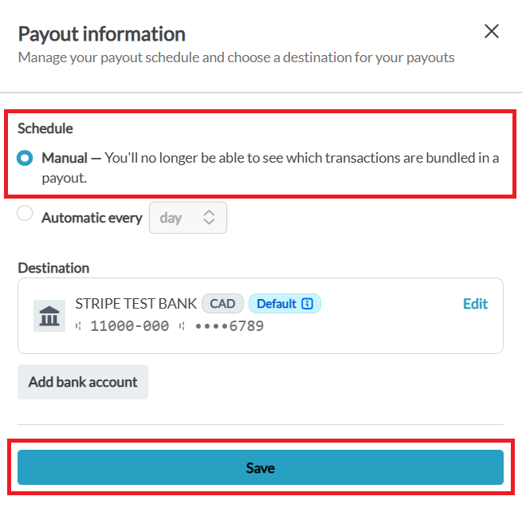
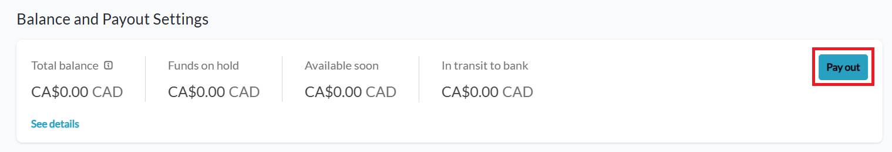
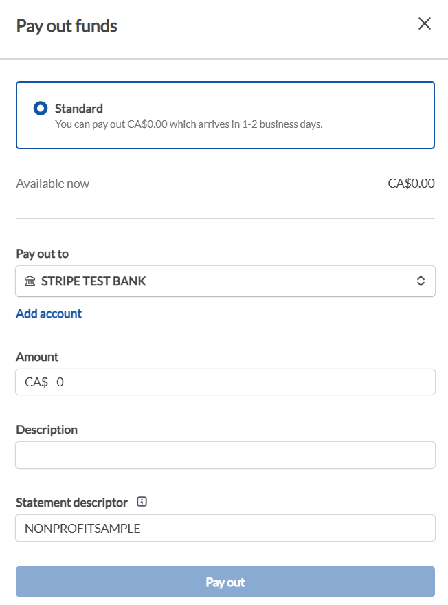

<!-- Source: https://chadmin.crowdchange.help/ct/stripe-banking-overview | Nav: Stripe Banking Overview | Mirrored 2026-10-14 -->

# Stripe Banking Overview

**Stripe** is one of the payment processors that CrowdChange is partnered with.  
CrowdChange works with different payment processors depending on the needs of your organization. If you have any questions about which payment processor is right for your organization, don't hesitate to reach out to your Partner Success Representative to discuss your options.

*** ** * ** ***

**Stripe Security**

Stripe is **Level 1 PCI Compliant** , which is the most stringent level of security available in the payment processing industry. For context, Stripe has never had a breach of data in the history of their company. They are used by UnderArmour, Unicef, Habitat for Humanity, Lyft, and many more (a full list of charitable clients, as well as non-charitable clients, can be found here: <https://stripe.com/customers#nonprofits> ).

While CrowdChange itself is also PCI Compliant, all sensitive credit card information is stored with Stripe through tokenization, thus no sensitive credit card information is stored on the CrowdChange platform. The CRA (Canadian Revenue Agency) requires Stripe to collect account owner information to help combat tax fraud, stop donations coming from flagged organizations, and other security concerns. Please note that this is not something that CrowdChange or Stripe mandate but rather something that is required by government regulators. Take a look at some Stripe documentation, as well as Canadian Government *Know your Customer* (KYC) requirements below:

* [Stripe's KYC acknowledgement and required fields depending on your location](https://support.stripe.com/questions/know-your-customer)

* [Minimum requirements for Canadian Clients](https://stripe.com/docs/connect/required-verification-information)

* [Government requirements to adhere to KYC rules](http://www.fintrac-canafe.gc.ca/guidance-directives/client-clientele/Guide11/11-eng.asp)

* CrowdChange uses Stripe's connect accounts to make it easy for charitable partners to collect funds. CrowdChange qualifies as an *Account-Based Business Relationship* and is therefore required to adhere to KYC rules. [More information on CRA requirements can be found here.](http://www.fintrac-canafe.gc.ca/guidance-directives/client-clientele/Guide11/11-eng.asp)

Stripe has the ability to put fundraisers on hold until banking information has been entered to your CrowdChange site to ensure that they are following all Canadian rules and regulations (CrowdChange is based in Canada). In order to ensure your campaign runs uninterrupted, we recommend entering all required banking fields as soon as possible.

*** ** * ** ***

## **Setting Up Stripe Banking**

**Scenario 1 - Fundraiser-Level Banking**

If your organization is using Stripe as their payment processor, and their CrowdChange site is set up for Users Manage Banking, banking can be set up by following these steps at the fundraiser level:

1. Go to your fundraiser and log in to your CrowdChange account.

2. Click **Manage Fundraiser** in the top right, then **Banking → My Banking Settings**.

3. Fill out the required fields with your organization's banking information.

**Scenario 2 - Universal/Global Banking**

If your CrowdChange site uses **Universal/Global** Banking (all fundraisers on the site use the same bank account), then this can only be entered at the site-wide level on the **Admin** page.

1. Go to your CrowdChange site and **Log In** with your admin credentials.

2. Click on **Profile** then **Admin**in the upper-right hand corner of your window.

3. Click **Banking settings** on the left sidebar, then **Stripe**.

4. Enter your organization's banking and representative information.

   *Example below:*

   

Please note that all banking information must be an**exact match**to what has been provided by your bank in order for Stripe to approve your fundraiser for payments.

*** ** * ** ***

### **Payouts - Manual or Automatic**

Admins now have the ability to schedule their payouts **manually**- however, in this case, you will no longer be able to see which transactions are included in a payout.

Alternatively, you can select **automatic**, and Stripe will process all donations on a rolling basis, meaning that a donation is processed on the schedule set (daily/weekly/monthly), after it is received by your fundraiser. After a donation is processed it will be deposited directly into your bank account - depending on the payout schedule configured.

To set adjust your payout schedule, follow the steps below:

1. Go to your CrowdChange site and **Log In** with your admin credentials.

2. Click on **Profile** then **Admin**in the upper-right hand corner of your window.

3. Click **Banking settings** on the left sidebar, then **Stripe**.

4. Under **Balance \& Payout Settings** , click **See details**.

   
5. Within the sidebar that appears, click **Update**under the 'On the way to your bank' section.

   
6. If desired, select **Manual** under **Schedule** , and click **Save**at the bottom of the page.

   
7. Under **Balance \& Payout Settings** , click **Pay out.**

   
8. You will then be able to manually trigger a payout of your desired amount.

   

*** ** * ** ***

**Looking for Support?**

Having issues with your banking setup? CrowdChange Support would be happy to investigate for you! Simply click the blue **Help**button in the bottom right corner of this page, fill out the details, and our support team will get back to you as soon as possible!
