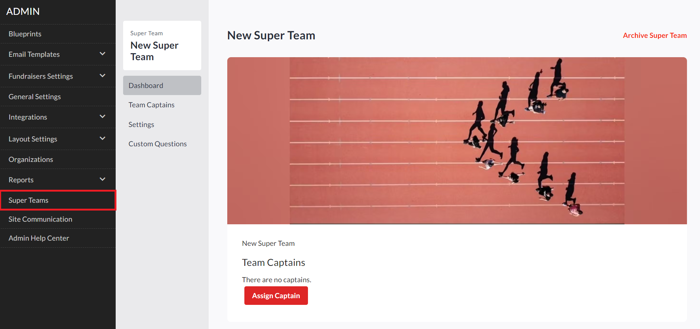
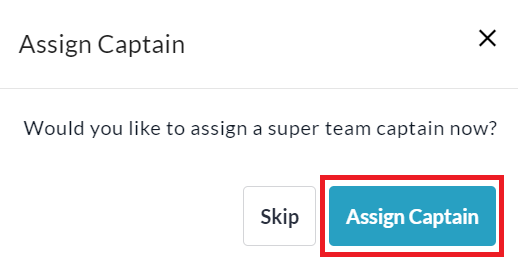
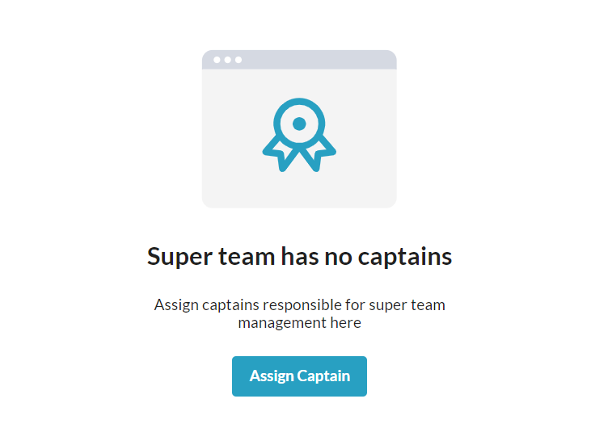
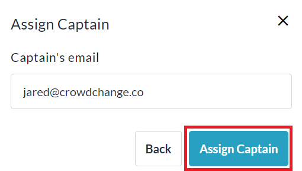
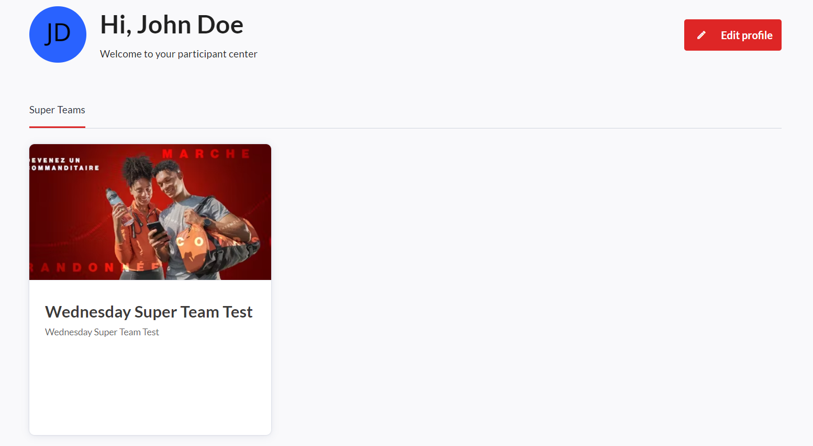
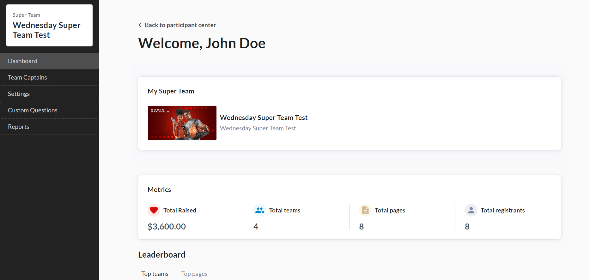
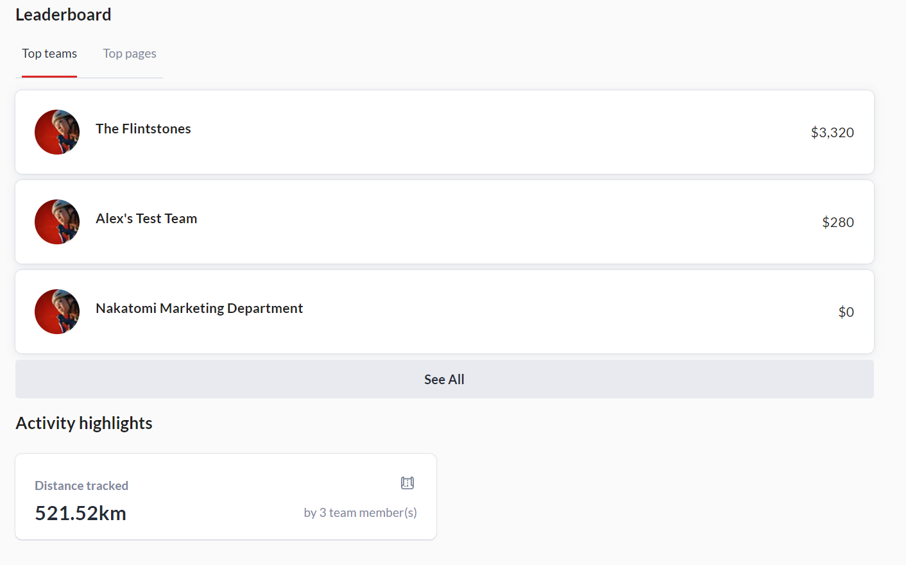
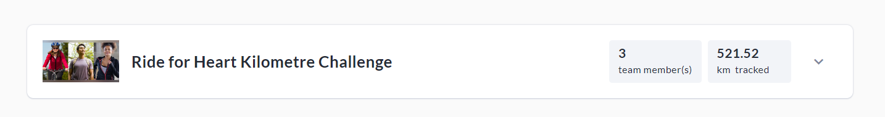
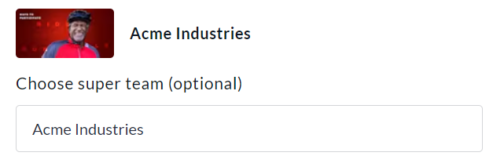
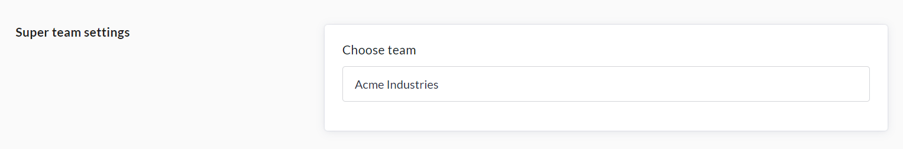

<!-- Source: https://chadmin.crowdchange.help/ct/super-teams | Nav: Super Teams | Mirrored 2026-10-14 -->

# Super Teams

Super Teams is an optional P2P fundraising feature, tailor made for corporate or national fundraising programs. This feature is implemented at the Admin / Site level and exists above regular team pages connected to fundraisers. Super Teams are accessible to fundraisers across an entire CrowdChange site, allowing teams to register within one, larger, Super Team.  
Please note that the Super Teams feature is **NOT** available by default.

Reach out to your Partner Success Representative to discuss how this feature can benefit your event!  

As an Admin user, you can create and manage Super Teams from your Admin Dashboard.

* The name 'Super Teams' and all other copy associated with this feature is fully customizable to suit each partner's requirements.

* Management of Super Teams can be passed off to 'Super Team Captains' of your choice.

* 'Super Team Captains' will be able to see Super Team statistics, details and reports within their Participant Center → Super Team dashboards.

* Within the registration process, team creators will have the option to connect their team to a Super Team.

* Custom Questions specific to a Super Team can be set up, which will appear after the team creator selects the Super Team they are connecting their team to.

* There is no public / front-facing indication of the Super Team a standard team or page is connected to, whether in the registration process or on the pages themselves.

## Use Case Example:

> Bayview Bank has a national corporate fundraising program with funds being raised in all provinces. To streamline the fundraising process and make it easier to track key metrics, the Super Team "Bayview Bank" was created.

An example use case of the Super Teams feature is corporate fundraising for Bayview Bank, a (fictional) national bank with branches in all provinces of Canada.

To streamline Bayview's national fundraising campaign, the Super Team - Bayview Bank could be created.

From there, regular teams (created within fundraisers and connected to the Super Team) would be for Bayview Bank's provincial branches.

Bayview Bank would then be able to track fundraising and activity tracking success across their entire program via the Super Team dashboard, leaderboard and reports. E.g. total amount raised, total teams, total pages, total registrants, activity progress, etc.

## How to Create a Super Team \& Add Captains

To get started and create your first Super Team, follow the steps below:

1. From anywhere on your CrowdChange site, click **Profile → Admin**in the top-right corner.

2. On the left sidebar, click **Super Teams** to be taken to the Super Teams dashboard.

3. Click **New Super Team** , fill out the information (title, description, image), and click **Save**.

4. You will be prompted to assign a Super Team Captain. Click **Assign Captain**.

   

5. On the Team Captains screen that appears, click **Assign Captain** again.

   
6. Enter the captain's email and click **Assign Captain** a final time.

   

7. The captain will receive an email invitation to manage the Super Team.

8. You may return to the Super Team → Team Captains menu at any time to add or remove captains.

## Super Team Captains - Viewing Dashboard

The Super Team Captains will get an email inviting them to manage the team, which they accept via email, and then they are taken to their Participant Center → Super Team dashboard. This is where they would come to see an overall view of what's happening across the Super Team, view reports and more.

Once a Super Team Captain has accepted the email invitation, they can access the Super Team Dashboard within their Participant Center using the steps below:

1. From anywhere on your CrowdChange site, click **Participant Center** at the top.

2. Click the **Super Teams** tab.

   
3. Click on a Super Team to view it's **Dashboard**.

     
     
   

## Connecting Teams to Super Teams

### During Multi-Registration \> Team Creation Process

At the fundraiser level, during the multi-registration process, when creating a team, team captains may optionally choose a Super Team for their team to be connected to. For example:  

### From Existing Team Page Edit Menu

Team Captains can always connect their team to a Super Team at a later date, within their team settings.  

