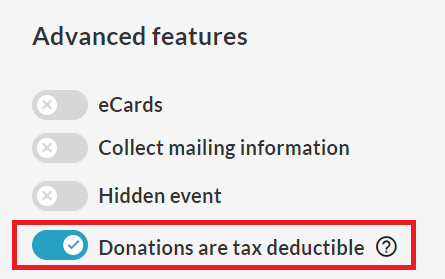
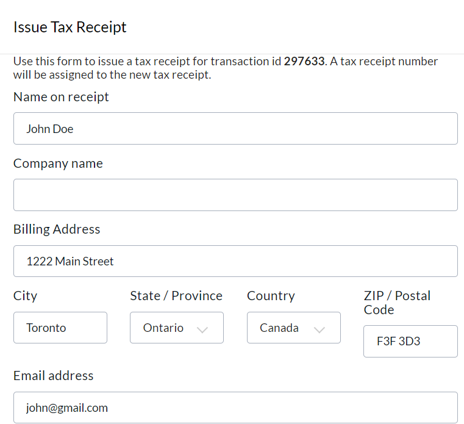
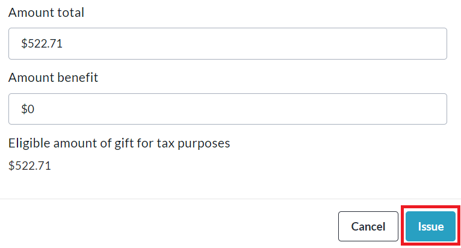
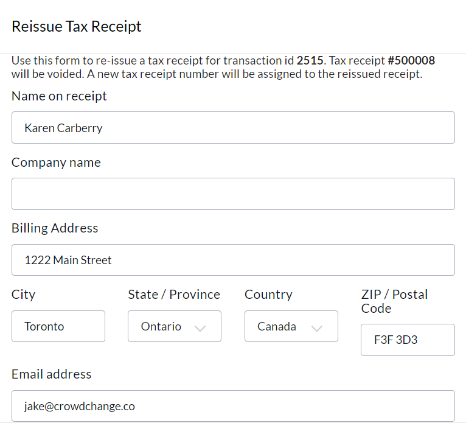
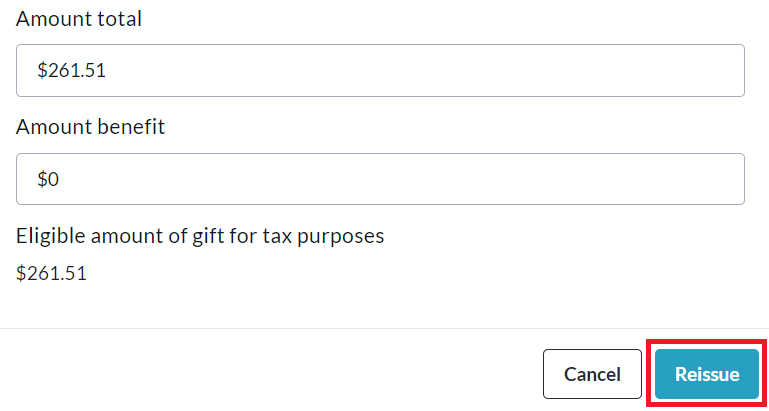
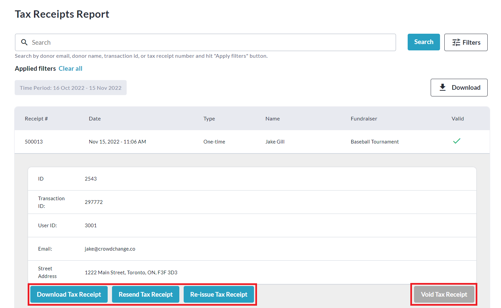

<!-- Source: https://chadmin.crowdchange.help/ct/tax-receipts-eligibility | Nav: Tax Receipts & Eligibility | Mirrored 2026-10-14 -->

# Tax Receipts & Eligibility

## **Canada \& US Tax Eligibility**

Our point-of-purchase tax receipt functionality is available for both **CA** and **US**partners!  
You also have the option to set up **both**on your CrowdChange site, so you have the ability to issue both CRA and IRS compliant Tax Receipts, depending on the Billing Address of the donor.

To get started, you will need to complete the sections below:

* **Admin Tax Receipt Settings**

* **Fundraiser Tax Receipt Settings**

Below, you will also find information on **Split Receipting** , what to do if a **Tax Receipt was not issued** , and instructions on how to **Issue** , **Re-Issue** , and **Void**Tax Receipts.

Please click the relevant box below to view accurate information, instructions, and troubleshooting steps for your country:
For CA Partners  

### **Admin Tax Receipt Settings**

To enter all the information for your Tax Receipt, follow these instructions:

1. From your CrowdChange site, click **Profile → Admin** and then **Tax Receipt Settings** on the left sidebar.

2. Fill in your **Charity Registration Number** , **Issuing Location** , and **Authorized Signatory name**

3. Include on Tax Receipt**Fundraiser Name** , **In Support of Value** and/or **Fund code**

4. Add your organization's **Logo Image**.

   1. *Recommended image size is 500 x 150 pixels, with 16:9 aspect ratio.*

5. Add your **Signature Image**.

   1. *Recommended image size is 500 x 150 pixels, with 16:9 aspect ratio.*

6. Enter **Contact / Additional Information**.

7. Enter**Prefix** - A String to prefix your Tax Receipt numbers. New prefixes will begin at the specified sequence start.

8. Enter**Sequence Start** - The Numerical starting value of your Tax Receipt numbers.

9. Enter**Minimum Length**- The minimum length of your Tax Receipt numbers. For example, if you specify a minimum length of five, and your prefix value is "CC-" the first tax receipt number (if starting from 1) would be CC-00001.

10. Include French version for Tax Receipt - Option to 'Always' or "just for Quebec Residents only'.

### **Fundraiser Tax Receipt Settings**

Please note that in order to issue Tax Receipts for a fundraiser, the **Donations are tax deductible** option **MUST** be turned **ON** under **Advanced Features** on the **Additional Settings** page.  

Additionally, if Tax Receipts are enabled on your CrowdChange site, you will be able to set:

1. Minimum Donation required for a Tax Receipt:

   1. From your CrowdChange site, click **Profile \> Admin** and then **General Settings** on the left hand side.

   2. Toggle on **Set Minimum Amount for Tax Receipts** and enter an amount, e.g $10.

2. If a Minimum donation amount is set on a Parent site, the child site will follow the same minimum donation amount as the Parent.

3. Taxable expenses are enabled on Tickets, Apparel and Registrations.

Once a fundraiser is created, the following rules must be met in order to change these settings.

**To be able to:**

* Turn ON / OFF tax receipt settings

* Change Expense amounts for tickets, apparel, registration

* Change minimum donation amount required to tax receipt to be issued

**At least one of the following conditions must be met:**

* Fundraiser must be in **Pending** state.

* User must be a **Full Admin** , or have **Manage Fundraisers** admin permission.

* User must be managing fundraiser's banking on a non-"Global Banking" CrowdChange Site.

### **Split Receipting**

A Charity can issue tax receipts for a fundraiser selling tickets/registration/apparel. They will have the option to add an "expense" field next to the price of each item.

If a ticket is sold for $200, but the Expense, defined as the true cost of that ticket to the charity before they markup the price (also known as Fair Market Value (FMV) or Benefit Amount), is $50, a tax receipt will automatically be issued for $150.

So if a dinner gala ticket is sold for $200 but the cost to the charity for hosting the dinner is $50 per person, they would enter $50 in the Expense field in CrowdChange, and we would instantaneously issue tax receipts for $150 for this ticket item.

### **Tax Receipt not Issued**

**If a tax receipt was not issued, go through this checklist:**

1. Was the tax-receipting feature enabled on that fundraiser? Each fundraiser needs to have the **Donations are tax deductible** feature enabled under **Advanced Features** on the **Additional Settings**page, in order for tax receipts to be issued. See below:

   
2. Did the donation reach the threshold required by the charity in order to receive a tax receipt? You can check this by logging in, clicking **Profile \> Admin \> General Settings** and scrolling down to check.

   **Remember**: If someone buys a $20 ticket and the expense field for that ticket is set to $15, that ticket will only count for $5 towards reaching an $18 threshold. This means if someone donates $10 and buys 1 ticket, they will not receive a tax receipt. If someone donates $15 and buy a ticket, they will be eligible for a tax receipt.
3. Was the donation a recurring donation? If yes, tax receipts for these donations are generated at **year-end** (in January) and sent to donors automatically. The reason for this is so that, if someone is making $20 monthly donations, instead of us sending them 12 x $20 tax receipts, they will simply get 1 x $240 tax receipt. We will consolidate all the recurring donation amounts into one tax receipt.

4. Was the donation made by an American address? If yes, we **do not** automatically issue them Canadian tax receipts. US Tax Receipts will only be automatically issued if they have been set up on the site.

### **Admin User Issuing Tax Receipts**

Tax receipts can be manually issued on a transaction-by-transaction basis via the Admin Donations Report of your CrowdChange site. Feel free to follow the steps below to do so:

1. From your CrowdChange site click **Profile** , then **Admin** in the top right corner of the page.

2. Click **Reports** , then **Donations Report** from the left sidebar.

3. Any transactions that have not been issued a tax receipt will say '**No**' next to them under the Tax Receipt column.

4. Use the search bar at the top of the page to find your desired transaction, and click on it to open the transaction window.

5. Click**Issue Tax Receipt** and confirm all information is correct in the window that appears.

6. Click **Issue** at the bottom of the page and the receipt will be sent to the email address entered in the previous step.

  

### **Admin User Reissuing a Tax Receipt through Donations Report**

Tax Receipts can be re-issued via the Donations Report, should you need to change any details on the Tax Receipt.

1. From your CrowdChange site, click **Profile** , then **Admin** in the top right corner of the page.

2. Click **Reports** , then **Donations Report** from the left sidebar.

3. Use the search bar at the top of the page to find your desired transaction, and click on it to open the transaction window.

4. Click**Re-issue Tax Receipt** and fill out all necessary information in the window that appears.

5. Click **Reissue** at the bottom of the page and a receipt will be sent to the email address entered in the previous step.

  

### **Admin User Resending / Reissuing / Voiding / Tax Receipts through Tax Receipts Report**

Tax Receipts can be re-issued, re-sent and marked as void via the Tax Receipts report, should you need to change any details on the Tax Receipt.

1. From your CrowdChange site click **Profile** , then **Admin** in the top right corner of the page.

2. Click **Reports** , then **Tax Receipt Report** from the left hand side menu.

3. Use the search bar and/or filters at the top of the page to find your desired transaction, and click on it to open the transaction window.

4. Click **Resend Tax Receipt** ,**Issue Tax Receipt** , or **Void**as needed.

  
Notifications are sent to both the donor and to site Admins when tax receipts are voided.

You can also enter a reason the tax receipt is being voided.
For US Partners  

## **US Tax Eligibility**

Our point-of-purchase tax receipt functionality is also available for **US** partners!  
Please note that this feature is **NOT**enabled by default, and you will need to reach out to your Partner Success Representative if you would like to use it.

Once we have enabled this feature on your site, you will need to complete the sections below:

* **Admin Tax Receipt Settings**

* **Fundraiser Tax Receipt Settings**

### **Admin Tax Receipt Settings**

To enter all the information for your Tax Receipt, follow these instructions:

1. From your CrowdChange site, click **Profile \> Admin** and then **Tax Receipt Settings** on the left sidebar.

2. Fill in your **EIN (Employer Identification Number)** , **Issuing Location** , and **Authorized Signatory name**

3. Include on Tax Receipts**Fundraiser Name** , **In Support of Value** and/or **Fund code**

4. Add your organization's **Logo Image**.

   1. *Recommended image size is 500 x 150 pixels, with 16:9 aspect ratio.*

5. Add your **Signature Image**.

   1. *Recommended image size is 500 x 150 pixels, with 16:9 aspect ratio.*

6. Enter **Contact / Additional Information**

7. Enter**Prefix** - A String to prefix your Tax Receipt numbers. New prefixes will begin at the specified sequence start.

8. Enter**Sequence Start** - The Numerical starting value of your Tax Receipt numbers.

9. Enter**Minimum Length**- The minimum length of your Tax Receipt numbers. For example, if you specify a minimum length of five, and your prefix value is "CC-" the first tax receipt number (if starting from 1) would be CC-00001.

10. Click **Save Changes**

### **Fundraiser Tax Receipt Settings**

Please note that in order to issue Tax Receipts for a fundraiser, the **Donations are tax deductible** option **MUST** be turned **ON** under **Advanced Features** on the **Additional Settings** page.  

Additionally, if Tax Receipts are enabled on your CrowdChange site, you will be able to set:

1. Minimum Donation required for a Tax Receipt:

   1. From your CrowdChange site, click **Profile \> Admin** and then **General Settings** on the left hand side.

   2. Toggle on **Set Minimum Amount for Tax Receipts** and enter an amount, e.g $10.

2. If a Minimum donation amount is set on a Parent site, the child site will follow the same minimum donation amount as the Parent.

3. Taxable expenses are enabled on Tickets, Apparel and Registrations.

Once a fundraiser is created, the following rules must be met in order to change these settings.

**To be able to:**

* Turn ON / OFF tax receipt settings

* Change Expense amounts for tickets, apparel, registration

* Change minimum donation amount required to tax receipt to be issued

**At least one of the following conditions must be met:**

* Fundraiser must be in **Pending** state.

* User must be a **Full Admin** , or have **Manage Fundraisers** admin permission.

* User must be managing fundraiser's banking on a non-"Global Banking" CrowdChange Site.

### **Split Receipting**

An organization can issue tax receipts for a fundraiser selling tickets/registration/apparel. They will have the option to add an "expense" field next to the price of each item.

If a ticket is sold for $200, but the Expense, defined as the true cost of that ticket to the organization before they markup the price (also known as Fair Market Value (FMV) or Benefit Amount), is $50, a tax receipt will automatically be issued for $150.

So if a dinner gala ticket is sold for $200 but the cost to the organization for hosting the dinner is $50 per person, they would enter $50 in the Expense field in CrowdChange, and we would instantaneously issue tax receipts for $150 for this ticket item.

### **Tax Receipt not Issued**

**If a tax receipt was not issued, go through this checklist:**

1. Was the tax-receipting feature enabled on that fundraiser? Each fundraiser needs to have the **Donations are tax deductible** feature enabled under **Advanced Features** on the **Additional Settings**page, in order for tax receipts to be issued. See below:

   
2. Did the donation reach the threshold required by the charity in order to receive a tax receipt? You can check this by logging in, clicking **Profile \> Admin \> General Settings** and scrolling down to check.

   **Remember**: If someone buys a $20 ticket and the expense field for that ticket is set to $15, that ticket will only count for $5 towards reaching an $18 threshold. This means if someone donates $10 and buys 1 ticket, they will not receive a tax receipt. If someone donates $15 and buy a ticket, they will be eligible for a tax receipt.
3. Was the donation a recurring donation? If yes, tax receipts for these donations are generated at **year-end** (in January) and sent to donors automatically. The reason for this is so that, if someone is making $20 monthly donations, instead of us sending them 12 x $20 tax receipts, they will simply get 1 x $240 tax receipt. We will consolidate all the recurring donation amounts into one tax receipt.

4. Are US Tax Receipts enabled and set up on this CrowdChange site? US Tax Receipts will only be automatically issued if they have been set up on the site.

### **Admin User Issuing Tax Receipts**

Tax receipts can be manually issued on a transaction-by-transaction basis via the Admin Donations Report of your CrowdChange site. Feel free to follow the steps below to do so:

1. From your CrowdChange site click **Profile** , then **Admin** in the top right corner of the page.

2. Click **Reports** , then **Donations Report** from the left sidebar.

3. Any transactions that have not been issued a tax receipt will say '**No**' next to them under the Tax Receipt column.

4. Use the search bar at the top of the page to find your desired transaction, and click on it to open the transaction window.

5. Click**Issue Tax Receipt** and fill out all necessary information in the window that appears.

6. Click **Issue** at the bottom of the page and the receipt will be sent to the email address entered in the previous step.

  

### **Admin User Reissuing a Tax Receipt through Donations Report**

Tax Receipts can be re-issued via the Donations Report, should you need to change any details on the Tax Receipt.

1. From your CrowdChange site, click **Profile** , then **Admin** in the top right corner of the page.

2. Click **Reports** , then **Donations Report** from the left sidebar.

3. Use the search bar at the top of the page to find your desired transaction, and click on it to open the transaction window.

4. Click**Re-issue Tax Receipt** and fill out all necessary information in the window that appears.

5. Click **Reissue** at the bottom of the page and a receipt will be sent to the email address entered in the previous step.

  

### **Admin User Resending / Reissuing / Voiding / Tax Receipts through Tax Receipts Report**

Tax Receipts can be re-issued, re-sent and marked as void via the Tax Receipts report, should you need to change any details on the Tax Receipt.

1. From your CrowdChange site click **Profile** , then **Admin** in the top right corner of the page.

2. Click **Reports** , then **Tax Receipt Report** from the left hand side menu.

3. Use the search bar and/or filters at the top of the page to find your desired transaction, and click on it to open the transaction window.

4. Click **Resend Tax Receipt** ,**Re-Issue Tax Receipt** , or **Void Tax Receipt**as needed.

  
Notifications are sent to both the donor and to site Admins when tax receipts are voided.

You can also enter a reason the tax receipt is being voided.
