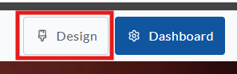
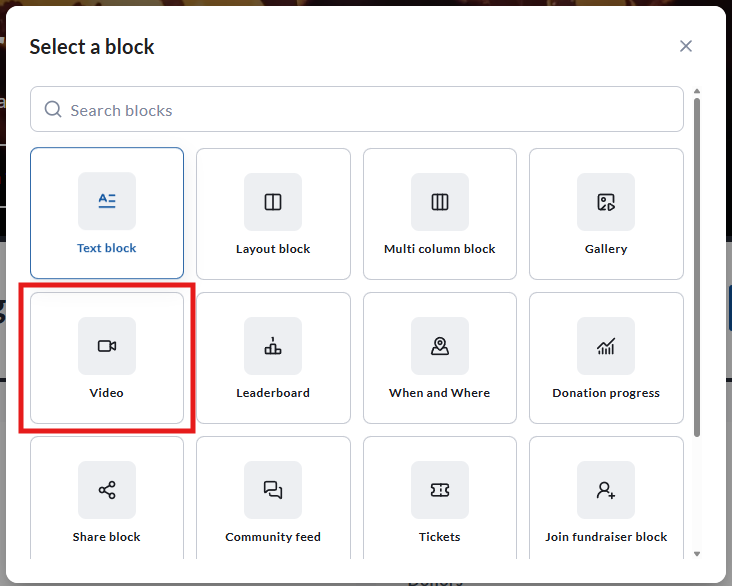
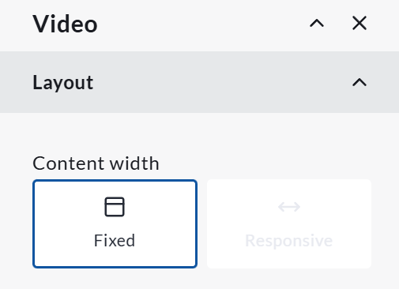
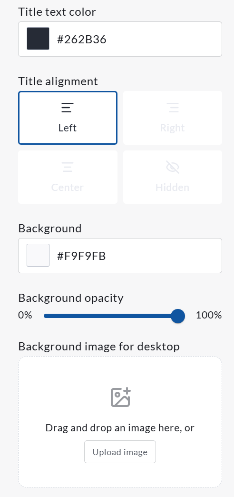
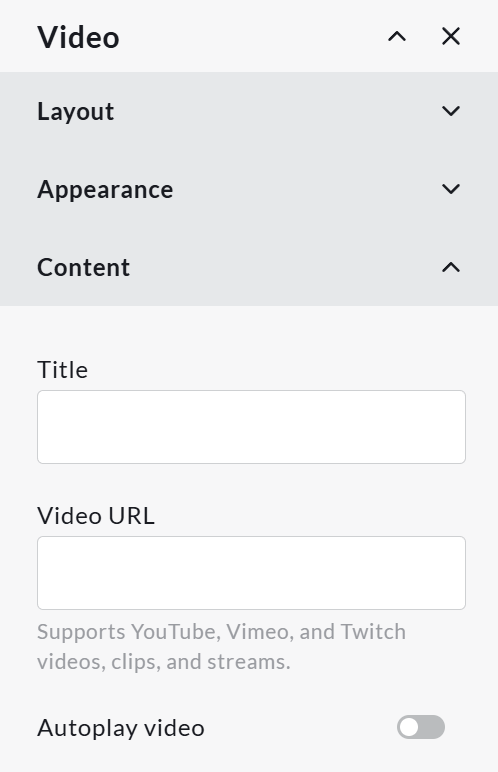

<!-- Source: https://chadmin.crowdchange.help/ct/video-block-how-to-show-a-video-on-your-crowdchange-fundraiser | Nav: Video block - how to show a video on your CrowdChange fundraiser | Mirrored 2026-10-14 -->

# Video block - how to show a video on your CrowdChange fundraiser

The **Video block** allows you to feature a video on the front-end of your CrowdChange page. To add a **Video block** to your fundraiser, follow these steps:

* Go to your CrowdChange fundraiser and log in

* On your fundraiser, click **Design**

The **Design** button

* Once in edit mode, click the plus sign between any two blocks

* In the **Select a block** menu, click **Video block**

*** ** * ** ***

Once the **Video block** is in place, click **Edit**on the right hand side to adjust this block's settings. You can adjust the following:

* **Layout** - this allows you to set either a **Fixed** or **Responsive**width for your video. Fixed refers to one size on all screen sizes/devices, whereas responsive will adjust width based on screen size. Please note this will have no affect on mobile layouts - mobile layouts are always fixed.

The **Layout** section of the **Video block** with **Fixed** selected

* **Appearance** - this allows you to set the following:

  * Title text color (set by hex code)

  * Title alignment (left, right, centered, or hidden)

  * Background opacity

  * Background image (only visible on desktop view)

View of the **Appearance** section within the **Video block**

* **Content** - this allows you to set the following:

  * Title - the title of the block

  * Video URL - videos from **Youtube** , **Vimeo** , or **Twitch**are accepted

  * Autoplay video - this determines whether or not users must click to play, or the video will play without input

View of the **Content** section within the **Video block**

Please note that videos that autoplay are muted by default unless clicked - this is not adjustable.  
**IMPORTANT - Hidden Videos**

Videos *must* be accessible on their platform of origin in order to be used on CrowdChange. This means that videos that are **private** will **not work** . *Unlisted* videos, however, will work.
