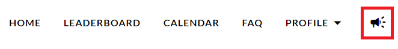
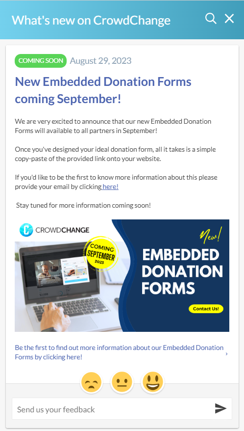

<!-- Source: https://chadmin.crowdchange.help/ct/what-s-new-section | Nav: What's New Section | Mirrored 2026-10-14 -->

# What's New Section

As an Admin user, for quick access to the latest CrowdChange Product Updates and Announcements, you can click on the **Megaphone**icon in the top right corner of your home page.  

This will bring up the '**What's New on CrowdChange**' tab, where you will see each announcement listed.

You can search for specific information, rate announcements, and even leave feedback!  

