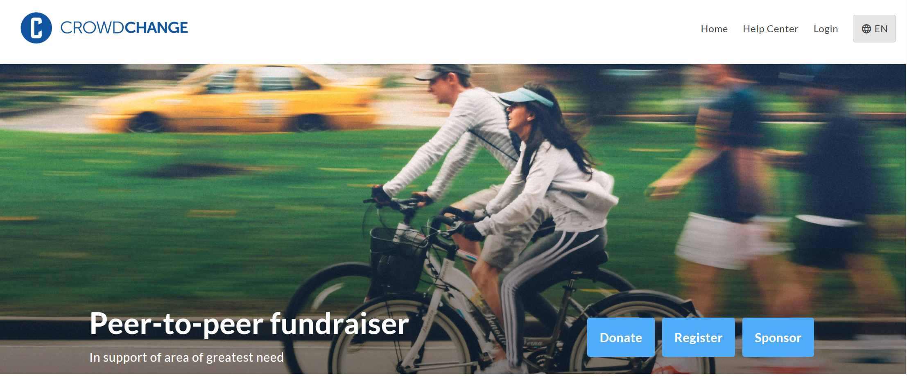
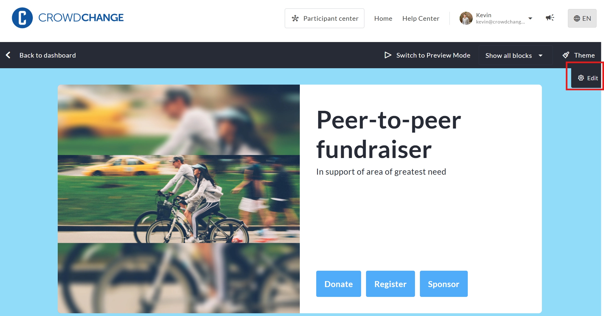

<!-- Source: https://ch.crowdchange.help/cnak/cover-image-block-how-to-update-the-banner-image-o | Nav: Cover Image Block - How to update the banner image on your fundraiser | Mirrored 2026-10-14 -->

# Cover Image Block - How to update the banner image on your fundraiser

The Cover image block (also referred to as the banner or hero image) appears at the top of your fundraiser and is one of the most visible elements of your public-facing page. It helps set the tone for your campaign and supports your branding.  

View of the **Cover image block** using the **Fullscreen** layout on a fundraiser

*** ** * ** ***

## How to edit the Cover image block

To edit the Cover image block, follow the below steps:

* Go to your CrowdChange page and **Log in**

* Once on the fundraiser you would like to edit, click **Manage fundraiser**

* Once on the Fundraiser dashboard, click **Design your fundraiser**

* Hover over the fundraiser's current cover image and click **Edit**

* On the right sidebar that appears, scroll down and expand the **Content** section

* Click the pencil icon to change the current image

* Select the new image from your computer, crop and edit if desired, and click **Save**

* At the bottom of the sidebar, click **Save** to confirm and publish your changes

The **Edit** button on the **Cover image block** within the **Design your fundraiser** function

*** ** * ** ***

## Cover image block layouts

Within the **Layout** section of the Cover image block, you can choose how your banner image is displayed at the top of your fundraiser. Each layout option offers a slightly different visual presentation to match your campaign style. Once a layout is selected, images are then added in the **Content** section. Below is a list of the potential layouts used in the **Cover image block**.

* **Full screen** (default) - Displays your cover image across the full width of the page in a bold, immersive hero format. This layout is ideal for high-impact visuals and branding-focused campaigns.

* **Gallery** - Allows you to upload multiple images that rotate in a slideshow format, creating a dynamic and engaging visual experience for visitors.

* **Centered** - Displays the image in a more contained format with content centered on the page, offering a balanced and structured look.

* **Sideway** - Positions the image beside your key content instead of above it, creating a split-layout design. This layout can be aligned left or right.

Each image format has different recommended dimensions - these are listed below. Please note that regardless of Layout settings, the **mobile** version of your cover image remains the same.  

| **Cover image format** | **Dimensions** |
|------------------------|----------------|
| Full screen            | 1920x699       |
| Gallery                | 1920x699       |
| Centered               | 1228x420       |
| Sideway                | 1056x1000      |
| Mobile                 | 750x480        |

*** ** * ** ***

### Using a video in place of your Cover Image

You can use an externally hosted **Video** on your fundraiser in place of your **Cover image** . CrowdChange can host videos, or live streams hosted on **Youtube** , **Vimeo** , or **Twitch** . Please note that these videos must be available publicly in order to show up on your page - they cannot be private. Unlisted videos are supported as long as the link is accessible to all. **Livestream links** , as well as **Youtube Shorts** are both supported via the **Cover image block**.

If you choose to feature a video on your page, it will automatically play upon accessing the fundraiser - the video will be muted, unless the user clicks on it, in which case it will popup over the screen, and play with sound.

While this replaces your cover image on the fundraiser page, the fundraiser tile on the main CrowdChange site, and meta images (for sharing on social media and other sources) are still drawn from the Cover Image, so please ensure you still have something added in this area.

*** ** * ** ***

### Customizing Buttons

You can adjust what **buttons** are displayed within the **Cover image block** , what text is shown on each button, and how each button is displayed on **mobile devices** , as well as on **Personal** and **Team fundraising pages**.

To access this element of the **Cover image block**, follow these steps:

* Go to your CrowdChange page and **Log in**

* Once on the fundraiser you would like to edit, click **Manage fundraiser**

* Once on the Fundraiser dashboard, click **Design your fundraiser**

* Hover over the fundraiser's current cover image and click **Edit**

* On the right sidebar that appears, scroll down and expand the **Buttons** section

Once you have expanded the **Buttons** section, you can edit each individual button. You are able to:

* Adjust the text on each button (for example, you could change *Tickets* to display *Buy tickets*)

* Decide which button is shown in which order by dragging and dropping the button up or down

* Decide if a button is always shown on mobile (by default the first button will be shown, and other options will be hidden behind an expandable menu - this is for space saving purposes

* Adjust whether or not the button is **Filled** or **Outlined**

* On Personal and Team Pages, you can choose whether or not a button is shown at all, and if it is shown, whether or not the settings shown on the main fundraiser page are adopted, or unique settings are applied
