<!-- Source: https://ch.crowdchange.help/cnak/donation-matching-setup-and-management-for-fundraisers | Nav: Donation Matching Setup and Management for Fundraisers | Mirrored 2026-10-14 -->

# Donation Matching Setup and Management for Fundraisers

Donation Matching allows your organization to match eligible donations using one or more sponsor-funded matching pools.

Each sponsor can have its own:

* Available matching funds

* Availability period

* Matching multiplier

* Minimum eligible donation

* Optional maximum match per donation

When you add multiple sponsors, they are placed in a queue. CrowdChange uses the first sponsor in the queue that is currently eligible to provide the match.  
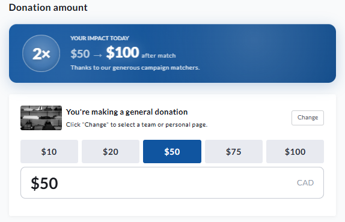
View of donation bar with a 2x match enabled

## Set up Donation Matching

During fundraiser creation, Donation Matching can be enabled under **Advanced Features**.

For an existing fundraiser:

1. Go to your fundraiser and log in.

2. Click **Dashboard**.

3. Select **Donation Settings** from the left sidebar.

4. Open **Donation Matching**.

5. Turn on Donation Matching.

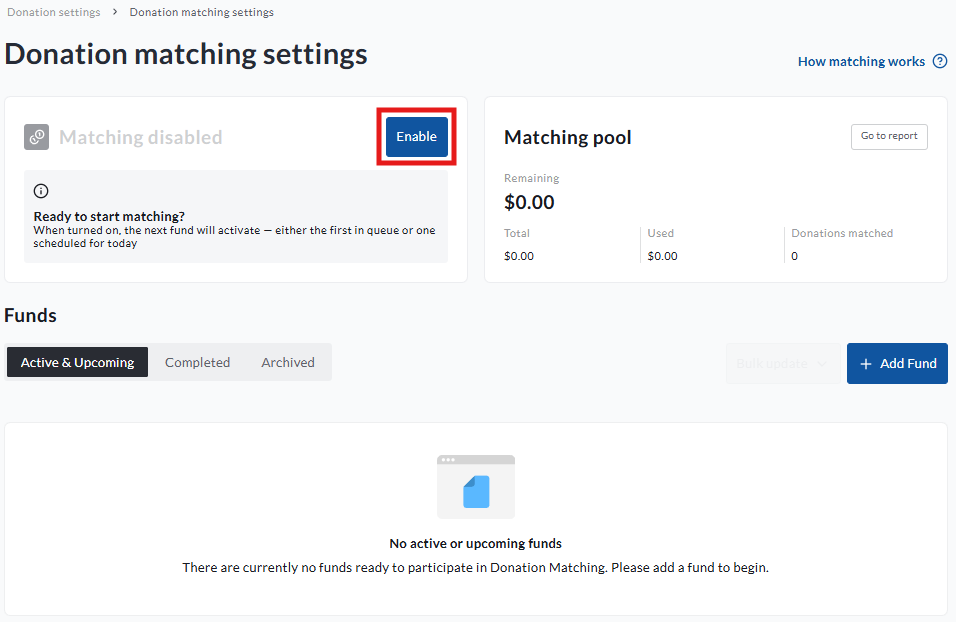
View of **Donation matching settings** with **Enable** button highlighted

Once Donation Matching is enabled, add your first sponsor.

For each sponsor, enter the following information:

* **Sponsor name:** The name that identifies the sponsor, such as Company X or The Smith Family.

* **Sponsor funds:** The total amount the sponsor has made available for matching.

* **Availability:** Choose whether the sponsor remains available until its funds are used, or set a specific start and stop date.

* **Matching rules:** Set the matching multiplier, minimum eligible donation, and an optional maximum match per donation.

For example, a minimum eligible donation can be used when only donations above a certain amount should be matched. A maximum match per donation limits the amount of sponsor funds that can be applied to one donation.  
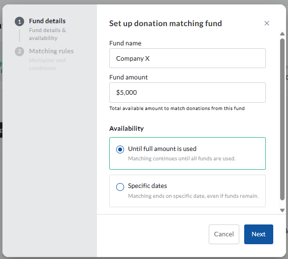
View of how to add a **Sponsor** within **Donation matching settings**  
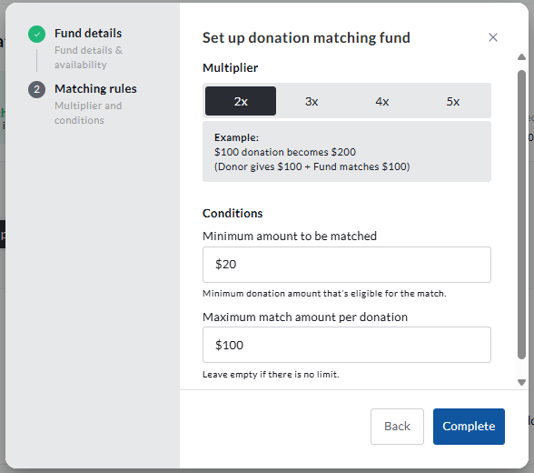
Rules set up for a **Sponsor**

Complete the sponsor setup and save your changes.

You can add additional sponsors as needed. The order of the sponsors determines which eligible sponsor will be used first.

## Understand sponsor statuses

Each sponsor will have one of the following statuses:

* **Upcoming:** The sponsor's start date has not yet arrived.

* **Active:** The sponsor is within its availability period, has funds remaining, and has not been manually completed or archived.

* **Completed:** The sponsor's funds have been used, its end date has passed, or an administrator has manually completed it.

* **Archived:** The sponsor is retained for historical reporting but cannot match new donations.

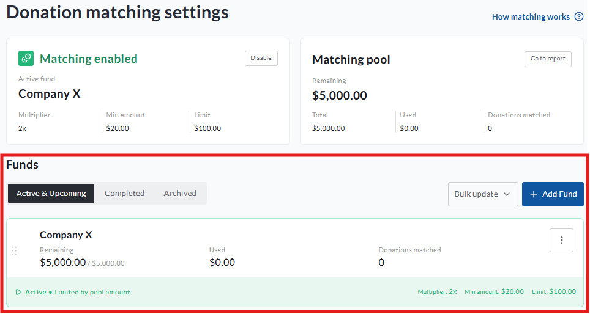

The combined matching pool provides a summary of the funds across all sponsors. Each individual sponsor card shows its own total funds, used funds, remaining funds, and donation count.

## How the sponsor queue works

When a donation is eligible for matching, CrowdChange checks the sponsors in their displayed order. The first sponsor that is currently eligible provides the match.

A single donation is not split between two sponsors.

For example, assume Sponsor 1 has $40 remaining and the next donation would normally receive a $100 match. Sponsor 1 will provide its remaining $40. Sponsor 2 will be considered for the next eligible donation, but it will not provide the remaining $60 for the same donation.

When a sponsor runs out of funds, CrowdChange automatically selects the next eligible sponsor for later donations.

Administrators can also manually complete the current sponsor to advance the queue. A manually completed sponsor remains completed until it is explicitly reactivated. It can only be reactivated while:

* Its availability dates are still valid

* It has funds remaining

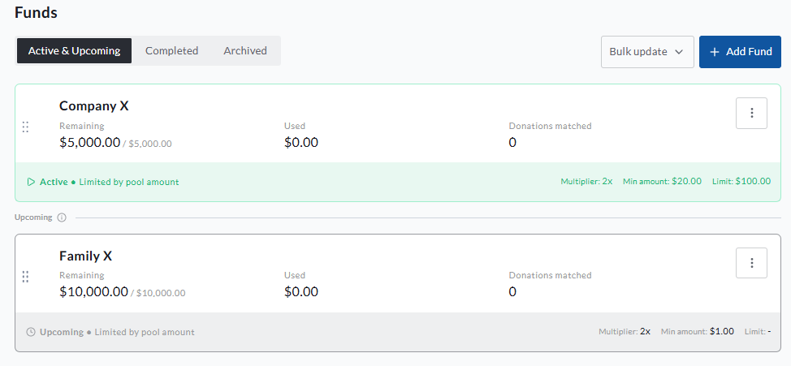
View of multiple sponsors within **Donation matching settings**  
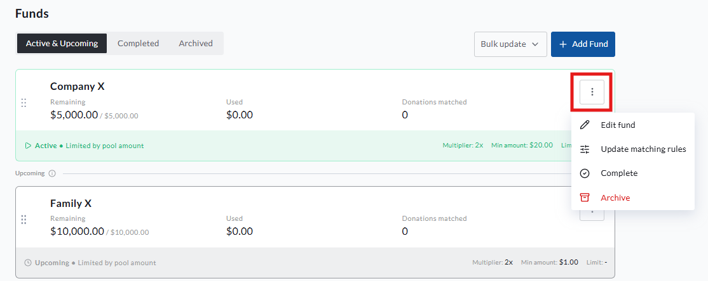

### Example: sponsors with separate availability periods

Assume the following sponsors have been configured:

* Sponsor 1 is available from August 1 to August 31.

* Sponsor 2 is available from September 1 to September 30.

If Sponsor 1 runs out of funds on August 20, matching pauses until Sponsor 2 becomes eligible on September 1. September funds are not used during August.

If Sponsor 2 has an overlapping availability period, or is available immediately, the next eligible donation will use Sponsor 2 as soon as Sponsor 1 is exhausted or manually completed.

If Sponsor 1 still has unused funds when its availability period ends, those funds remain visible in Sponsor 1's history. They are not transferred to Sponsor 2.

## Reorder sponsors

You can change the order of sponsors to control which eligible sponsor is considered first for future donations.

Reordering sponsors:

* Changes the matching priority for future donations

* Does not change the sponsor associated with previous donations

* Does not move historical matching activity between sponsors

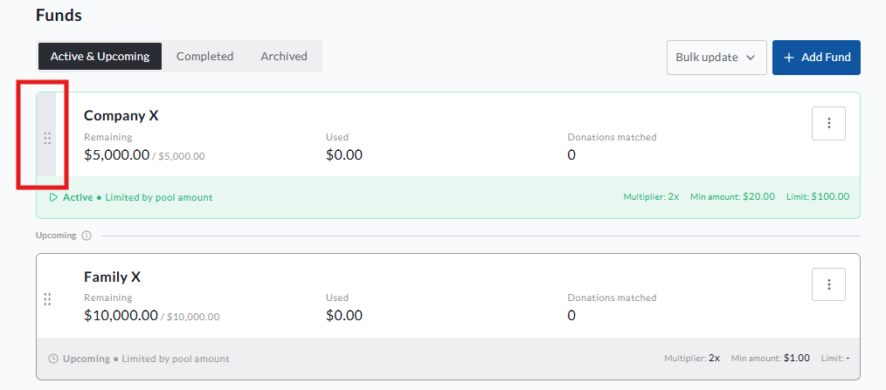
Click and drag sidebar to reorder sponsors

## Set up matching for teams and personal pages

For peer-to-peer fundraisers, go to:

**Donation Settings → Team \& Page Matching Setup**

When team and personal page matching is turned **off**, donations made through teams and personal pages use the fundraiser's main matching program.

When team and personal page matching is turned **on**:

* The fundraiser's main matching pool applies only to donations made directly to the fundraiser.

* Each team or personal page can have its own sponsors, sponsor queue, availability periods, and matching rules.

* A donation made through a team uses that team's matching program.

* A donation made through a personal page uses that page's matching program.

* If the team or personal page does not have an eligible sponsor, the donation is not matched using the fundraiser's main pool.

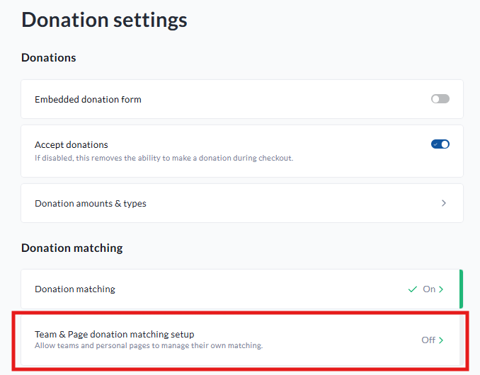
Click **Team \& Page donation matching setup** to enable **Donation matching**for peer-to-peer pages  
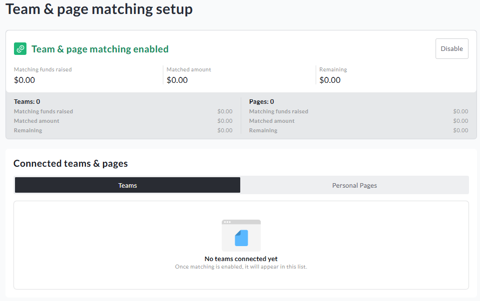
Once enabled, the **Team \& page matching setup**dashboard will be visible

Match pools are added via the **Team** or **Personal page dashboards** - once matching funds are added, they will be visible in the **Connected teams \& pages** list shown above.

Use the **Teams** and **Personal Pages** tabs to locate a specific team or page and open its matching setup.

The same sponsor queue rules apply at each level. Only one eligible sponsor is used for a donation, one donation is not split across multiple sponsors, and the next eligible sponsor is automatically selected for later donations.

### Team and personal page example

Assume the fundraiser has the following matching pools:

* A $10,000 general fundraiser sponsor

* A $2,000 sponsor for Team A

* A $500 sponsor for Jane's personal page

In this example:

* A donation made directly to the fundraiser uses the $10,000 general pool.

* A donation made through Team A uses Team A's $2,000 pool.

* A donation made through Jane's personal page uses Jane's $500 pool.

If Jane's sponsor funds are exhausted, later donations through Jane's page will not be matched unless another eligible sponsor is added to Jane's queue. Those donations do not fall back to Team A's pool or the fundraiser's general pool.

## Refunds and returned matching funds

When refunding a donation that received matching funds, you can choose whether the associated match should become available again.

To return the matching funds:

1. Open the fundraiser's **Donations Report**.

2. Locate the donation and click on it to get to the **Transaction details page**

3. Scroll down and click **Refund**

4. You then can determine the amount of funds to return to the match pool (see below).

5. Complete the refund.

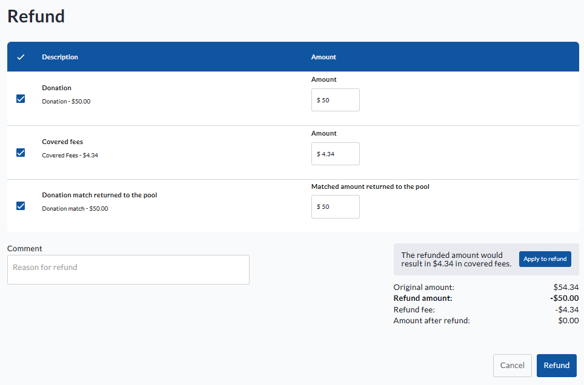

This option is separate from the money being returned to the donor. It updates the matching balance associated with the donation.

When you choose to return funds to the match pool:

* The matched amount is returned to the sponsor pool that originally funded the donation.

* A partial refund returns only the matching amount associated with the refunded portion.

* Matches from team or personal page donations return to the original team or personal page pool.

When this option is left blank or set to $0:

* The donor refund is processed.

* The matched amount remains recorded as used.

Returned funds follow the original sponsor allocation. They are not added to whichever sponsor is active at the time of the refund.

### Example: refund after the active sponsor has changed

Assume Sponsor 1 matched a donation in August and later ran out of funds. Sponsor 2 then became active in September.

If the August donation is refunded in October and **Return matched funds to available matching pool** is selected, the matched funds return to Sponsor 1. They are not added to Sponsor 2.

What happens after the funds are returned depends on Sponsor 1's status:

* If Sponsor 1 was automatically completed because its funds were exhausted, and its dates are still valid, the returned funds may make it eligible again. The normal sponsor order determines when it resumes matching.

* If Sponsor 1 was manually completed, it remains completed until an administrator reactivates it.

* If Sponsor 1's availability period has ended, it remains unavailable even though its history shows remaining funds.

* If Sponsor 1 was archived, it remains archived. The funds are still credited to the correct historical pool, but the sponsor must be restored and reactivated before those funds can be used again.

For purchases containing both a direct donation and registrations, returned matching is applied to the direct donation portion first. It is then applied to registration portions in a consistent order.

## Monitor Donation Matching activity

Use the Donation Matching report to monitor and reconcile sponsor activity. This report is accessible at the fundraiser level, within the **Fundraisers report** in the reports tab of the fundraiser dashboard.

The report can help you review:

* Total sponsor funds

* Funds already used

* Remaining funds

* Number of matched donations

* Matching funds returned through refunds

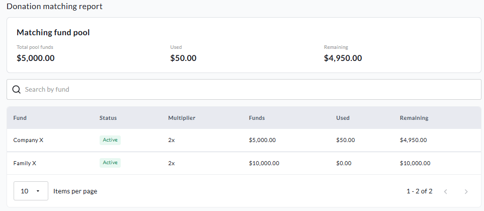

The combined matching pool summarizes overall sponsor funding and usage.

## Important notes

* Date-based availability must have a stop date that occurs after the start date.

* A donation cannot be split between two sponsor pools.

* Editing, completing, reordering, or archiving a sponsor does not change the sponsor associated with past donations.

* Unused funds are not transferred automatically between sponsors.

* When team and personal page matching is enabled, their donations do not fall back to the fundraiser's main matching pool.

* The Donation Matching report is the best place to reconcile sponsor usage and matching funds returned through refunds.
