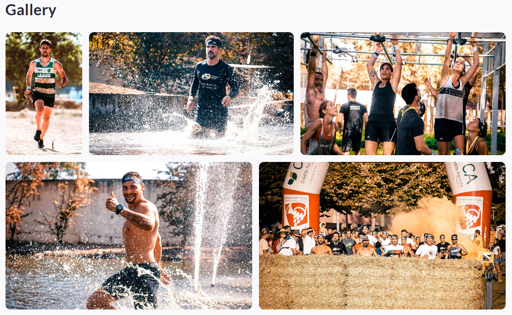

<!-- Source: https://ch.crowdchange.help/cnak/gallery-block-how-to-add-an-image-gallery-to-the-b | Nav: Gallery Block - How to add an image gallery to the body of your fundraising page | Mirrored 2026-10-14 -->

# Gallery Block - How to add an image gallery to the body of your fundraising page

The **Gallery block** allows you to add a photo gallery directly within the body of your fundraiser page. This is a great way to showcase event photos, highlight your impact, recognize sponsors, or add visual storytelling throughout your campaign.

You can upload **up to 20 images** into a single Gallery block, customize the gallery title, select a layout style, and adjust basic colour settings to match your fundraiser branding.  

The **Gallery block** using the **Modular** layout

*** ** * ** ***

## How to add a Gallery block

The **Gallery block**is not enabled by default. To add a Gallery block, please follow these steps:

* Go to your CrowdChange page and **Log in**

* Once on the fundraiser you would like to edit, click **Manage fundraiser**

* Once on the Fundraiser dashboard, click **Design your fundraiser**

* Within the user interface, between any two blocks, click the **Plus** icon

* The list of available blocks will then be shown, select the **Gallery block**

*** ** * ** ***

## Content - how to set your gallery title and upload images

Within the **Content** section of the Gallery block editor, you can:

### Gallery title

* Update the **Gallery title** (for example, "Event Photos", "Impact Highlights", or "In the Community")

* If left as-is, the default title will display as **Gallery**

### Images

In the **Images** section, you can upload the photos you want displayed in the gallery.

Supported file rules:

* Accepted formats: **JPG, PNG, GIF**

* Maximum number of images: **20**

* Maximum file size: **25MB per image**

Tip: For the best visual results, use clear, high-resolution images with consistent lighting and similar aspect ratios where possible.

*** ** * ** ***

## Layout - how to choose how your gallery displays

Within the **Layout** section, you can select how your gallery images are arranged on the page. Layout availability may vary depending on your fundraiser setup.

Common layout options include:

* **Modular** - Displays your images in a dynamic grid layout, designed to create a visually engaging gallery with a mix of image sizes.

* **Stack** - Displays images in a simpler stacked layout, ideal for a clean, straightforward photo list.

* **Carousel** - Displays images in a rotating slider format, ideal when you want visitors to browse photos without taking up as much vertical page space.

*** ** * ** ***

## Appearance - how to adjust colours

Within the **Appearance** section of the Gallery block editor, you can customize:

* **Title text color** - Controls the colour of the Gallery title text.

* **Background color** - Controls the background colour behind the gallery block.
