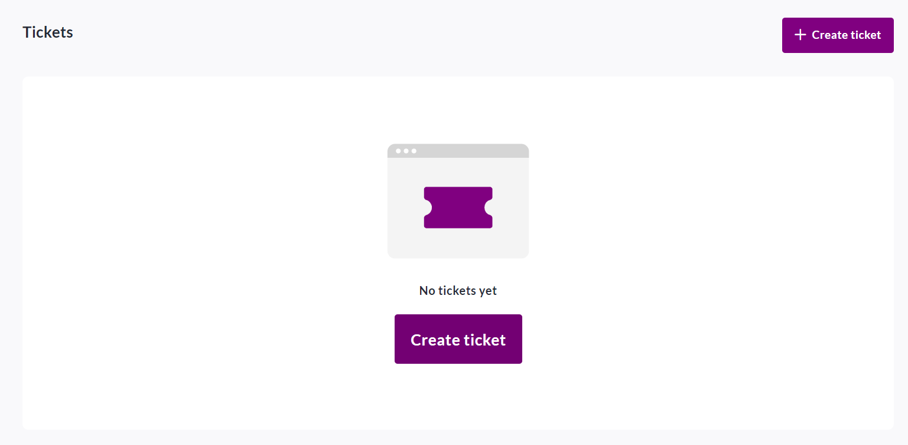
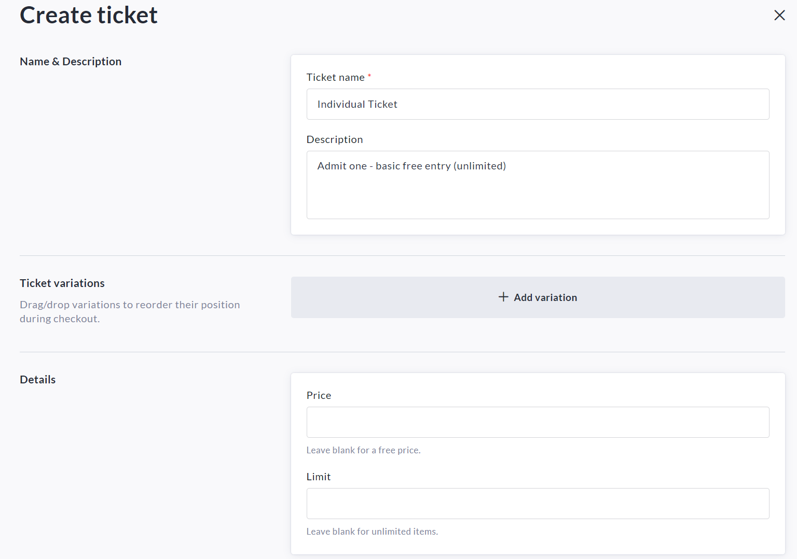
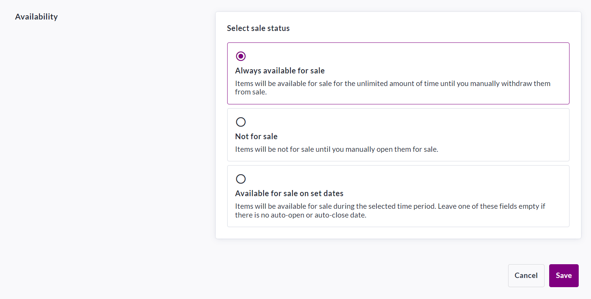

<!-- Source: https://ch.crowdchange.help/cnak/how-ticketing-works | Nav: How Ticketing Works | Mirrored 2026-10-14 -->

# How Ticketing Works

Need to sell tickets? No problem, just turn on our **Fundraiser Tickets** feature!

You can create as many ticket tiers (with variations) as desired, and participants can pay directly online.

Upon purchase confirmation, the donor will receive an email receipt with their tickets attached as a PDF.

To set up tickets within your fundraiser, follow these simple steps:

1. Go to your fundraiser, **Log In** , and then click **Manage Fundraiser**.

   
2. On the left sidebar, click **Purchase Options**.

   
3. On the **Purchase Options** page, click Tickets and toggle the feature on.

   
4. Click **Save**.

5. To set up your ticket options, scroll down and click **Create Ticket**.

   
6. Set a **name** , **description** , add **variations** if needed, set a **price** (if desired) and a **limit** (if desired).

   \**All variations will carry the same price.\**

   
7. Set your desired **availability** for the new ticket tier.

   *\*If desired, you may set a date to automatically close ticket sales.\**

   
8. Click **Save**when finished.

As the owner of a fundraiser you will have access to all tickets and ticket purchase details within your **Tickets Report** and **Donations Report**. To access these, refer to the articles below:

[How to Access the Donations Report (Fundraiser Level)](https://chadmin.crowdchange.help/ct/How-to-Access-the-Donations-Report-(Fundraiser-Level).2006974566.html)

[How to Access the Tickets Report (Fundraiser Level)](https://chadmin.crowdchange.help/ct/How-to-Access-the-Tickets-Report-(Fundraiser-Level).2006941750.html)  
Donors will receive a **confirmation email** once their purchase is complete.

Please refer to [How Email Templates Work](https://chadmin.crowdchange.help/ct/How-Email-Templates-Work.2013757497.html) when confirming the Automated Trigger Emails within your fundraiser.
