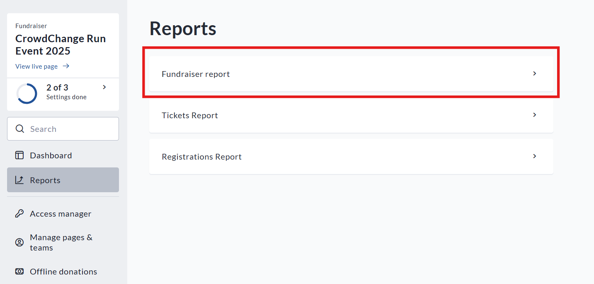
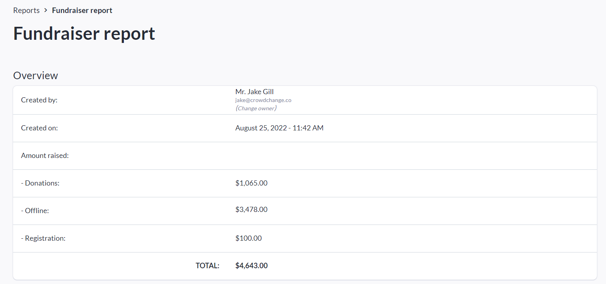
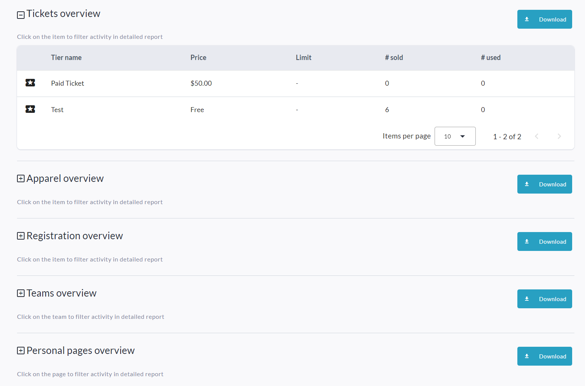
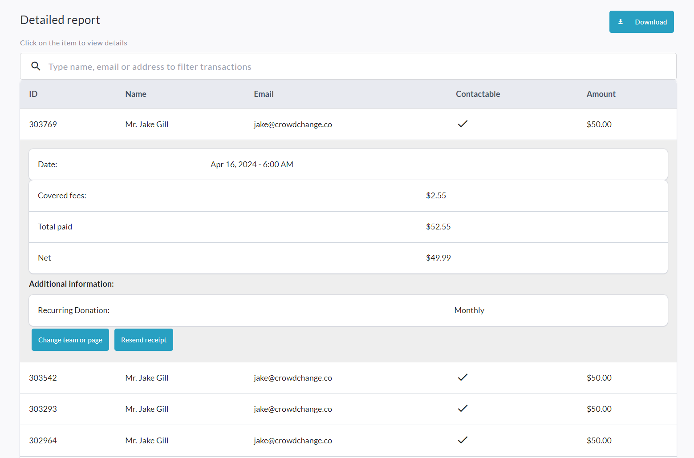

<!-- Source: https://ch.crowdchange.help/cnak/how-to-access-your-fundraiser-s-donations-report | Nav: How to Access Your Fundraiser's Donations Report | Mirrored 2026-10-14 -->

# How to Access Your Fundraiser's Donations Report

The **Donations Report** offers a quick and easy way to find information on all donations made to your fundraiser. You can also use it to [**resend receipts**](how-to-re-send-a-receipt-confirmation-email.md) and [**move donations**](how-to-move-donations-to-another-team-or-personal-.md) between personal or team pages.

To access it, follow the simple steps below:

1. Go to your CrowdChange site and**Log In**.

2. Go to your fundraising page and click **Manage Fundraiser**.

   
3. On the left sidebar, click **Reports** , then **Fundraiser Report**.

   
4. You will be shown an **Overview**with the following information:

   
5. Depending on which Purchase options you have enabled, you will also be shown 'Overview' sections with some basic details like sales of tickets, apparel, registration, etc, as well as information on teams and personal pages within your fundraiser. You can download any of these overview sections to Excel by clicking their respective **Download**button.

   
6. If you need to see specific transactions and transaction details, scroll down to the **Detailed Report** section. Here you can search for specific transactions by Name, Email, and Transaction ID, and you can see the details of each transaction, including the amount, display name used, answers to custom questions, and more. You can see which team and/or personal page the donation was made to and change this via the **Change team or page**button.

   
7. You can download the Excel version of this report via the **Download**button in the top right corner.
