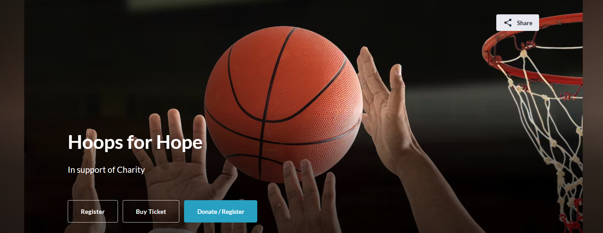
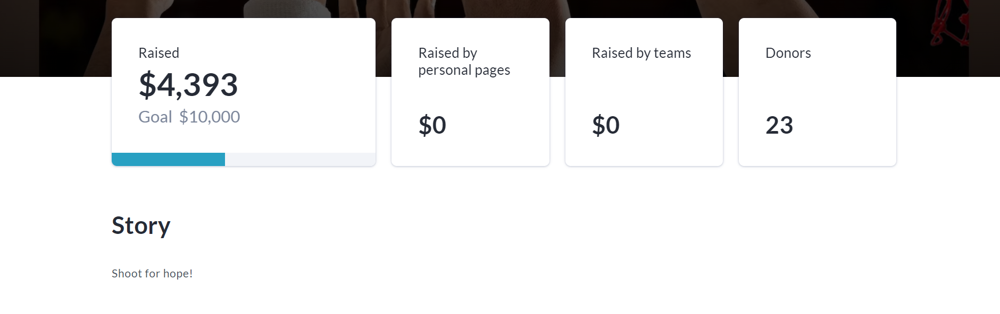
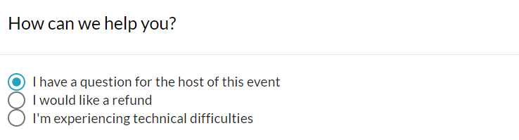
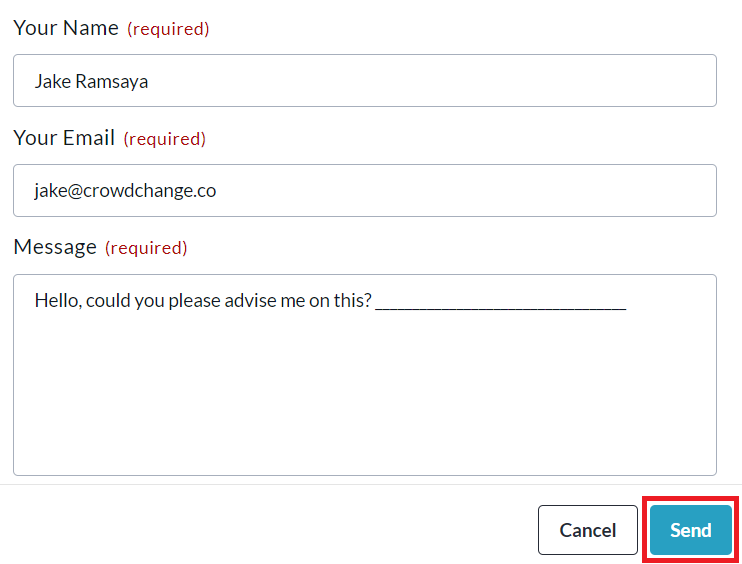

<!-- Source: https://ch.crowdchange.help/cnak/how-to-contact-the-host-of-a-fundraiser | Nav: How to Contact the Host of a Fundraiser | Mirrored 2026-10-14 -->

# How to Contact the Host of a Fundraiser

CrowdChange is an online fundraising platform, and we're happy to help with any technical requests, however we are not the best people to ask about the details of an event!

In many cases, we recommend that you reach out to the host of the fundraiser directly.

To do so, please follow these steps:

1. On the fundraising page, scroll down to **Have questions?** and click **Contact Us**.

     
     
   
2. In the popup that appears, select **I have a question for the host of this event**.

   
3. Fill in your **Name** , **Email** , your **Message** , and click **Send**.

   

**IMPORTANT:**

Ensurethat you select **I have a question for the host of this event**.

Selecting any other option will send your message to CrowdChange, not the event host.
