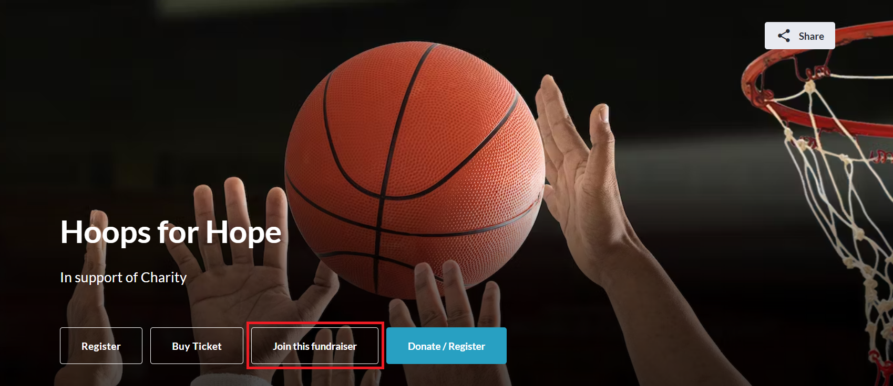
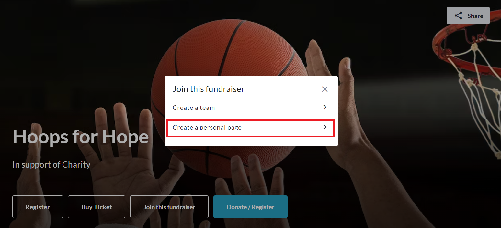
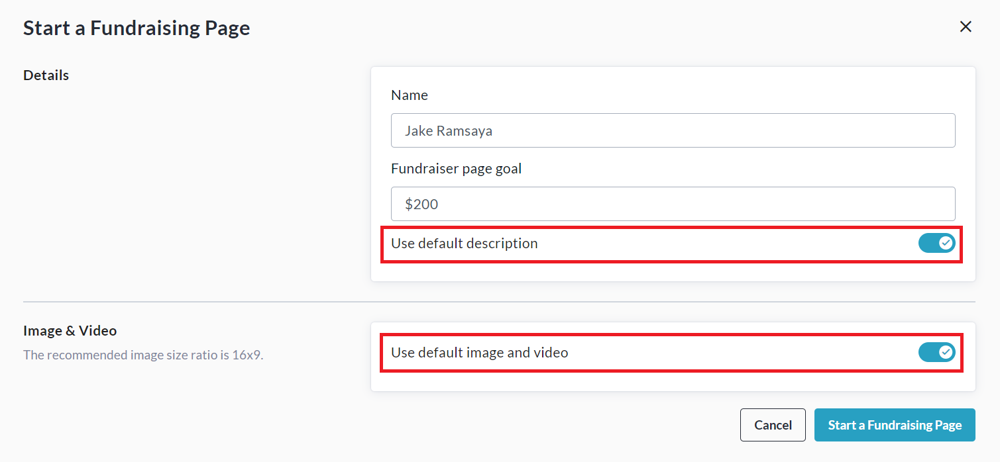
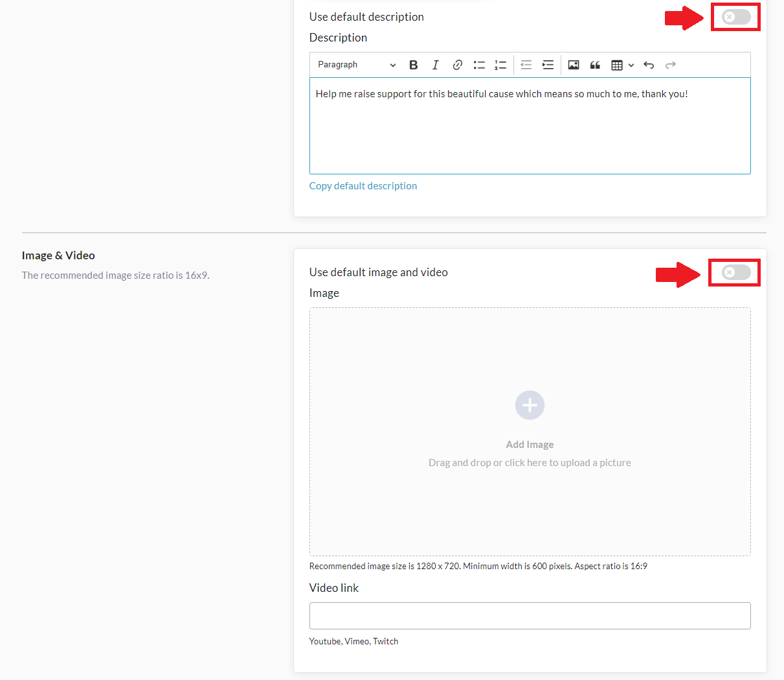
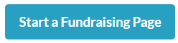

<!-- Source: https://ch.crowdchange.help/cnak/how-to-create-a-personal-fundraising-page-share-it | Nav: How to Create a Personal Fundraising Page & Share It | Mirrored 2026-10-14 -->

# How to Create a Personal Fundraising Page & Share It

Use our **Personal Fundraising Pages** feature to raise significantly more with your fundraisers and increase supporter engagement!

To use this feature, be sure to turn on **Personal fundraising pages** on the **Additional Settings** page when you are setting up or editing your fundraiser.

Once enabled, participants will be able to click **Join this fundraiser** **→ Create a personal page.**  
  

Participants will then be prompted to enter their **Name** and **Fundraising Goal** for the page. If desired, they can also add their own **image** , **video** , or **text description** , by turning **OFF**the following toggles:  

They will then be prompted to upload an image or video, and enter their own description for the page.  

When they have finished, they can click **Start a Fundraising Page** at the bottom to complete this process.  

## Sharing A Personal Fundraising Page

Nothing is more effective for increasing engagement and raising more money than sharing with friends and family, whether that's via our Social Media share buttons, our Mailing List feature, or simply word of mouth.

### Sending emails using the CrowdChange 'Mailing List' feature

**Step 1:** Once participants create their personal fundraising pages, they can share directly to social media using the **Share** button. Mass emails can also be sent using the **Mailing List** , which can be accessed via **Advanced Settings → Mailing List** . For steps on using the **Mailing List**, please continue to Step 2.

**Step 2:** Click "**Contacts** " from the Mailing List main page. Next, click "**Add Contacts** " in the upper right corner of the page and select whether you would like to import contacts from a CSV file, Gmail, Outlook, manually, and more. Once you have imported your contacts, click "**Save Contacts** ." Once completed, click "**Back to Mailing List**".

**Step 3:** Click "**New Campaign** " from the Mailing List's main page. Select your desired recipients by clicking the '**To** ' field, and choosing from the list of Imported Contacts, Donors or Previous Donors using the drop-down menu in the top left corner. The Donors list will show contacts who have made a donation to your page. Click "**Add Recipients**" to proceed.

**Step 4:** Under the "**Select email template** "section, select "**Use blank template**" to create your own email message. If any custom templates have been created, either by you or an admin, they will be available in this section as well.

**Step 5:** Select "**Click here** " under the "**From**" field to add yourself as the sender. A pop-up will ask for your name and email address. Once entered, CrowdChange will send a verification code to your email to confirm your identity.

**Step 6:** When you receive the email verification code, copy/paste the code into your CrowdChange page and click **Verify**. If you did not receive a verification email, please click resend verification code.

**Step 7:**Enter your subject line, your desired email text or edit an existing template by using the editing options within the Message editor. Note: If you are sending this from a bilingual fundraiser, you will be prompted to enter a subject line \& email message for both English and French.

**Step 8:** As you finalize your email, click "**Send Preview Email** " to send yourself a preview. To save this as a template, toggle on "**Save this message as a template for future use** ", confirm the message complies with your regional/national anti-spam laws and click "**Send**" to send it off!  
From the Mailing List's main page, you can track delivery details for all recipients of your email campaigns by clicking "**View Report**" next to the desired campaign. This report will help you to understand which contacts have received and/or opened your email campaigns.  
For more in-depth info on the Mailing List and Templates, see the following tutorials:

**How Email Templates Work**

**How to Create a Custom Email Template**

**How to Edit a Pre-existing Email Template**
