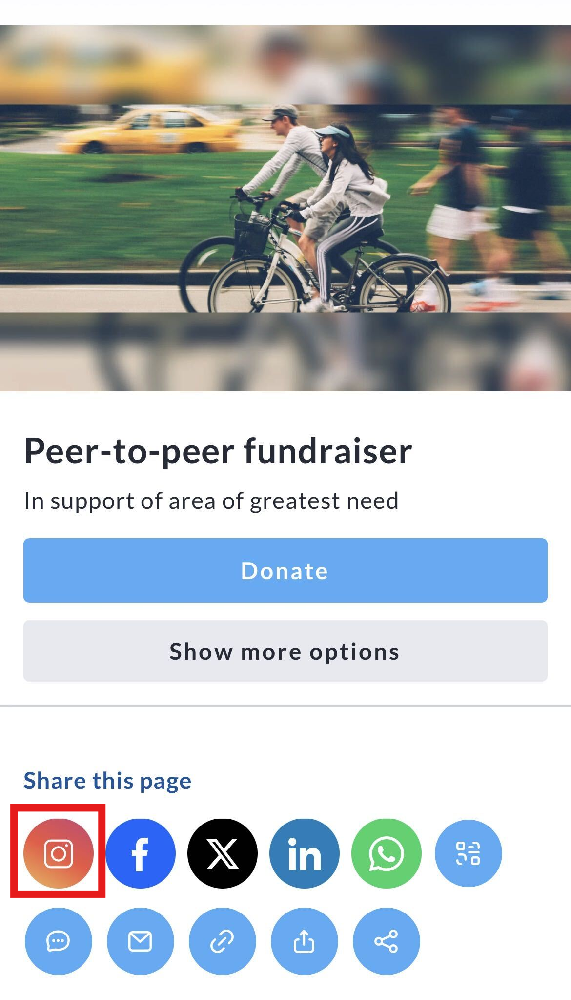
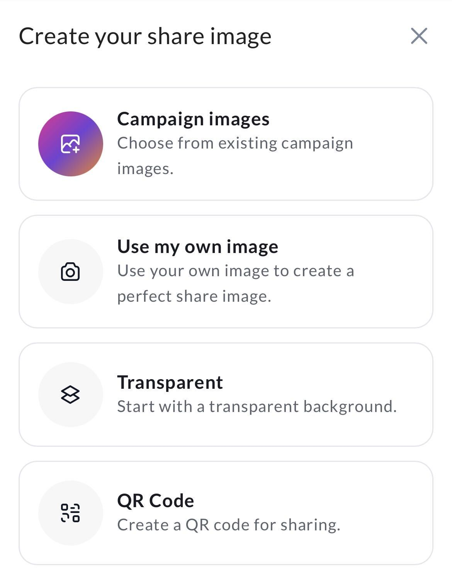
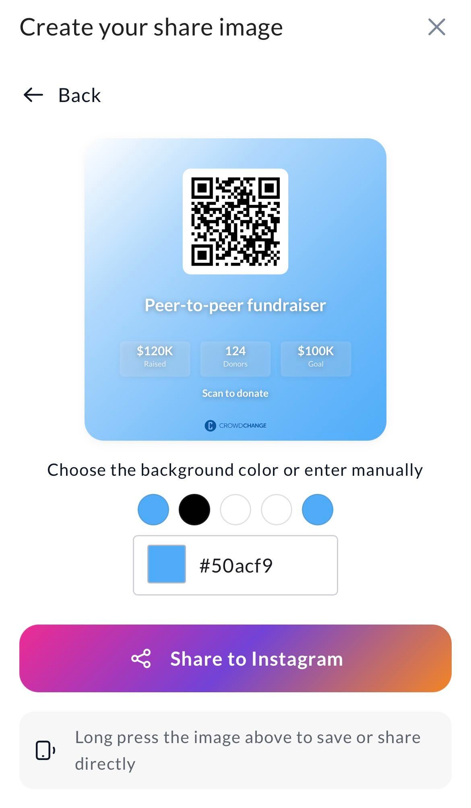
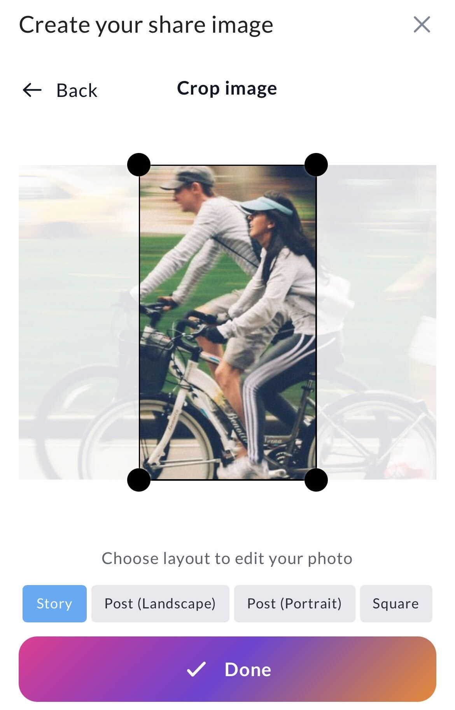
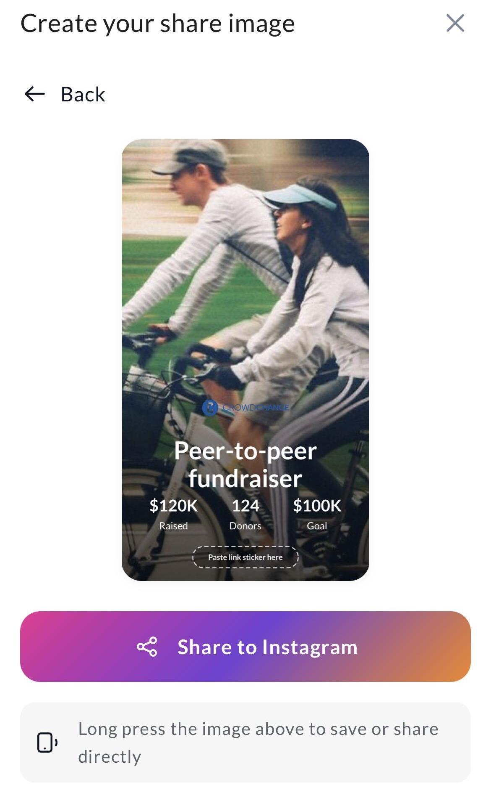
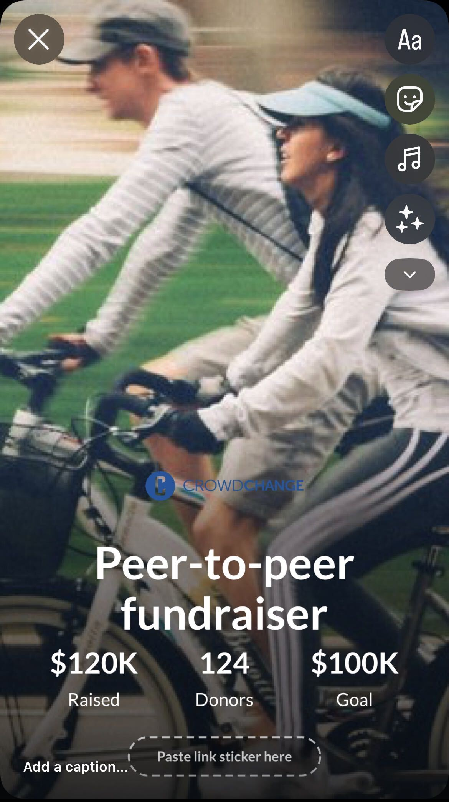

<!-- Source: https://ch.crowdchange.help/cnak/how-to-create-and-share-an-instagram-image-sharing | Nav: How to Create and Share an Instagram Image - Sharing your CrowdChange page or fundraiser via Instagram | Mirrored 2026-10-14 -->

# How to Create and Share an Instagram Image - Sharing your CrowdChange page or fundraiser via Instagram

The Instagram Share feature allows participants to create custom images for Instagram Stories, Posts, and other formats, making it easier to promote their fundraising page and encourage donations. This feature is available from the **Share** block on fundraising, personal fundraising, and team fundraising pages.

## Step 1: Open the Share Menu

1. Navigate to your fundraising page, personal fundraising page, or team fundraising page.

2. Scroll to the **Share** block.

3. Click the **Instagram** icon.

You will be taken to the **Create your share image** screen.  

*** ** * ** ***

## Step 2: Choose Your Image Type

Select how you would like to create your Instagram image. Each option will generate a share-ready image that can include key fundraising details such as the fundraiser name, amount raised, number of donors, fundraising goal, and a link sticker placeholder for Instagram Stories.  

### Campaign Images

Choose from existing campaign images already uploaded to the fundraiser. This is a great option when your organization already has branded graphics available.

### Use My Own Image

Use an image from your own device or camera roll to create a personalized share image. This can help create a more personal fundraising appeal.

### Transparent

Start with a blank slate using a transparent background.

### QR Code

Create a QR code image for sharing. This option can be used to help supporters quickly access your fundraising page by scanning the QR code.  

*** ** * ** ***

## Step 3: Crop and Format Your Image

If you select **Campaign Images** or **Use My Own Image**, you will be prompted to crop your image.

Choose the format you would like to create:

* Story

* Post (Landscape)

* Post (Portrait)

* Square

Adjust the crop area as needed, then click **Done**.  

*** ** * ** ***

## Step 4: Generate Your Share Image

Once your image has been cropped and formatted, CrowdChange will generate a share-ready image containing fundraising information such as:

* Fundraiser name

* Amount raised

* Number of donors

* Fundraising goal

* Link sticker placeholder (for Instagram Stories)

Review the generated image before sharing.  

*** ** * ** ***

## Step 5: Share Your Image

You have two options for sharing your image:

### Option 1: Share Directly

1. Click **Share to Instagram**.

2. Select **Instagram** from your device's sharing menu.

3. Follow Instagram's prompts to create your post or story.

### Option 2: Save the Image

1. Press and hold the generated image.

2. Save it to your device.

3. Upload it manually to Instagram at any time.

*** ** * ** ***

## Important: Adding a Link Sticker to Instagram Stories

When sharing to **Instagram Stories**, CrowdChange cannot automatically add a clickable link sticker due to Instagram's platform restrictions.

If you want supporters to be able to visit your fundraising page directly from your Story, you must manually add Instagram's **Link Sticker** before publishing.

To do this:

1. Create your share image and select **Share to Instagram**.

2. Choose **Instagram Stories** when prompted.

3. Once the Story opens in Instagram, tap the **Sticker** icon.

4. Select **Link**.

5. Paste your fundraising page URL into the Link Sticker.

6. Position the sticker over the **"Paste link sticker here"** placeholder shown on the generated image.

7. Publish your Story.

**Please Note:** The "Paste link sticker here" area on the generated image is only a visual placeholder. The link sticker is not added automatically and must be inserted manually within Instagram before posting. If a link sticker is not added, viewers will not have a direct way to access your fundraising page from the Story.
