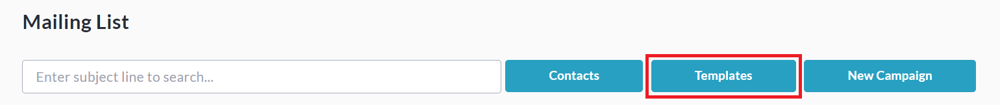
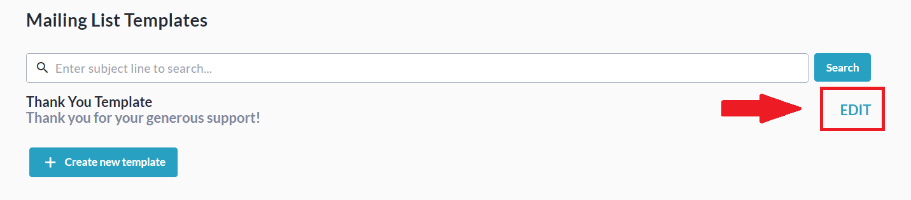

<!-- Source: https://ch.crowdchange.help/cnak/how-to-edit-a-pre-existing-email-template | Nav: How to Use the Mailing List > How to Edit a Pre-existing Email Template | Mirrored 2026-10-14 -->

# How to Edit a Pre-existing Email Template

To **edit** an email template you've already created, it's super easy!

This article covers how to edit your existing email templates within our **Mailing List** feature.  
See also: **How to Use the Mailing List**

To edit an existing email template, follow the steps below:

1. From your fundraising page, click **Manage Fundraiser**.

   
2. On the left sidebar, click**Mailing List**.

   
3. Click **Templates**.

   
4. Click **Edit**to the right of the template you would like to adjust.

   
5. Edit **Template Name** , **Subject** , **Message Body** , and **Dynamic Tags** as desired.

6. *Optional: Click* ***Send Preview Email*** *to get a preview.*

7. Click **Save**to save the changes to this template.
