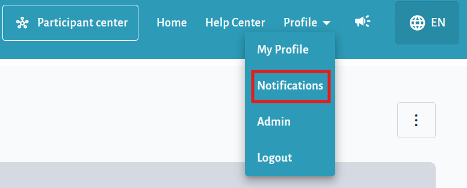
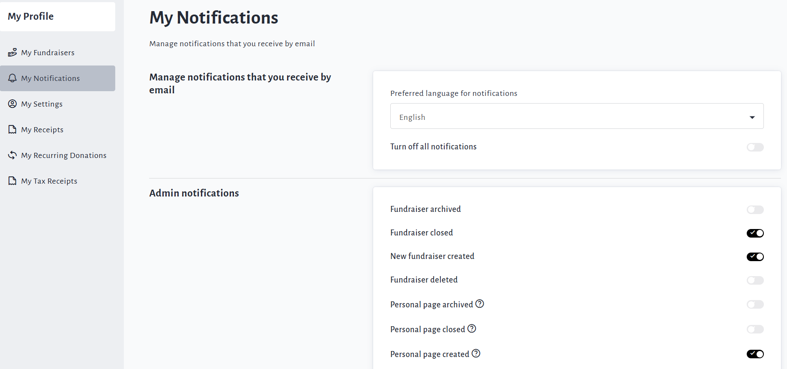
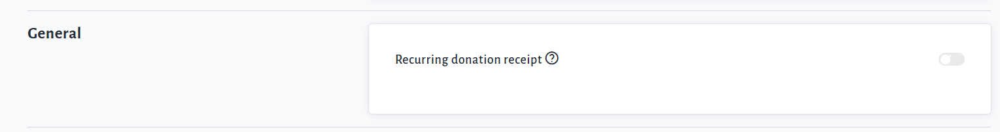
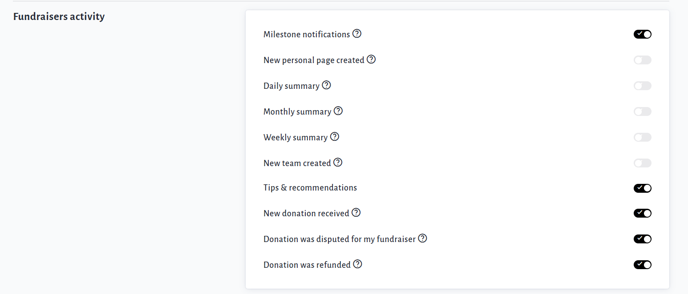
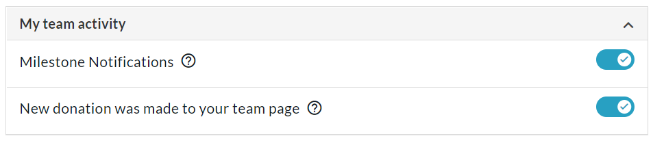
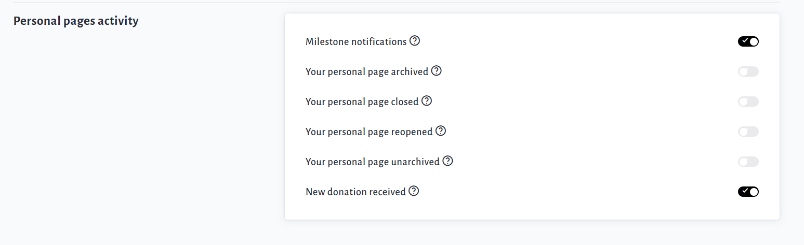
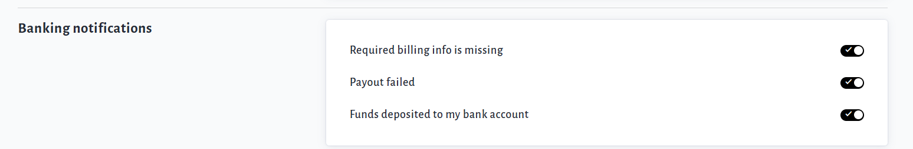
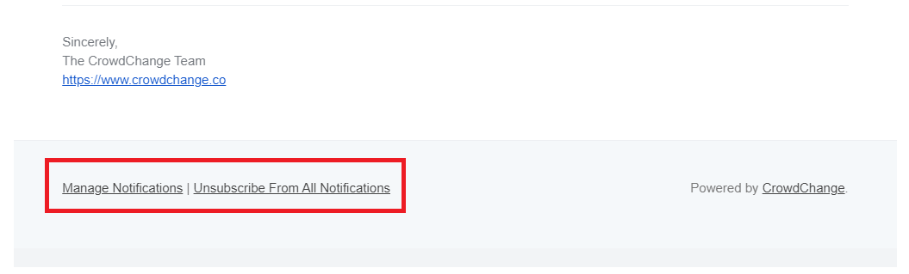

<!-- Source: https://ch.crowdchange.help/cnak/how-to-edit-email-notifications | Nav: How to Edit Email Notifications | Mirrored 2026-10-14 -->

# How to Edit Email Notifications

You have the ability to decide which email notifications you receive via your **My Notifications**page.

From there you can also set your preferred language for notifications, and unsubscribe from all if desired.

To access this page, follow these simple steps:

1. Go to your CrowdChange site and **Log In**.

2. Click **Profile** in in the top right corner, then**Notifications**.

   

3. Turn off any undesired notifications by clicking the relevant toggle sliders. (Further explanation below)

   

## Categories of Notifications

Notifications are sectioned off into the following categories (which of these you see will depend on your level of access and what type of pages you manage):

* **General**- Toggle on or off the 'Recurring donation receipt' - we recommend leaving this off, as you will receive a consolidated receipt at year-end for all your recurring donations.

* **My fundraisers activity**- Set which notifications you receive for the fundraisers you manage, such as 'New Donation Received', 'Donation Refunded', 'Milestone Notifications' and more.

  

* **My team activity**- Select which notifications you receive for your team page(s).

  
* **My personal page activity** - Select which notifications you receive for your personal page(s).

  

* **My banking notifications**- Select which (if any) banking-related notifications you receive.

  

* **Admin Notifications**- As an Admin user on your CrowdChange site, here is where you will go to set or adjust your site-wide notifications settings. Note that if you have many fundraisers on your site, these notifications may result in many emails, so you may want to disable some from here, for example, 'New Donation Received'.

  

For further information on CrowdChange Notifications and what exactly triggers them, check out [**this article**](https://chadmin.crowdchange.help/ct/CrowdChange-Notifications.2149777409.html).

To unsubscribe from all notifications, click the toggle slider next to '**Turn off all notifications**' at the top.  
You can also get to**My Notifications** via the links at the bottom of our emails, as shown below:  

