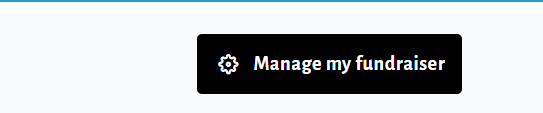
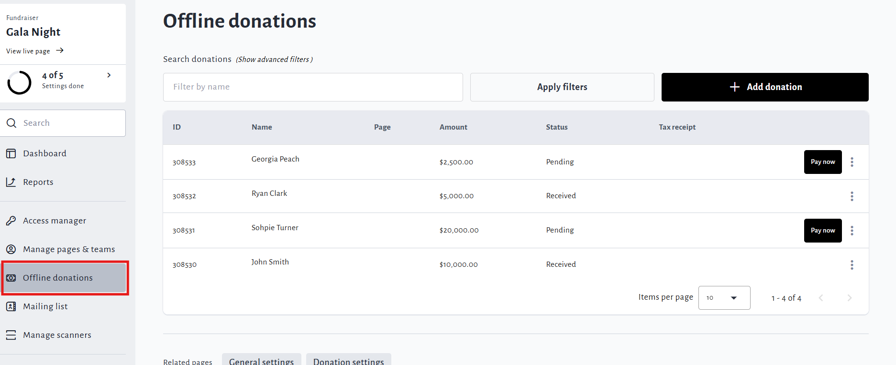
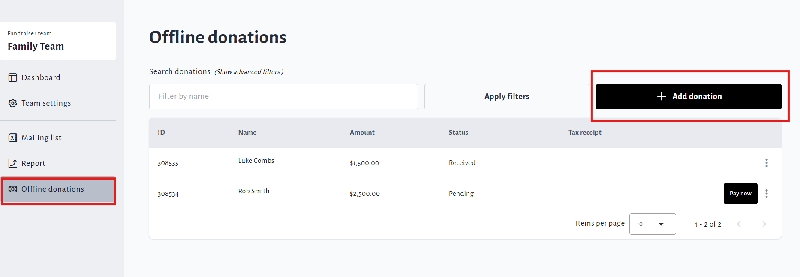
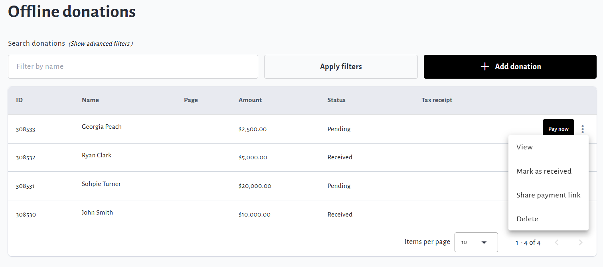

<!-- Source: https://ch.crowdchange.help/cnak/how-to-enter-offline-donations | Nav: How to Enter Offline Donations | Mirrored 2026-10-14 -->

# How to Enter Offline Donations

You can use our **Offline Donations** feature to:

* Add donations you've received outside of CrowdChange to your Total Amount Raised and Donor List

* Pay a donation on behalf of a donor, with them receiving a Tax Receipt in their name

* Facilitate [**Pledging**](https://chadmin.crowdchange.help/ct/How-Pledging-Works.2086600705.html?t=lsmx9P7KHk1WU6-3G11a4w)and send donors a direct Payment link via Email or SMS

To add in an Offline Donation, follow these steps:

1. Go to the fundraising page (or Personal / Team Page) you would like to add the donation to.

2. Click **Manage Fundraiser** (on fundraisers) then go to **Offline donations** on the left sidebar.

     
   

3. On Personal / Team pages, click**Manage my page (or team)→ Offline donations**.

   

4. Click **Add Donation** and fill out the required fields. **Please note**the following:

   1. *If desired, you can email a payment link by entering an email and clicking the '* ***Send link for individual or group to make online payment*** *'* *checkbox. If you would like to send a payment link via SMS instead of email, leave this checkbox* ***unchecked*** *- once the donation has been added, you will be able to click* ***Share Payment Link*** *and send to your desired phone number.*

   2. *If you select '* ***This is a Lump Sum Donation*** *', you will* ***not*** *be required to enter any Billing Information, and* ***no*** *Tax Receipt will be issued.*

      
   3. *If you require a tax receipt for this donation, click '* ***Request tax receipt for this donation*** *' and enter the billing address of the donor for tax receipt.*

   4. *To assign this donation to a team, indicate the payment method and date of donation, set a donation display name, write a public comment, show/hide the donation amount, and/or add any internal notes about this donation, click '* ***Show advanced settings*** *' under '* ***Additional Information*** *'.*

   5. *If you select* ***Mark as Received*** *under '* ***Transaction Status*** *', the donation will be confirmed and shown in CrowdChange Donations Reports. This will be done automatically if online payment is received.*

      

5. Once you have added the information as desired, click **Save**at the bottom of the page.

   

6. You can return to the Offline Donations menu at any time to **view** , **update** or **delete** donations entered.

   

Offline Donations will only be shown in our Donations Reports once they have been **paid/received**.

However, Offline Donations **will be** included in Total Raised bar amounts while in **Pending**.

Only admins and the host of a fundraiser have the option to **Mark As Received**.

If desired, you can send donors a **Payment Link** for them to pay a pending donation themselves. Just click the triple dot icon next to the donation you'd like them to pay and select **Share Payment Link.**

## To make a donation on behalf of someone else

1. Go to**Manage Fundraiser → Offline Donations** (Personal / Team pages:**Manage my page (or team) → Offline donations**).

2. Click **Add Donation** and enter the donor's details. Enter **Tax Receipt Information** if necessary.

3. Under**Additional Information → Show Advanced Settings** , select **Credit Card** as Payment Method.

4. Once you have added all relevant information, click **Save**at the bottom of the page.

5. Click **Pay Now** next to the pending donation to pay for the donation using your own Credit Card \& Billing info. The tax receipt will still be issued in the donor's name and address (entered in Step 2).

## To issue a tax receipt after an offline donation has been entered

1. Go to**Manage Fundraiser → Offline Donations** (Personal / Team pages:**Manage my page (or team)→ Offline donations**).

2. Find the donation you would like to issue a Tax Receipt for and click the **triple dot icon** next to it.

3. Click **Issue Tax Receipt**.

4. Fill out all necessary information and click **Issue**.

This will only be an option for donations that have been **Paid** or **Marked as Received**.

If you want to re-issue a tax receipt for an offline donation, follow the same steps, but you will select **Re-Issue Tax Receipt** instead.
