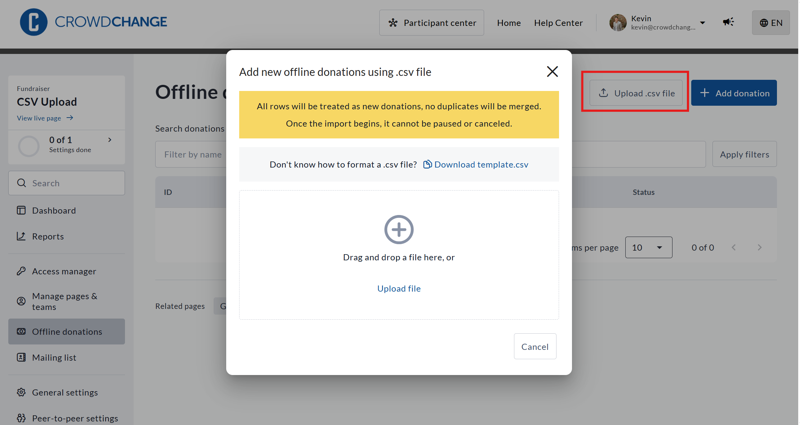

<!-- Source: https://ch.crowdchange.help/cnak/how-to-mass-upload-offline-donations-using-a-csv-f | Nav: How to Mass Upload Offline Donations Using a CSV File | Mirrored 2026-10-14 -->

# How to Mass Upload Offline Donations Using a CSV File

You can now upload multiple offline donations at once using our CSV upload tool. This feature is helpful when you have collected several cash or cheque donations offline and want to add them quickly to your fundraiser in CrowdChange.

*** ** * ** ***

## How to Access the CSV Upload Tool

1. Go to your fundraiser on your CrowdChange site and **Log In**.

2. Click **Manage fundraiser** in the top-right corner.

3. In the fundraiser dashboard menu, select **Offline donations**.

4. Click the **Upload .csv file** button.

A modal will appear where you can download the CSV template and upload your completed file.  

A view of the .csv upload tool feature, with the **Upload .csv file** button highlighted

*** ** * ** ***

## Step 1: Download the CSV Template

Before uploading, download the required template and fill it in. You can download the template by clicking **Download template.csv** in the above-pictured modal.

Do not rename or change any column headers, as this may prevent your file from being processed.  
**Important:**All rows in the CSV will be treated as new donations. Duplicate entries will not be merged. Once the upload begins, it cannot be paused or cancelled.

*** ** * ** ***

## Step 2: Upload Your File

1. Open the **Upload .csv file** modal.

2. Drag and drop your completed CSV into the upload area, or click **Upload file** to select it.

3. Review the summary on screen.

4. Click **Import** to complete the upload.

*** ** * ** ***

## What Happens After Upload

### Donation Status

All uploaded offline donations will be created with the status **Pending** by default.

Pending offline donations:

* Do appear in the Admin-level donations report, but their status will be indicated as **Pending**.

* Do appear as pending contributions on the fundraiser dashboard for admins and hosts.

To confirm an offline donation:

* Open the donation entry from **Offline donations**.

* Change the status to **Received**.

### Tax Receipts

Tax receipts are **not** automatically issued for offline donations uploaded via CSV.

If your organization issues tax receipts:

* Receipts must be issued **manually** , after upload, **one donation at a time**.

* Tax receipts can only be issued on offline donations that are marked as **Received**.

* This can be done from the donation's details page or through the Tax Receipts Report, depending on your site's configuration.
