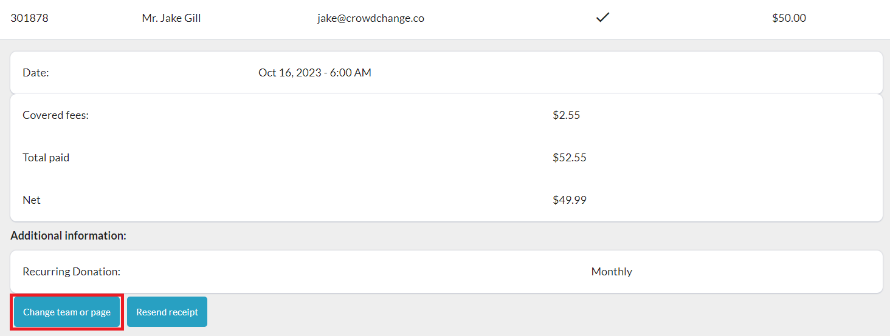
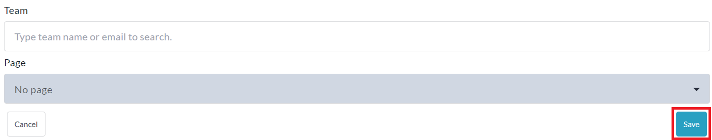

<!-- Source: https://ch.crowdchange.help/cnak/how-to-move-donations-to-another-team-or-personal- | Nav: How to Access Your Fundraiser's Donations Report > How to Move Donations to another Team or Personal Page | Mirrored 2026-10-14 -->

# How to Move Donations to another Team or Personal Page

As a fundraiser host or Admin user, moving donations from one Team or Personal Page to another, within a single fundraiser, is easily done via the fundraiser-level**Donations Report**.

To do this yourself, simply follow the steps below:

1. Go to your CrowdChange site and **Log In**.

2. Go to your fundraiser (main fundraising page) and click **Manage Fundraiser**.

3. On the left sidebar, click**Reports** , then **Donations Report**.

4. Click on the transaction you would like to move to a different Team or Personal Page.

5. Click the **Change Team or page** button as highlighted below.

   
6. Enter the Team and/or Personal Page you'd like to move this donation to and click **Save**.

   
